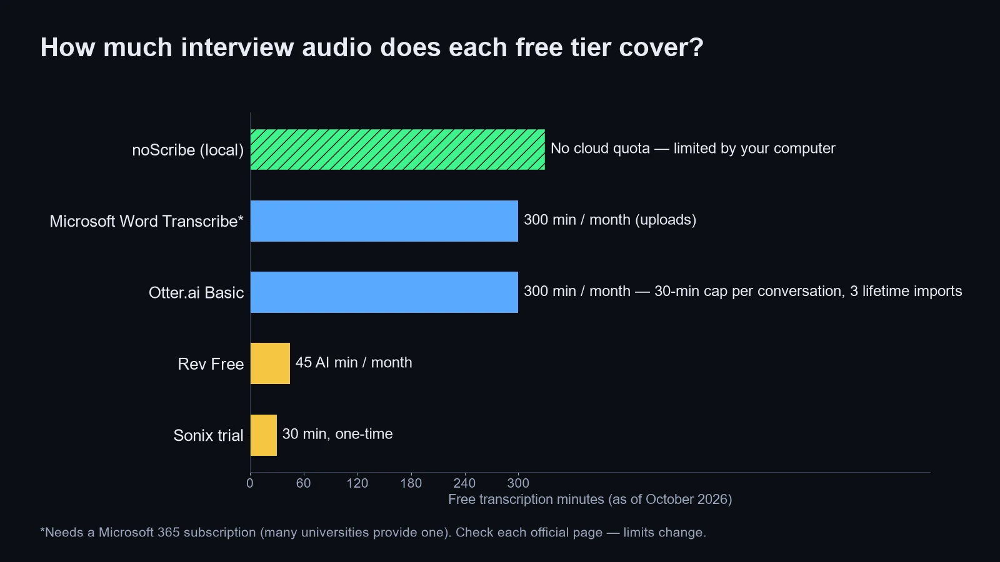
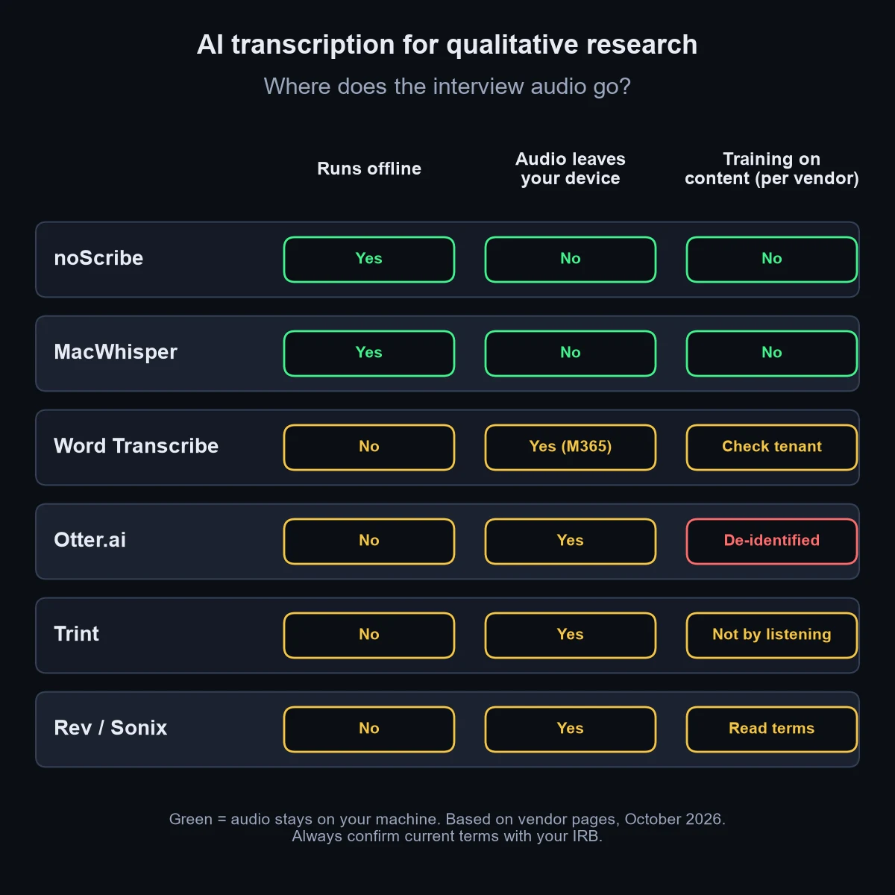
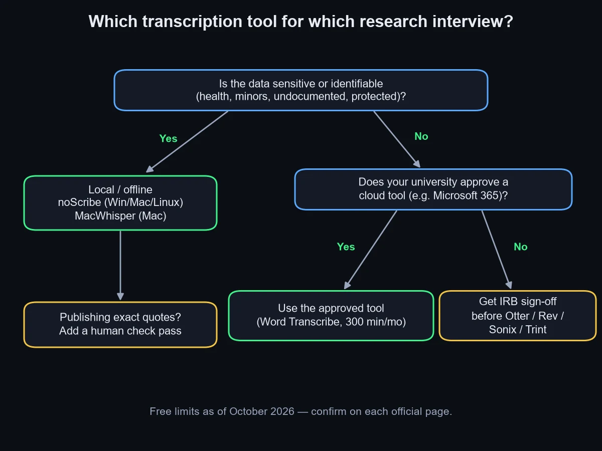

📌 Quick take
For sensitive interviews, the safest AI transcription for qualitative research is a <b>local</b> tool: <b>noScribe</b> (free, Windows/Mac/Linux) or <b>MacWhisper</b> on a Mac with its optional cloud features left off. The audio stays on your computer.

If your university's Microsoft 365 license and admin settings include it, <b>Word Transcribe</b> covers 300 minutes of uploads a month with speaker labels.

Use Otter, Rev, Sonix or Trint only after your IRB has seen their data terms, and always check quotes against the audio.

The best AI transcription for qualitative research is the one your ethics board will approve, and for most graduate students as of October 2026 that means a local tool first. The short answer: transcribe identifiable or sensitive interviews with **noScribe** or **MacWhisper**, which run on your own machine, and use **Word Transcribe** through your university's Microsoft 365 account for everything else. The well-known cloud tools are fine for low-risk work, but they come with paperwork and free tiers that are smaller than they look.

This is not a lab accuracy test on my own recordings. I compared these tools on their official pricing, privacy and help pages, opened the top-ranking roundups, and read published university guidance. Most of those roundups come from a vendor that ranks itself first.

## Why local first? The comparison table behind the recommendation

Local tools win for research interviews because the confidentiality question disappears. The [noScribe project on GitHub](https://github.com/kaixxx/noScribe) describes itself plainly: "It runs completely locally on your computer, protecting the confidentiality of your interviews." It is free and open source (GPL-3.0), built on OpenAI's Whisper plus pyannote for speaker detection, and written by a sociologist who runs qualitative interviews himself.

Cloud tools are quicker to start, but every upload sends participant voices to a third party. Limits are as of October 2026 and change often, so confirm on each official page before you rely on them.

| Tool | Free allowance | Speaker labels | Privacy / offline | Getting text out |
| --- | --- | --- | --- | --- |
| noScribe | Free, no quota | Yes (pyannote) | Runs fully offline | Built-in editor, then export to your QDA app |
| MacWhisper | Free basic version | Pro feature | On-device by default, Mac only; optional cloud transcription and AI features | Text exports; check the current version |
| Word Transcribe | 300 min/month of uploads with Microsoft 365 | Yes ("Speaker 1", "Speaker 2") | Cloud, inside your M365 tenant; depends on your license and admin settings | Lands in a Word document |
| Otter.ai Basic | 300 min/month, 30-min cap per conversation (only the first 30 min viewable), 3 lifetime file imports | Yes | Cloud; trains on de-identified data per its policy | Exports vary by plan |
| Rev | 45 AI min/month; human $1.99/min | Yes | Cloud | Text and caption exports; check your plan |
| Sonix | 30 free minutes, one time; then $10/hour | Yes | Cloud, SOC 2 Type II listed | Word and text with timestamps |

Accuracy is left out of the table on purpose, because vendors quote "99%" without a published method. [Bentley University's User Experience Center](https://www.bentley.edu/centers/user-experience-center/transcription-tools-qualitative-data-uxr) kept taking its own notes and used Otter transcripts only to fill gaps in them, jumping to moments the note-takers had missed via timestamps. The team used them to verify data, not as a client deliverable, and judged them not accurate enough to share with a client unreviewed.

## How many interviews does each free tier actually cover?

Free tiers fall apart on hour-long interviews. The math below uses each vendor's own limits, assuming one-hour recordings uploaded after the session.

Otter's Basic plan looks generous at 300 minutes a month, but its [pricing page](https://otter.ai/pricing) lists a 30-minute cap per conversation and only 3 lifetime file imports. For uploaded interviews, that means three files ever, with only the first 30 minutes of each usable on Basic. As of October 2026, Otter Pro is listed at $16.99 a month (or $8.33 a month billed yearly) with a 90-minute cap and 10 imports a month, and Otter offers a 20% discount on Pro for .edu students and teachers; check the page before you pay. [Rev's free plan](https://www.rev.com/pricing) gives 45 AI minutes a month, which is less than one full interview. Sonix gives 30 minutes once, enough to test quality on a single clip, then bills $10 per audio hour on pay-as-you-go.

Word Transcribe is the quiet winner here: [Microsoft's Transcribe support page](https://support.microsoft.com/en-us/office/transcribe-your-recordings-7fc2efec-245e-45f0-b053-2a97531ecf57) lists 300 minutes of uploaded audio per month for Microsoft 365 subscribers, which is roughly five one-hour interviews every month at no extra cost. Availability depends on your university's license and admin settings: the desktop version needs optional connected experiences, which IT admins can switch off, so check that the button appears in your account. noScribe has no quota at all; the only limit is how long your laptop takes to process the file.

## Which tools train on your interview audio?

This is where most roundups get it wrong: they list "SOC 2" and "encryption" and skip the question an ethics board asks first, which is whether the vendor can use your participants' words to improve its product.

[Otter's privacy policy](https://otter.ai/privacy-policy) says it trains its proprietary AI on de-identified audio recordings and on transcriptions, and notes that those transcriptions may contain personal information. Enterprise workspaces can have different defaults, so a university-managed account may differ from a personal one. [Trint's security page](https://trint.com/security) says it never listens to recordings to train its algorithms and lists ISO 27001 certification, though it is less explicit about transcripts. Sonix lists SOC 2 Type II and HIPAA support on its pricing page but did not state a training policy there, so read the full terms.

Local tools sidestep the question, as long as you stay on local models. noScribe uploads nothing. MacWhisper transcribes on-device by default, and its Pro speaker recognition runs locally on WhisperKit models, which are built for Apple Silicon Macs. The same app also offers optional cloud transcription (ElevenLabs, Deepgram) and ChatGPT features that send text or audio out through API keys, so keep those off for sensitive audio.

## What does your IRB actually expect from a transcription tool?

Your IRB mostly wants to know where the audio goes, who can access it, and when it is destroyed.

Published university guidance is consistent on this. The [UMBC research office guidance on transcription services](https://research.umbc.edu/using-transcriptionists-for-recorded-interviews/) warns that "Many, if not most, retain access to recorded information," tells researchers to read the fine print before signing up, and requires a signed confidentiality agreement from any outside human transcriptionist, kept in the protocol file. The [University of Florida's ECE department](https://www.ece.ufl.edu/resources/it/otter-ai-approved-use) allows Otter only on paid Business or Pro plans with a university email, states the free plan is not approved, and excludes sensitive research data entirely.

Most IRBs will expect a cloud tool to be named in the protocol, often in the consent form too, with its retention and training terms described and approval granted before the first upload. Check your institution's policy for the exact requirements. With a local tool, that section is short because no third party touches the data.

## What should you check before uploading interview audio?

Run through this list before any recording leaves your laptop.

1. **Check the consent form.** Does it mention AI or third-party transcription? If not, ask your IRB before uploading.
2. **Ask whether your IRB needs to approve the specific tool.** Many expect the tool by name, not just "automated transcription."
3. **Use a university-managed account** where one exists (Microsoft 365, an institutional Otter licence), never a personal free account.
4. **Read the training clause** in the privacy policy and switch off any opt-in to model improvement.
5. **Strip identifiers first**: rename files with participant codes, and avoid saying full names on the recording.
6. **Set a deletion date** for audio and transcripts in the vendor account, and move the final transcript to approved university storage.
7. **Turn off auto-join and auto-share** features that send notes to everyone on a call.
8. **Keep a copy of the terms** you relied on, dated, in your protocol file.

⚠️ Free plans are often not approved
At least one university department explicitly bars Otter's free plan for university business. Assume a personal free account is not covered by your institution's agreements unless your IRB says otherwise.

## When is local-first the wrong pick?

Local-first has real exceptions.

If you have hundreds of hours of focus-group audio and an old laptop, local transcription can take longer than your timeline allows; an approved cloud tool or a paid Sonix block may be the sensible trade. If your interviews are in a language where Whisper-based tools struggle, or participants switch languages mid-sentence, test a short clip in two tools before committing. Reviewers of MacWhisper note mixed-language conversations can turn into garbled text.

If exact quotes will appear in a journal article or a news story, plan for a human check pass. Rev sells human transcription at $1.99 per minute; a cheaper route is to correct the AI draft yourself while listening, which doubles as a first round of familiarisation with the data. If your team already codes in NVivo, its transcription add-on keeps transcripts next to your project, but NVivo Transcription is itself a cloud service: audio is uploaded to the vendor's online platform. It needs the same IRB review as any other cloud tool, and the The [University of York](https://www.york.ac.uk/it-services/tools/nvivo/), for one, allows it only in limited cases with anonymised data, after a data protection impact assessment.

## How do you get speaker-labeled transcripts into NVivo or ATLAS.ti?

Speaker identification is the feature that saves the most cleanup time for interviews, and every tool in the table offers it in some form. Expect to rename labels: Word uses "Speaker 1" and "Speaker 2", which you can rename once and apply everywhere. Overlapping talk in focus groups is where every tool slips most.

For analysis software, plain formats travel best. NVivo, ATLAS.ti and MAXQDA all import Word documents and plain text, so export a DOCX or TXT with speaker names on each turn and timestamps if your tool supports them. Keep the audio linked in your QDA project until coding is done.

If you are still building the rest of your research stack, the guide to the [best AI tools for graduate students](/best-ai-tools-for-graduate-students/) covers literature, notes and writing, and the [best AI tools for research](/best-ai-tools-for-research/) roundup goes deeper on analysis and verification.

## Frequently asked questions

**Q. What is the best free AI transcription tool for qualitative research?**
A. noScribe is the strongest free option because it runs offline, labels speakers, and has no monthly quota. If you already have Microsoft 365 through your university, Word Transcribe adds 300 minutes of uploaded audio per month at no extra cost.

**Q. Is it safe to upload research interviews to Otter.ai?**
A. Only if your IRB has approved it and your consent form covers it. Otter's privacy policy allows training on de-identified audio and transcripts, and some universities do not approve its free plan for institutional work.

**Q. Do I need to tell participants I am using AI transcription?**
A. In most cases, yes. Consent should cover who handles the recordings, and UMBC's guidance requires any outside transcriptionist to sign a confidentiality agreement before transcribing. Ask your IRB whether the consent form must name the specific AI tool.

**Q. How accurate is AI transcription for research interviews?**
A. Good enough for a working draft on clear audio, not good enough to publish quotes unchecked. Accents, crosstalk and technical vocabulary reduce accuracy, so listen back to every passage you plan to quote.

**Q. Can I import AI transcripts into NVivo or ATLAS.ti?**
A. Yes. Export a Word or plain-text file with speaker names on each turn, and both programs will import it as a document you can code.

---

**Related keywords** — #aitranscriptionforqualitativeresearch #researchinterviewtranscription #besttranscriptionsoftwareforinterviews #noscribe #macwhisper #wordtranscribe #otteraiforresearch #irbtranscription #offlinetranscription #nvivotranscription #speakeridentification
