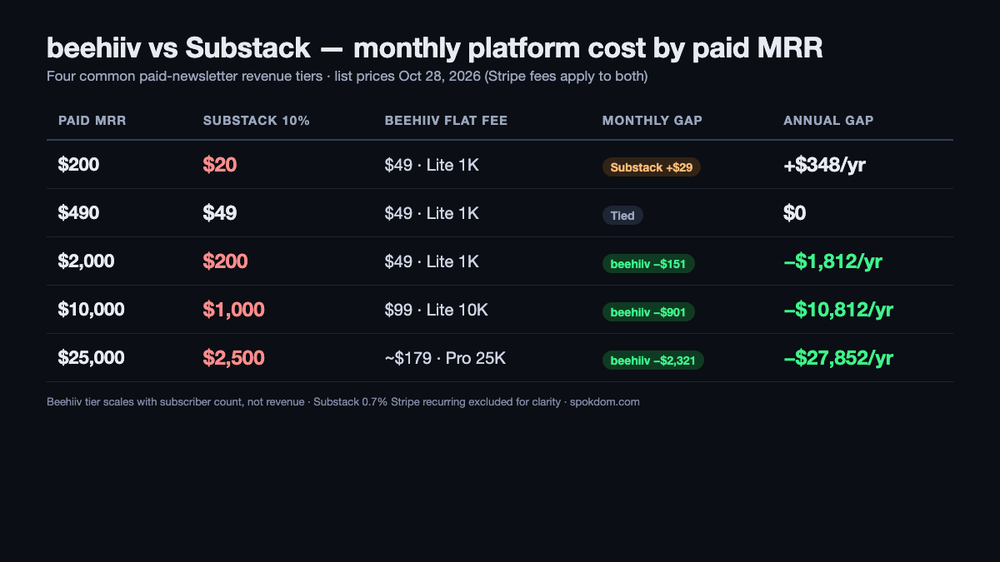
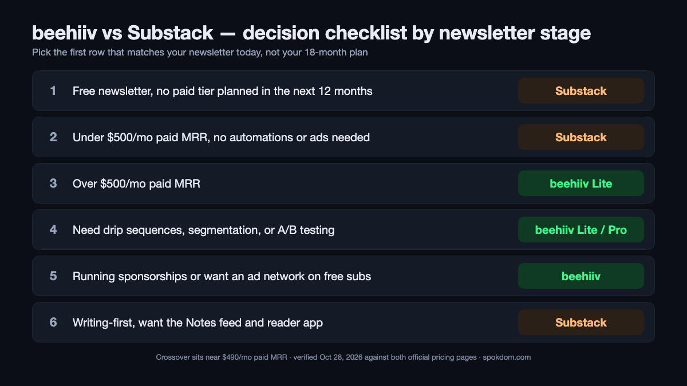

📌 Quick take
beehiiv vs Substack for newsletters is a fee-structure fight, not a feature fight. Substack takes 10% of every paid subscription forever; beehiiv charges a flat monthly fee and takes 0% of subscription revenue.

The crossover sits around <b>$490/mo in paid MRR</b> — below that, Substack is cheaper; above it, beehiiv is. At $10,000/mo in paid revenue the gap is roughly $900/mo in beehiiv's favor.

Default pick: Substack for pure writers under ~$500/mo paid revenue who want the discovery network. beehiiv for anyone running ads, drip sequences, segmentation, or over $500/mo in paid subs.

beehiiv vs Substack for newsletters only has a clean answer once you understand that Substack is not "free" — it is a 10% rent on every paid subscription you ever collect, as of October 28, 2026 and verified on both the Substack creator fee docs and the Substack support pages. beehiiv runs the opposite meter: a flat $0, $49, or $95 monthly tier based on subscriber count, with 0% of subscription revenue taken. The flip point is lower than most comparison posts admit, and the five myths below are where paid writers lose the most money.

How this comparison was built: on October 28, 2026 I captured both official pricing pages, opened eleven top-ranking comparisons with WebFetch, cross-checked Substack's recurring billing fee (now 0.7%, not the legacy 0.5%) against the Sparkleon fee breakdown, and modeled total platform cost at four paid-MRR tiers against beehiiv's current Lite and Pro plans. No month-long production account on either platform, so treat the dollar figures as a planning model and reconfirm them on the live pricing pages before you move a list.

## beehiiv vs Substack for newsletters in one paragraph

For a writer whose newsletter is free and will stay free, Substack is the better home — it costs zero, the Notes feed and recommendation network deliver real organic subscriber growth, and the editor keeps you focused on prose. For a newsletter that already earns paid subscriptions or runs sponsorships, beehiiv wins on both math and tooling: no 10% rent above $490/mo in paid MRR, a native ad network, drip sequences, segmentation, A/B testing, and 1,000+ integrations. The honest short answer — Substack if you write, beehiiv if you operate — is not a cop-out, it is the actual axis the decision moves on.

Where the two platforms genuinely overlap is roughly the first 1,000 subscribers and the first few hundred dollars a month of paid revenue. In that range the Substack 10% fee is $0–$50/mo and beehiiv Lite is $49/mo at 1,000 subs — a near-identical cost with Substack adding free discovery on top. Above that range, the lines diverge sharply and the five myths below are where creators keep paying a 10% rent long after it stopped making sense.

## Myth 1: "Substack is free, so it's the cheaper option"

Substack lists at $0/month to start, but the fee is applied per paid transaction: 10% to Substack plus 2.9% + $0.30 per payment plus 0.7% recurring billing to Stripe, per Substack's own support pages and the Sparkleon breakdown captured in 2025–2026. On an $8/month subscription, a creator keeps about $6.61 after all fees — roughly 83%. The 10% number sounds small until you compound it across every subscriber, every month, forever. There is no tier of Substack where that rent disappears.

beehiiv charges a flat monthly fee tied to subscriber count: Free up to 2,500 subscribers, Lite starting at $49/mo annual ($59 monthly) at 1,000 subs, Pro starting at $95/mo annual ($109 monthly) at 1,000 subs, with Enterprise for lists above the Pro cap. beehiiv takes 0% of subscription revenue — only Stripe's standard 2.9% + $0.30 applies. On an $8/month subscription on beehiiv Lite, a creator keeps about $7.46 — around 93% — plus the ability to run ad network revenue on the same list.

The math only breaks even for Substack when paid MRR is low. At $49/mo in paid MRR, Substack takes $4.90 while beehiiv Lite charges $49 — Substack is $44 cheaper that month. At $490/mo in paid MRR, Substack takes $49 and beehiiv Lite still charges $49 — the two meters tie. Above $490/mo the Substack meter accelerates while the beehiiv meter stays flat, which is why multiple 2026 breakdowns (influencerskit, remogrid, carrieloranger) place the practical crossover between $390 and $500/mo in paid revenue depending on the exact beehiiv tier you need.

## Myth 2: "beehiiv's $49 is just a tax Substack avoids"

Framed as "SaaS fee vs no fee", beehiiv looks like a worse deal. Framed as "flat SaaS fee vs permanent 10% revenue rent", the picture inverts the moment you cross about $500/mo in paid MRR. Here is the same newsletter priced at four monthly paid-revenue tiers on 2026 list pricing, assuming the beehiiv tier that matches each subscriber count (Lite at 1,000; Lite at 2,500; Lite at 10,000; Pro at 25,000).

| Paid MRR | Subs est. | Substack take (10%) | beehiiv flat fee | Monthly gap | Annual gap |
| --- | --- | --- | --- | --- | --- |
| $200 | ~50 at $4 | $20 | $49 (Lite 1K) | +$29 Substack cheaper | +$348/yr |
| $490 | ~100 at $5 | $49 | $49 (Lite 1K) | $0 — tied | $0 |
| $2,000 | ~400 at $5 | $200 | $49 (Lite 1K) | –$151 beehiiv cheaper | –$1,812/yr |
| $10,000 | ~1,250 at $8 | $1,000 | $99 (Lite 10K) | –$901 beehiiv cheaper | –$10,812/yr |
| $25,000 | ~3,000 at $8 | $2,500 | ~$179 (Pro 25K) | –$2,321 beehiiv cheaper | –$27,852/yr |

At $200/mo in paid revenue, Substack saves you $348 a year. At $2,000/mo the direction has reversed and beehiiv saves you $1,812 a year. At $10,000/mo — a mid-sized paid newsletter — the gap is roughly $10,800 a year, which is enough to pay a part-time editor. The remogrid breakdown runs the same scenario and lands within $200 of these numbers; the influencerskit breakdown at $10K MRR shows beehiiv about $700/mo cheaper after Stripe differences, consistent with the $901 estimate here before Stripe recurring-billing adjustments.

The one real caveat: beehiiv's tier price scales with your subscriber count, not your revenue. A newsletter with 50,000 free subscribers and only $500 in paid revenue will still owe beehiiv the 50K-subscriber Lite or Pro fee, which is where Substack keeps its advantage for low-conversion free newsletters.

## Myth 3: "The two platforms are basically the same tool with different names"

Writing-wise, yes — both ship a decent editor, both send to inboxes, both expose a public archive. Operations-wise, no. beehiiv's Lite plan adds a visual automation builder, A/B testing, segmentation, custom HTML, API access, 1,000+ integrations, and a native ad network (Boosts and programmatic) that pays per subscriber or per impression. Substack's paid tooling is intentionally narrower — a single welcome email, no segmentation, no A/B testing, no native ad network. That is a product philosophy, not a bug; Substack sells "writer-first" and ships a reader-facing experience to match.

| Capability | Substack | beehiiv (Lite/Pro) | Why it matters |
| --- | --- | --- | --- |
| Flat monthly fee | $0 | $49–$95 annual at 1K subs | beehiiv's cost is predictable, Substack's scales with revenue |
| Revenue share on paid subs | 10% + Stripe | 0% + Stripe | The headline difference |
| Welcome/drip sequences | 1 welcome email only | Multi-step automations | Operators lose onboarding ROI without this |
| Segmentation | ✗ | ✓ (tags, source, engagement) | Can't run "lapsed" or "VIP" campaigns on Substack |
| A/B testing | ✗ | ✓ (subject lines + content) | Headline tests move open rates 5–20% |
| Ad / sponsorship tools | Manual deals only | Boosts + programmatic ad network | A second revenue stream Substack structurally lacks |
| Discovery network | Notes feed + recommendations | Boosts (paid), referral program | Substack discovery is free; beehiiv discovery costs money |
| Custom domain | $50 one-time | Included on paid tiers | beehiiv includes it; Substack bills once |
| API access | Minimal | Full REST API | Required for any serious CRM/data piping |
| Mobile app distribution | Substack app (reader) | None | Substack's app surfaces your posts in a feed |

Substack wins two rows that matter a lot for pure writers (discovery network and the mobile app). beehiiv wins eight rows that matter a lot for operators. If any three of segmentation, automations, A/B testing, custom HTML, API, or an ad network show up in your actual workflow, Substack is a hard "no" regardless of the fee math.

💡 How to read the "0% fee" without getting fooled
beehiiv's "0% platform fee" applies only to paid subscriptions. The flat monthly plan still exists. Stripe still charges 2.9% + $0.30 per transaction on either platform, so creator take-home is "gross minus Stripe minus (0% beehiiv OR 10% Substack OR 0.7% Stripe recurring)".

Substack's "free" headline hides the same thing in reverse. There is no plan tier on Substack. The 10% fee is the plan. Treat it as a permanent revenue tax, not a growth-stage discount.

## Myth 4: "Substack's discovery network alone justifies staying"

Substack's recommendation system and the Notes feed are the most frequently cited reasons writers stay on Substack even after they outgrow the fee math. The devopscube operator (19K+ subscribers), carrieloranger (10K+ subscribers), and the painpointmap breakdown all name Notes and recommendations as a real growth engine — 30% to 60% of new paid subs on established publications, depending on who's counting. For a cultural, political, or personal-brand newsletter in a crowded category, that discovery is worth paying 10% for because the alternative is paying for ads anyway.

beehiiv's answer is Boosts: a paid cross-promotion marketplace where newsletters bid on each other's subscribers, typically $1.50–$3.00 per acquired subscriber per the mailercloud and remogrid 2026 breakdowns. That's a different mechanism — not organic discovery but paid acquisition at a knowable CAC. For a B2B or niche-professional newsletter where Substack Notes rarely surfaces your content, Boosts is often a better return on dollars than Substack's "free" discovery would be, because the free discovery was never going to reach the audience in the first place.

The honest test is simple: look at where your last 100 subscribers came from. If more than one-third arrived via a Substack recommendation or Notes thread, the discovery engine is working for you and the 10% is probably worth it. If your subscribers come mostly from your own channels (podcast, Twitter, LinkedIn, SEO, newsletter swaps), Substack's discovery is not actually paying rent for its 10% rent, and beehiiv wins the math.

## Myth 5: "Switching platforms means losing your subscribers"

Free subscribers transfer cleanly in either direction via CSV export and import — all the top 2026 comparisons confirm this. The real friction is on paid subscribers, who do not transfer automatically because the Stripe billing relationship moves. The painpointmap and influencerskit breakdowns put typical paid-subscriber retention through a migration at 60–80% when the move is clearly announced and 80–90% with beehiiv's one-click Substack import tool, which attempts to carry over the Stripe metadata where possible.

The devopscube operator migrated from Substack to beehiiv at 19K+ subscribers and reports that open rates dipped 10–20% for the first few weeks before recovering, as both the sending domain and the inbox-provider trust had to rebuild. The painpointmap breakdown reports the same curve: 10–20% open-rate dip, recovery in 2–3 months. If you move during a slow season, the dip is barely visible by the next launch; if you move in the middle of a launch, you will feel it.

The non-obvious tax is URL migration. Substack publications live under `yourname.substack.com` by default, and even custom-domain Substacks keep that URL as the canonical. Moving to beehiiv means either setting up 301 redirects (easy if you own the custom domain), accepting a loss of SEO equity on old posts (hundreds of dollars of lost organic traffic for a 2+ year old publication), or republishing the archive on the new host and letting the old Substack domain atrophy. For publications under a year old, the SEO cost is minor; for established archives, migrate deliberately and plan the redirects first.

⚠️ The one line of fine print both platforms share
Pricing has moved on both sides during 2026. beehiiv renamed Launch → Free, Scale → Lite, and Max → Pro on October 1, 2026, and some 2026 comparison posts still cite the older "Scale $39" or "Scale $42" numbers. Substack's Stripe recurring-billing surcharge rose from the legacy 0.5% to 0.7% in mid-2025. Always reconfirm current numbers on <a href="https://substack.com/">Substack official</a> and on beehiiv's pricing page before you build a cost model, and screenshot the version you're buying so you can prove what you agreed to if the page moves.

## Three real newsletter shapes priced for 2026

The best way to settle beehiiv vs Substack for newsletters is to price your actual newsletter against both meters on paper. Three common shapes, on October 2026 list pricing.

**Shape A — The personal-brand writer at 1,500 subs, 60 paying at $5/mo.** Paid MRR: $300. On Substack: 10% × $300 = $30/mo in fees — $360/yr. On beehiiv Lite at 2,500-sub tier: around $49/mo annual = $588/yr. On beehiiv Free (if under 2,500 subs free and no monetization needed) it would be $0, but Lite is required to accept paid subs. **Winner: Substack** — $228/yr cheaper and Notes keeps feeding new subs.

**Shape B — The 10,000-sub ops newsletter with 400 paying at $8/mo.** Paid MRR: $3,200. On Substack: 10% × $3,200 = $320/mo = $3,840/yr. On beehiiv Lite at the 10K-sub tier: $99/mo annual = $1,188/yr. **Winner: beehiiv** — $2,652/yr cheaper, plus the ad network and segmentation unlock a second revenue stream Substack cannot run.

**Shape C — The 50,000-sub free newsletter with sponsorships, no paid subs.** Paid MRR: $0. On Substack: $0/mo in platform fees. On beehiiv Lite at the 50K-sub tier: around $149–$179/mo annual. **Winner: Substack** on platform cost — unless the newsletter's sponsorships are routed through beehiiv's Boosts or programmatic ad network, in which case the ad revenue typically more than covers the flat fee at scale.

The pattern across all three: Substack wins when paid revenue is low and the subscriber list is either small or free; beehiiv wins when paid revenue is substantial or when operator tooling (automations, segmentation, ads) is the point. Low-paid, high-subscriber newsletters sit in the fuzziest middle, and that is also where our [best Mailchimp alternatives for small business](/mailchimp-alternatives-small-business/) guide covers the related billing-model trap for email marketing tools billed by contact count.

## Decision checklist by newsletter stage

Pick the first row that matches your newsletter today, not the one that matches your 18-month plan. Platform cost compounds faster than the migration cost of moving later.

1. Is the newsletter free with no paid tier planned in the next 12 months? → **Substack** — $0 cost, Notes discovery is upside.
2. Under $500/mo in paid MRR and no need for automations or ads? → **Substack** — the 10% tax is below beehiiv's flat fee.
3. Over $500/mo in paid MRR? → **beehiiv Lite** — the flat fee saves money and keeps revenue in your pocket.
4. Need drip sequences, segmentation, or A/B testing to onboard paid subs? → **beehiiv Lite or Pro** — Substack ships none of these.
5. Running sponsorships or want an ad network to monetize free subs? → **beehiiv** — Boosts + programmatic ads.
6. Writing-first, no monetization urgency, want the Notes feed? → **Substack** — the discovery is the product.

Most paid writers who follow the fee math migrate from Substack to beehiiv around the $500–$1,000/mo paid-MRR mark and keep a dormant Substack publication as a cross-promotional surface. Most free writers who grow past 2,500 subs on beehiiv upgrade to Lite rather than migrate, because beehiiv Free is the only free plan that actually accepts a paid tier later without a replatform.

## When to start on which, and when to migrate

If you are starting a newsletter today with no paid revenue and no monetization plan for 12 months, start on Substack. The $0 cost beats everything else, the Notes feed will probably bring you your first 500 subscribers, and the migration cost later is paid in open-rate dip and SEO redirects — not in dollars. If you are starting a newsletter today with a clear monetization plan (ads, sponsorships, or paid subs within 6 months), start on beehiiv Free. Free hosts up to 2,500 subs, you accept the Lite upgrade only when you turn on paid subs, and you avoid moving a Stripe billing relationship later.

If you are already on Substack with 100+ paying subscribers and over $500/mo in paid MRR, run the migration seriously. Export the list, use beehiiv's import tool, communicate the move clearly to paid subscribers to maintain the 60–80% retention baseline, set up 301 redirects from the old Substack URL, and expect a 10–20% open-rate dip for the first month. The $2,000–$10,000/yr in recovered fees typically pays for the one-time migration pain within the first paid quarter after the move.

The one scenario where staying on Substack past the fee crossover is defensible: your inbound subscriber mix shows more than 40% coming from Substack recommendations and Notes threads, meaning you'd have to spend to replace that acquisition on beehiiv Boosts. In that case, do the math: if Substack's 10% is cheaper per acquired subscriber than beehiiv's $1.50–$3.00 Boosts rate on the same volume, keep the rent. If not, move. The decision does not need to be loyal to either brand — it needs to be loyal to the subscriber-acquisition and fee math your actual newsletter runs.

## FAQ

**Q. beehiiv vs Substack for newsletters — which is actually cheaper?**
A. Below about $490/mo in paid subscription revenue, Substack is cheaper because its 10% cut is smaller than beehiiv Lite's $49/mo flat fee. Above $490/mo, beehiiv is cheaper, and the gap widens with revenue. At $10,000/mo in paid MRR, beehiiv saves roughly $10,800/year compared with Substack's 10% rent.

**Q. Does beehiiv really take 0% of paid subscription revenue?**
A. Yes, on all four plans including the Free tier that supports paid subs if you upgrade to Lite. The only payment deduction beehiiv passes through is Stripe's standard 2.9% + $0.30 per transaction, the same Stripe fee Substack creators also pay on top of the 10% Substack cut.

**Q. Can I use beehiiv's free plan with paid subscriptions?**
A. No. beehiiv Free hosts up to 2,500 subscribers but monetization — paid subscriptions, the ad network, and automations — requires upgrading to Lite starting at $49/mo annual. If you want to accept a paid tier, Lite is the entry point regardless of subscriber count.

**Q. Will Substack subscribers transfer to beehiiv if I migrate?**
A. Free subscribers transfer cleanly via CSV export. Paid subscribers face more friction because the Stripe billing relationship moves — typical retention is 60–80% when the move is clearly announced, and up to 80–90% with beehiiv's one-click Substack import tool that attempts to carry over Stripe metadata. Expect a 10–20% open-rate dip for the first month after any migration.

**Q. Is the Substack recommendation network worth paying 10% for?**
A. It depends on where your subscribers come from. If more than one-third of recent subscribers arrived via a Substack recommendation or Notes thread, the discovery engine is working and the 10% is partially paying for acquisition that would otherwise cost ad dollars. If subscribers come mostly from your own channels, Substack's discovery isn't earning its rent and beehiiv's math wins.

**Q. Should I migrate from Substack to beehiiv in 2026?**
A. Only if you're earning more than roughly $500/mo in paid subscription revenue, or if you need automations, segmentation, A/B testing, or an ad network that Substack structurally does not offer. Below $500/mo in paid MRR and with a writing-first workflow, the 10% rent is not yet painful enough to justify the migration cost and the open-rate dip.

---

**Related keywords** — #beehiivvssubstack #substackvsbeehiiv #beehiivvssubstackfornewsletters #beehiivpricing2026 #substackfees2026 #newsletterplatforms #paidnewsletters #substackalternatives #beehiivfreeplan #beehiivboosts #substacknotes #newslettermonetization
