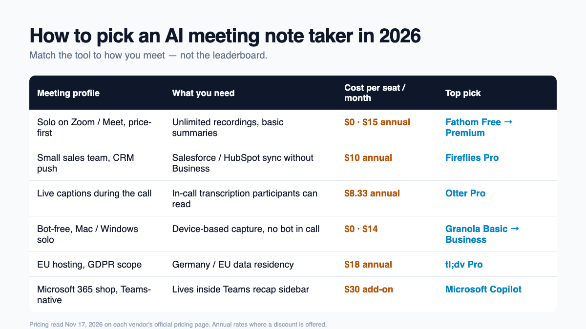
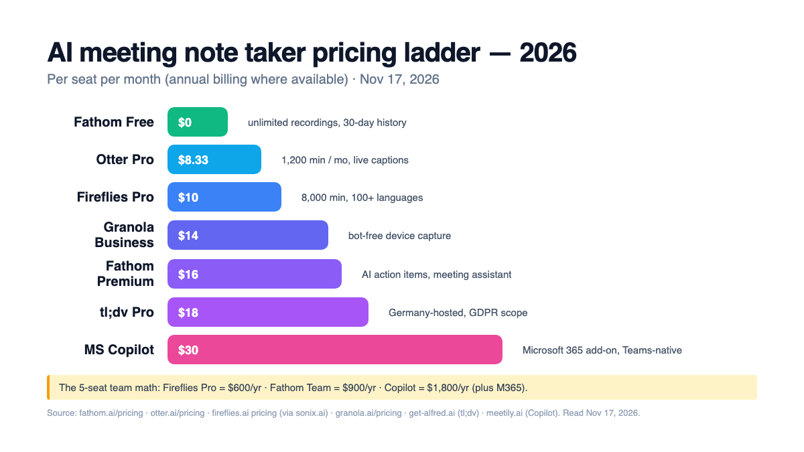
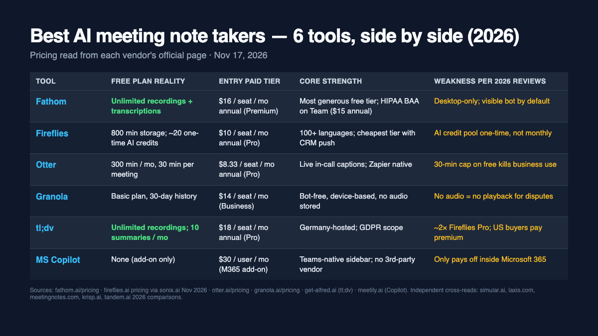

The best AI meeting note takers in 2026 are Fathom (free, $16/seat/mo Premium annual), Fireflies ($10/seat/mo annual Pro), Otter ($8.33/seat/mo annual Pro), Granola ($14/seat/mo Business), tl;dv ($18/seat/mo annual Pro), and Microsoft Copilot ($30/user/mo add-on, charged on top of an existing Microsoft 365 per-user seat cost). Prices were read directly off each vendor's official page on November 17, 2026 and cross-checked against two or more independent 2026 pricing breakdowns.

The real question across every opened 2026 review is not which tool transcribes best — accuracy is commoditized at 90–95%. It is which tool fits your calendar, your consent rules, and your downstream workflow (CRM, HIPAA, EU hosting). Bot visibility, data residency, and whether the tool already lives inside Microsoft 365 end up mattering more than a one-percentage-point accuracy edge.

*Transparency: this is a comparison post. The site is building toward affiliate partnerships with the SaaS tools reviewed here, but no links in this post are currently affiliate-tagged — the picks are made on fit, not payout.*

📌 Quick take
No single AI meeting note taker wins every meeting. 2026 shortlist, priced off each vendor's official page on November 17, 2026: Fathom (free, unlimited recordings; $16/seat/mo Premium annual) for solo users, Fireflies ($10/seat/mo annual Pro) for CRM-connected small teams, Otter ($8.33/seat/mo annual Pro) for live transcription, Granola ($14/seat/mo Business) for bot-free Mac or Windows capture, tl;dv ($18/seat/mo annual Pro) for EU hosting, Microsoft Copilot ($30/user/mo) for Microsoft 365 shops.

The feature that matters more than price is bot visibility. Visible bots can trigger participant consent complaints (three 2025–2026 class actions were filed — Otter in August 2025, Fireflies in March 2026, Granola in July 2026), and the bot-free tools are not a cosmetic preference — they are a compliance decision.

Free plans look generous until you hit the hidden limit. Fathom's free tier ships unlimited recordings but gates advanced summaries and AI action items on Premium; Otter caps you at 300 minutes a month and 30 minutes per meeting; Fireflies ships a one-time pool of ~20 AI credits that never refill. Pick for the tier you will actually use, not the free row.

How this was built: on November 17, 2026, the top ten Google results for "best ai meeting note takers" were queued and eight were opened directly with WebFetch (cirrusinsight.com, simular.ai, laxis.com, meetingnotes.com, krisp.ai, granola.ai, wearetandem.ai, meetily.ai, toolfinder.com). Pricing below was read directly off each vendor's public pricing page the same day (fathom.ai/pricing, otter.ai/pricing, granola.ai/pricing) and cross-checked against two or more independent 2026 pricing breakdowns (sonix.ai, get-alfred.ai). Prices are listed as "starts at" because these tools adjusted pricing multiple times in 2026 — see [Microsoft 365 Copilot pricing](https://www.microsoft.com/en-us/microsoft-365/copilot) for the official Microsoft rate the Copilot section below is read against, and [OpenAI ChatGPT pricing](https://openai.com/chatgpt/pricing/) for the general-purpose AI-assistant tier most readers mentally compare these note takers against.

## The 60-second shortlist — 6 AI meeting note takers, matched to how you meet

If you only read one section: the right tool is the one that fits your meeting stack, not the one at the top of the leaderboard. Solo users on Zoom or Google Meet with price sensitivity go to Fathom. Small revenue teams that need CRM push without paying for Business go to Fireflies Pro. In-call live transcription for accessibility or hearing-support goes to Otter. Mac or Windows solo users who refuse a visible bot in the call go to Granola. EU-hosted meetings bound by GDPR go to tl;dv or Jamie. Microsoft 365 shops with Teams as the default already pay Microsoft — Copilot is the add-on, not a new vendor. Five of the eight opened 2026 reviews (simular, meetily, toolfinder, cirrusinsight, laxis) organize around use case rather than a single leaderboard — that framing wins because it blocks founders from paying for workflow features their team will never use.

The six profiles below cover almost every meeting decision in 2026 based on the opened competitor reviews. Pick the row that fits before shopping.

| Meeting profile | What you need | 2026 cost per seat/month | Top pick |
| --- | --- | --- | --- |
| Solo on Zoom/Meet, price-first | Unlimited recordings, basic summaries | $0 (free) or $16 annual | Fathom Free → Premium |
| Small sales team, CRM push | Salesforce/HubSpot sync without Business tier | $10 annual | Fireflies Pro |
| Live captions during the call | In-call transcription participants can read | $8.33 annual | Otter Pro |
| No visible bot, Mac/Windows solo | Device-based capture, no bot joining | $0 (basic) or $14 | Granola Basic → Business |
| EU hosting, GDPR scope | Germany/EU data residency | $18 annual | tl;dv Pro |
| Microsoft 365 shop, Teams-native | Lives inside Teams recap sidebar | $30 add-on | Microsoft Copilot |

Three traps to dodge before paying anything. First, do not pay for Otter Pro and Fireflies Pro at the same time — both fill the same "paid tier, small team" slot, and running them together ($18.33 blended per seat per month on annual billing) duplicates summaries and bots. Second, do not assume Fathom's "unlimited free" means unlimited everything — the free tier gates advanced summaries and AI action items on Premium, and once a team needs those or the meeting assistant, the actual bill becomes Premium at $16/seat/month annual. Third, do not buy Granola for a team expecting one unified feed — Granola's bot-free capture runs on each user's device, so the "team feed" is really an aggregation of individual notes, which falls apart the moment a user forgets to open the app before a call.

## The bot-visibility question every 2026 review ducks

The single most under-covered finding across the eight opened 2026 reviews is this: whether the note taker joins the call as a visible bot or captures silently from your device is not a cosmetic preference — it is a consent and compliance decision. The tandem.ai 2026 comparison and the simular.ai 2026 review both flag that visible-bot tools (Fireflies, Fathom, Otter in default mode) rely on an implicit consent model: the bot shows up, the other participants accept or don't, and if they don't, the meeting is awkward or the recording ends. Bot-free tools (Granola, Krisp, Laxis, Jamie) capture from the host's microphone and speakers directly, which is lower-friction but puts the burden of telling participants they're being recorded squarely on the host.

Three 2025–2026 class actions were filed around meeting-bot consent — against Otter (August 2025), Fireflies (March 2026), and Granola (July 2026) per the tandem.ai legal roundup — which tells you regulators are paying attention to this entire category, visible-bot or not. The practical rule from the opened reviews is simple. For external calls with prospects, customers, or regulators, either use a bot-free tool and announce the recording in your opening line, or use a visible-bot tool and make sure every external participant clicks through the consent prompt the bot ships with. Internal team syncs rarely trigger the same risk because participants are employees under an internal recording policy.

💡 How to pick between bot and bot-free in 30 seconds
Answer three questions. (1) Do most of your meetings have external participants (prospects, customers, vendors)? If yes, lean bot-free with a verbal recording disclosure — it keeps the UX clean and the compliance burden on the host where it belongs. (2) Does your calendar run on Microsoft Teams and are most calls internal? If yes, Microsoft Copilot's recap sidebar already lives inside Teams, no bot needed. (3) Do you need searchable transcripts for 50+ meetings a month across a team? If yes, visible-bot tools (Fireflies, Fathom Team) make team-wide search practical in ways device-side tools can't — Granola's "team" tier is a stitched aggregation, not a shared feed.

## Fathom — the unlimited free tier that most solo users land on

Fathom is the 2026 winner for solo users on Zoom, Google Meet, or Microsoft Teams who want unlimited recordings and transcriptions without paying. The free plan — read directly off fathom.ai/pricing on November 17, 2026 — includes unlimited recordings, unlimited transcriptions, instant AI summaries, clips, playlists, and search. That is not a 300-minute cap or a 10-meetings-a-month limit — it is actually unlimited capture, which is why five of the eight opened reviews (laxis.com, meetingnotes.com, toolfinder.com, granola.ai's own competitive comparison, tandem.ai) name Fathom the best free pick.

Where Fathom narrows is on advanced features. Premium at $16/seat/month annual ($20/seat/month if billed monthly) adds advanced call summaries, AI action items, the meeting assistant, and a custom bot. Team at $15/seat/month annual adds a shared workspace, team recordings view, trackers, and HIPAA compliance with a standard BAA. Business at $25/seat/month annual adds CRM syncing and AI scorecards. Enterprise at $35/seat/month (annual only) adds hands-on Launch Assist, SSO, SCIM, custom data retention, and a dedicated success manager. Multiple 2026 reviews (laxis, tandem) also flag that Fathom is desktop-only with no native mobile app, which rules it out for founders taking a lot of calls from a phone.

The 2026 differentiator worth naming explicitly is HIPAA pricing on the entry team tier. Fathom Team at $15/seat/month annual is the only tool in this 6-pick set where HIPAA ships on the team tier instead of Enterprise. Otter, Fireflies, Granola, and tl;dv all push HIPAA to their Enterprise tier (custom to $39/seat/month annual), so for a US clinic or health-adjacent team the cheapest compliant path in the entire category is Fathom Team — cross-referenced in the HIPAA question in the FAQ below.

💡 Who Fathom is wrong for
Fathom is the wrong pick when meetings are primarily on mobile (no mobile app), when the team wants silent capture without a visible bot (Fathom's default is a visible bot — Granola or Laxis fit better), or when HIPAA is in scope and you're not willing to move up to Team at $15/seat/month annual to get the BAA. The strongest anti-Fathom case is a sales team of 10+ that needs Salesforce sync on day one — Fireflies Pro at $10/seat/month annual is cheaper and includes CRM integration a tier earlier.

## Fireflies — the cheapest tier that actually includes CRM integration

Fireflies at $10/seat/month annual (Pro) is the 2026 answer for a small sales team that needs Salesforce or HubSpot push without paying $19+ for Business. Pricing verified against sonix.ai's November 2026 breakdown and get-alfred.ai's 2026 plan comparison: Free ($0) gives 800 minutes of cumulative storage, a 2-hour per-meeting recording cap, and a one-time shared pool of about 20 AI credits. Pro at $10/seat/month annual ($18 monthly) lifts storage to 8,000 minutes and keeps the one-time ~20 AI credit pool. Business at $19/seat/month annual ($29 monthly) adds unlimited storage, full video recording, Salesforce and HubSpot integrations for team-wide use, advanced analytics, and a one-time 30 AI credit pool. Enterprise at $39/seat/month annual adds HIPAA, SSO, private storage, a 50 AI credit pool, and a dedicated account manager.

The 2026 trap that the simular.ai, laxis.com, and sonix.ai pricing breakdowns all flag is this. Fireflies AI credits are a one-time pool that does not refill monthly. When the pool runs out, add-on credits are sold at a per-credit rate that auto-renews unless paused (check fireflies.ai/pricing for current numbers). Teams that assumed "20 credits" meant "20 per month" burn through them in the first few weeks and face a surprise top-up charge. The practical fix is to budget for an add-on credit bundle from day one and use the AskFred assistant sparingly if you are on Free or Pro.

A concrete first month on Fireflies Pro, for a 4-person Zoom-first sales team that already has HubSpot connected. Week one looks like installing the Fred bot in the shared Zoom account and pointing the HubSpot integration at the existing pipeline — Pro ships this for $10/seat/month annual, $40/month for the team. Week two is when the one-time pool of ~20 AI credits drains down by day eight across four reps running AskFred queries, so the team either tops up or restricts AskFred to closed-won deal reviews. By month end, every discovery call is searchable team-wide and HubSpot deal cards auto-populate with call summaries — the single reason this tier beats Fathom for a CRM-first team.

💡 Who Fireflies is wrong for
Fireflies is the wrong pick when the team needs HIPAA on a budget (that is on Enterprise at $39/seat/month annual — Fathom Team at $15 wins outright), when the use case is live in-call captions for hearing-support or accessibility (Otter's live transcription is the category answer), and when a solo user hates visible bots in external calls (Fireflies ships as a visible bot by default — Granola's device-side capture fits better). The worst-fit buyer is a 3-person consultancy that will burn through the one-time 20 AI credit pool in week one and keep topping up without noticing.

## Otter — live transcription when captions have to show up during the call

Otter at $8.33/seat/month annual (Pro) is the 2026 pick when live captions have to appear in the call itself — for hearing-support, accessibility, cross-language meetings, or when a stakeholder needs to read while the meeting runs. Pricing verified on otter.ai/pricing November 17, 2026: Basic ($0) gives 300 monthly transcription minutes, 30 minutes per meeting, 3 lifetime file imports, and basic live-transcription features. Pro at $16.99/seat/month ($8.33/seat/month annual, ~51% savings) lifts the cap to 1,200 monthly minutes, 90 minutes per meeting, 10 monthly file imports, and adds advanced AI workflows plus Salesforce, HubSpot, and Zapier integrations. Business at $30/seat/month ($19.99 annual) removes meeting-count caps, lifts per-meeting runtime to 4 hours, and adds 3 concurrent meetings plus enhanced admin controls. Enterprise is custom-priced with SSO, SCIM, domain capture, and a HIPAA add-on option.

Otter has three limits worth naming, flagged in both the laxis.com and tandem.ai 2026 reviews. Only about four major languages are supported live (vs 100+ on Fireflies), the Basic 30-minutes-per-meeting cap makes it useless for any real business call out of the box, and the visible bot is the one that triggered the August 2025 class action around consent. Otter is also the slowest to update CRM fields natively compared to Fireflies Business — teams that treat the note taker as the CRM pipeline usually end up moving to Fireflies within six months.

A concrete first month on Otter Pro, for a 3-person accessibility-first consultancy running hour-long Google Meet client calls. Week one is installing the Otter Assistant on the shared calendar so every booked meeting gets an auto-join bot with live captions visible to participants in real time. Week two is when the Pro plan's 1,200 monthly minute cap hits on day fourteen across three reps doing hour-long calls, so the team either upgrades to Business at $19.99/seat/month annual for uncapped meetings or rations file imports. By month end, searchable transcripts and in-call captions for hearing-impaired stakeholders are the payoff — the CRM side feels thin next to Fireflies and is the point where accessibility-first teams usually stay and sales-first teams usually leave.

💡 Who Otter is wrong for
Otter is the wrong pick when meetings run over 30 minutes on the Basic plan (the free tier is effectively a demo), when the primary language is anything outside the ~4 Otter supports live (Fireflies covers 100+), and when the team has already been named in a consent-prompt complaint — the August 2025 class action makes Otter the hardest sell for compliance reviews in 2026. Sales teams that want CRM to be the system of record should skip Otter and buy Fireflies Pro at $10/seat/month annual instead.

## Granola — bot-free capture for solo Mac and Windows users

Granola at $14/seat/month (Business, no monthly/annual difference) is the 2026 pick for a Mac or Windows solo user who refuses to put a visible bot in the call. Pricing verified on granola.ai/pricing November 17, 2026: Basic ($0) runs on the user's device, captures audio from microphone and speakers directly, and includes AI meeting notes, AI chat, shared folders, and voice typing — but caps meeting history at 30 days. Business at $14/seat/month unlocks unlimited meeting notes and history, advanced AI thinking models, Notion / HubSpot / Zapier integrations, API and MCP access, and centralized billing. Enterprise at $35/seat/month adds SSO, priority support, usage analytics, HIPAA compliance, and org-wide admin controls.

The honest limit shows up in both the laxis.com and simular.ai 2026 reviews. Granola does not save audio or video recordings — only the AI-processed notes. That is great for privacy and bad for verification. If a client disputes what was said on the call, you have Granola's summary and nothing to play back. The second limit, from the tandem.ai 2026 comparison, is that Granola runs on each user's device, so "team" use is really an aggregation of individual sessions — a teammate who forgets to open the app before the call generates no notes for that meeting. Granola is a precise fit for a specific user (privacy-first solo operator on a laptop) and a poor fit for anything resembling a sales team.

A concrete first month on Granola Business, for a solo consultant on Mac who refuses visible bots in external client calls. Week one is installing the Granola desktop app, connecting Google Calendar, and enabling microphone-plus-speaker capture so no bot ever joins the Zoom call. Week two is when the 30-day history cap on Basic becomes the upgrade trigger, so the consultant moves to Business at $14/seat/month — unlimited history, HubSpot push, and MCP/API access come with it. By month end, notes are clean and searchable, but there is no audio to replay if a client disputes a summary — a trade the solo operator accepts and a QA-driven team typically does not.

💡 Who Granola is wrong for
Granola is the wrong pick when audio or video playback is needed for dispute resolution, QA, or coaching (no recording is saved — only the AI notes), when the team needs a unified searchable feed across every teammate's meetings (device-side capture means missed calls = missed notes), and when calls happen on mobile or on a Linux box (Mac and Windows desktop only). Any sales team of three or more should look at Fathom Team at $15/seat/month annual or Fireflies Pro at $10 before Granola.

## tl;dv — EU-hosted, euro-priced, GDPR-friendly

tl;dv at $18/seat/month annual (Pro) is the 2026 pick when meetings have to be hosted in the EU under GDPR. Pricing verified against the get-alfred.ai November 2026 breakdown and the tandem.ai 2026 comparison: Free includes unlimited recordings but only 10 AI summaries per month. Pro at $18/seat/month annual ($29 monthly) lifts the summary cap, adds integrations, and unlocks team features. Business at $29/seat/month annual ($39 monthly) adds advanced analytics and more granular admin controls. Enterprise is custom-priced with SSO and dedicated infrastructure. The tandem.ai 2026 comparison specifically flags tl;dv as "Germany-hosted," which matters for European organizations that cannot park meeting data in US-based S3 buckets.

tl;dv is not a budget pick. At $18/seat/month annual it costs almost double Fireflies Pro at $10 — the premium buys the EU-hosting answer, not a better product. Shops that do not have a GDPR data-residency requirement almost always come out ahead on Fireflies Pro or Otter Pro. The fair comparison for EU buyers is really tl;dv vs Jamie (another EU-hosted option, flagged in the krisp.ai 2026 roundup) — both answer the same question from different angles, and the pick usually comes down to whether the host-country preference is Germany (tl;dv) or EU-generic with privacy-first UX (Jamie).

A concrete first month on tl;dv Pro, for a 5-person EU-based team bound by GDPR. Week one is picking Germany-hosted recording during onboarding, connecting Google Calendar or Microsoft 365, and setting up the consent prompt in the organization's preferred EU language. Week two is when the Free tier's 10-summaries-per-month cap hits on day nine, forcing the move to Pro at $18/seat/month annual ($90/month for five seats) — the per-seat premium over Fireflies Pro buys EU data residency, not extra features. By month end, the compliance review passes without the US data-transfer conversation, which is the entire point of paying roughly 2× what a US-only team would.

💡 Who tl;dv is wrong for
tl;dv is the wrong pick when there is no GDPR data-residency requirement — US-only teams are paying almost double Fireflies Pro for a feature they will never use. It is also wrong when the free plan has to carry real use: the 10-AI-summaries-per-month cap means the 11th meeting pushes everyone to Pro at $18/seat/month annual. And it is wrong for Microsoft 365 shops that already own Copilot — the EU-hosting argument does not override already-paid-for infrastructure.

## Microsoft Copilot — the Teams-native option when you're already in the ecosystem

Microsoft Copilot at $30/user/month as a Microsoft 365 add-on is the 2026 pick when the organization already lives inside Teams, Outlook, and SharePoint. Flagged in the meetily.ai 2026 comparison, Copilot does not run as a visible bot — it runs as a Teams-native recap sidebar that activates when the meeting is recorded, which means no third-party vendor is in the consent chain. For organizations already paying for Microsoft 365 Business Standard or Business Premium, this is a single add-on line on the existing invoice rather than a new vendor relationship.

The limits are called out in meetily.ai's November 2026 analysis. Copilot works best when the meeting is on Teams. Zoom or Google Meet calls do not get the same native recap. Pricing is also higher per-seat than Fireflies or Fathom — $30/user/month for the Microsoft 365 Copilot add-on is roughly double Fireflies Business and triple Fathom Team. The economics only make sense when the team is already standardized on Microsoft 365 and does not want a separate note-taker vendor to approve through procurement, IT, and legal. For non-Microsoft shops, the "Teams-native" advantage disappears and the per-seat price alone sinks it.

A concrete first month on Microsoft 365 Copilot, for a 20-person Teams-first company already paying for Microsoft 365 Business Standard. Week one is IT enabling the Copilot add-on in the Microsoft 365 admin center — the per-seat cost becomes the existing Microsoft 365 fee plus $30/user/month, with no new vendor going through procurement. Week two is when Teams meeting recaps start appearing in the sidebar of every recorded internal meeting, Outlook email summaries land in the mailbox, and SharePoint/OneDrive files become Copilot-searchable. By month end, Zoom and Google Meet calls still get nothing from Copilot — mixed-platform teams that assumed Copilot would cover everything hit the ceiling here and either move those calls to Teams or add Fathom as a second tool.

💡 Who Microsoft Copilot is wrong for
Copilot is the wrong pick when the team is not already paying for Microsoft 365 (the add-on math only works on top of an existing per-user seat), when most calls happen on Zoom or Google Meet (the Teams-native recap sidebar does not carry over), and when per-seat budget is tight — at $30/user/month, Copilot is roughly 3× Fathom Team and ~1.5× Otter Business. Solo founders and sub-10-person teams almost always come out ahead on Fathom or Fireflies unless Microsoft 365 is already a non-negotiable.

## Free tier + 6-tool side-by-side — 2026 pricing read off each vendor page

The free plans across the six picks look similar in marketing copy and behave very differently in practice. The table below is read from each vendor's official pricing page on November 17, 2026, cross-checked against the laxis.com and sonix.ai 2026 breakdowns where the free-tier fine print matters most.

| Tool | Free plan cap | The hidden limit | When free stops being free |
| --- | --- | --- | --- |
| Fathom | Unlimited recordings + transcriptions | Advanced summaries + AI action items are Premium | When the team needs action items or a custom bot — $16/seat/mo annual |
| Fireflies | 800 minutes cumulative storage | One-time ~20 AI credit pool (not monthly) | When the credit pool runs out — add-ons billed per-credit, auto-renews unless paused |
| Otter | 300 min/mo, 30 min per meeting, 3 lifetime file imports | 30-min cap kills real business calls | On the first 45-min stakeholder meeting — Pro at $8.33/seat/mo annual |
| Granola | Basic plan; 30-day history | No audio/video saved; no team feed | When the team needs meeting history beyond 30 days — $14/seat/mo |
| tl;dv | Unlimited recordings | 10 AI summaries per month | When the 11th meeting happens — Pro at $18/seat/mo annual |
| Microsoft Copilot | None (add-on only) | Must have Microsoft 365 already | Day one — $30/user/mo on top of Microsoft 365 |

The pattern across the six is clear. Free is a trial, not a destination, except for solo Fathom users with light summary needs. The sonix.ai 2026 breakdown is blunt about Fireflies specifically — the Free plan is designed around the AI credit pool running out, not around genuinely free use. The laxis.com 2026 review makes the same point about Otter's 30-minute per-meeting cap — there is almost no real business meeting that runs under 30 minutes, so Pro is effectively mandatory the first week.

Once free stops being free, the entry paid tier is where the real decision lives — and that is where the six tools separate on more than price. The side-by-side below pairs each free plan with the first paid tier a real team lands on, then names the one feature that wins the segment and the one 2026 reviewers flag as the deal-breaker. Read the "Weakness" column first, not the "Core strength" column — strengths are advertised everywhere; weaknesses are the thing that gets a tool returned after the first invoice.

⚠️ The cheapest total-cost path for a 5-person team in 2026
Fireflies Pro at $10/seat/month annual × 5 seats = $50/month ($600/year). Fathom Team at $15/seat/month annual × 5 seats = $75/month ($900/year). Otter Business at $19.99/seat/month annual × 5 seats = $99.95/month ($1,199/year). Granola Business at $14/seat/month × 5 seats = $70/month ($840/year). tl;dv Pro at $18/seat/month annual × 5 seats = $90/month ($1,080/year). Microsoft Copilot at $30/user/month × 5 seats = $150/month ($1,800/year) — plus whatever Microsoft 365 already costs. Fireflies Pro is the cheapest team tier that still includes CRM integrations, which is why four of the eight opened reviews name it the best small-team value in 2026. Numbers are per-seat monthly billed annually, computed on November 17, 2026 from each vendor's listed rates.

| Tool | Free plan | Entry paid tier | Core strength | Weakness per 2026 reviews |
| --- | --- | --- | --- | --- |
| Fathom | Unlimited recordings + transcriptions, 30-day history | Premium $16/seat/mo annual | Most generous free tier; HIPAA BAA on Team ($15/seat/mo annual) | Desktop only, visible bot by default |
| Fireflies | 800 min storage, ~20 one-time AI credits | Pro $10/seat/mo annual | 100+ languages, cheapest tier with CRM push | One-time AI credit pool, not monthly |
| Otter | 300 min/mo, 30 min per meeting | Pro $8.33/seat/mo annual | Live in-call captions, Zapier native | 30-min meeting cap on free kills business use |
| Granola | Basic (30-day history) | Business $14/seat/mo | Bot-free, device-based, no audio stored | No audio means no playback if a client disputes |
| tl;dv | Unlimited recordings, 10 summaries/mo | Pro $18/seat/mo annual | Germany-hosted, GDPR scope | Costs ~2× Fireflies Pro; US buyers pay a premium for nothing |
| Microsoft Copilot | None (add-on only) | $30/user/mo | Teams-native sidebar, no separate vendor | Only pays off inside Microsoft 365 shops |

### Honorable mentions — Jamie, Krisp, Laxis in 2026

Three bot-free tools come up repeatedly in the opened reviews but did not make the top six because each wins only in an ultra-narrow slice. They are listed here because 10-tool competitor posts cover them by name and readers comparing roundups need to see each addressed with a concrete 2026 price rather than a vague "honorable mention."

**Jamie** — EU-hosted (Germany/EU), privacy-first UX, around €24/seat/month on the Pro tier per the krisp.ai 2026 roundup. The 2026 differentiator is a consumer-grade desktop app that never joins the call as a visible bot — capture is device-side, which is the same answer Granola gives but with a stronger privacy-first brand positioning for European buyers. Jamie sits below tl;dv in this roundup only because most US buyers never hit a GDPR trigger in the first place, and when they do, tl;dv's Germany hosting is the flag tandem.ai's 2026 legal roundup already names.

**Krisp** — bot-free capture with real-time noise cancellation baked in, around $12/seat/month on the Pro tier per the krisp.ai 2026 pricing page. The 2026 differentiator is the noise-suppression layer on both ends of the call — none of the top six ship this natively, and for remote teams on noisy home networks the audio-clean-up is more valuable than a marginally better summary. Krisp sits outside the top six because the note-taking feature is secondary to the noise layer; teams whose primary pain is capture rather than audio quality end up on Granola or Fathom instead.

**Laxis** — agent-driven summaries that auto-fill a CRM template (BANT, MEDDIC, discovery), around $19/seat/month on the Business tier per laxis.com. The 2026 differentiator is the agent that fills a structured sales template instead of a free-form summary — the exact fit for an outside-sales team running the same call template every week. Laxis sits below Fireflies in this shortlist because the tier that unlocks the CRM-template agent costs roughly 2× Fireflies Pro at $10/seat/month annual, and most small teams do not need the structured-template behavior enough to pay that premium.

See the related picks in our [best Grammarly alternatives (2026)](/best-grammarly-alternatives/) roundup for a parallel comparison on writing-side AI assistants — same decision frame (fit the tool to the workflow, not the brand), different category.

## Frequently asked questions

**Q. Which is the best AI meeting note taker in 2026 for a solo user with no budget?**
A. Fathom Free. The plan — read directly off fathom.ai/pricing on November 17, 2026 — includes unlimited recordings, unlimited transcriptions, instant summaries, clips, playlists, and search. The honest trade-off is that advanced summaries, AI action items, and the meeting assistant live on Premium at $16/seat/month annual. Five of the eight opened 2026 reviews (laxis, meetingnotes, toolfinder, tandem, granola's own comparison) name Fathom the best free pick for the same reason — no 300-minute cap, no 10-meetings-a-month cap, no AI credit pool that runs out silently.

**Q. Fireflies vs Otter — which is cheaper per seat for a 5-person team in 2026?**
A. On the Pro tier, both tools ship Salesforce and HubSpot integrations at the per-user level — Fireflies Pro at $10/seat/month annual and Otter Pro at $8.33/seat/month annual. Team-wide CRM push lives on the Business tier for both, where Fireflies charges $19/seat/month annual and Otter charges $19.99/seat/month annual. For a 5-person team on Pro, Fireflies costs $600/year vs Otter at $500/year — close enough that the pick really comes down to whether the team wants searchable team-wide transcripts (Fireflies) or live in-call captions (Otter). Numbers verified on fireflies.ai/pricing and otter.ai/pricing on November 17, 2026.

**Q. Is Granola worth $14/seat/month in 2026 when Fathom is free?**
A. Yes, but only for a specific user — a privacy-first solo operator on Mac or Windows who refuses a visible bot in client calls. Granola's bot-free capture runs device-side and does not save audio or video, which is the 2026 answer for consultants, therapists, and solo founders whose external calls make a visible bot awkward. For a team that wants a unified meeting feed or any form of playback for dispute resolution, Granola is the wrong tool — Fathom Team at $15/seat/month annual gives the shared workspace and the audio Granola does not. The granola.ai 2026 comparison page is honest about this split.

**Q. Do AI meeting note takers for Microsoft Teams work with Zoom and Google Meet too?**
A. Fathom, Fireflies, Otter, tl;dv, and Granola all capture across Zoom, Google Meet, and Microsoft Teams per their official pricing pages read November 17, 2026 — Microsoft Copilot is the one that only shines on Teams. The meetily.ai 2026 comparison flags this directly: Copilot runs as a Teams-native recap sidebar, so a Zoom or Google Meet call does not get the same native experience. If the team is on mixed platforms, pick a multi-platform note taker first (Fathom, Fireflies, Otter). If the team is ~100% Teams and already pays Microsoft 365, Copilot's native integration usually wins on procurement alone.

**Q. Are AI meeting note taker bots legal to use in client calls in 2026?**
A. In most US states, one-party consent rules mean the host can record, but federal and state laws differ, and some states (California, Illinois, Florida among them) require all parties to consent. Three 2025–2026 class actions — against Otter in August 2025, Fireflies in March 2026, and Granola in July 2026 per the tandem.ai legal roundup — show regulators are watching the category. The practical rule from the eight opened 2026 reviews: announce the recording in the opening line, let the bot's consent prompt handle the record of acceptance, and for EU calls pick an EU-hosted tool like tl;dv or Jamie that ships GDPR-compliant consent flows by default. This is a general rule, not legal advice — check your state or country's recording law before use.

**Q. What is the cheapest AI meeting note taker with HIPAA compliance in 2026?**
A. Fathom Team at $15/seat/month annual with a standard BAA, per fathom.ai/pricing read November 17, 2026. Otter requires its Enterprise plan with a HIPAA add-on (custom pricing). Granola and Fireflies both require Enterprise ($35/seat/month and $39/seat/month annual respectively) for HIPAA. Microsoft Copilot inherits HIPAA from Microsoft 365's existing BAA when the organization already has one with Microsoft. For a US clinic or health-adjacent team on a budget, Fathom Team is the 2026 answer — it is also the only tool in the top six where HIPAA ships on the entry team tier rather than only on Enterprise.

---

**Related keywords** — #AIMeetingNoteTakers #FathomVideo #FirefliesAI #OtterAI #Granola #TlDv #MicrosoftCopilot #MeetingTranscription #AINoteTaker #AIMeetingAssistant #ZoomNotes #GoogleMeetNotes
