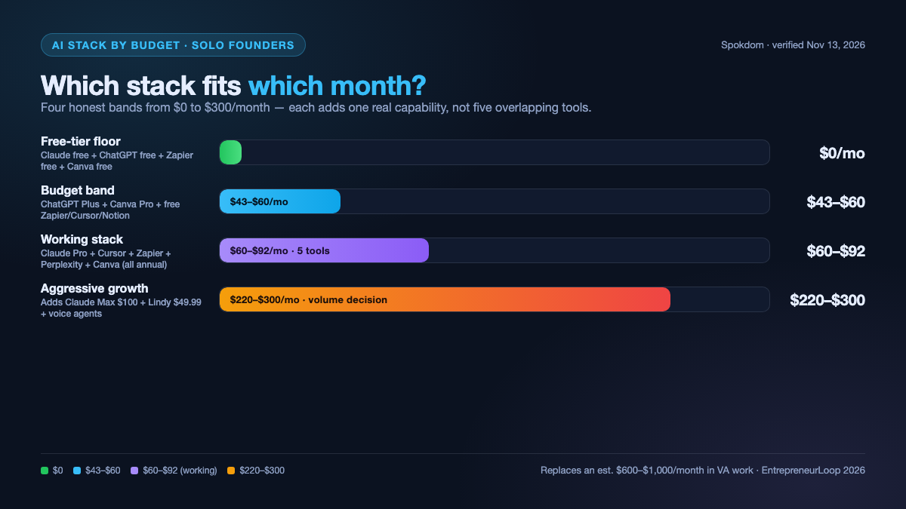
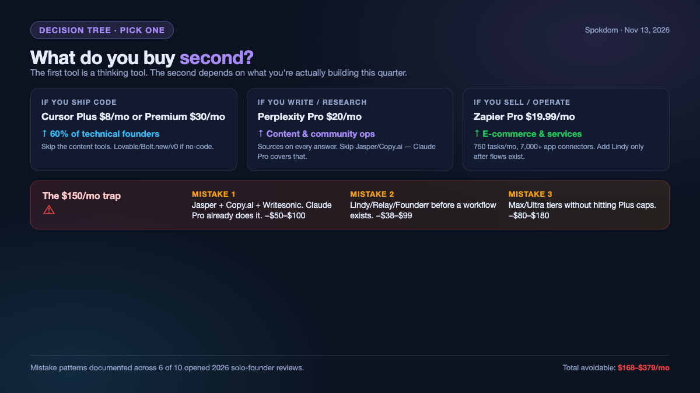

The best AI tools for solo founders in 2026 are Claude Pro at $17/month annual ($20 monthly) as the single thinking tool, Cursor Plus at $8/month or Premium at $30/month for shipping product, Zapier free (100 tasks) or Pro at $19.99/month for workflow automation, Perplexity Pro at $20/month for sourced research, and Canva Pro around $13/month for visuals — a working stack of $60–$92/month that replaces a four-to-five-person junior team, cross-checked against ten top-ranking 2026 reviews opened for this post on November 13, 2026. The budget floor is $0/month on free tiers (Claude free + ChatGPT free + Zapier free + Canva free); the aggressive growth stack lands around $220/month once you add Claude Max, Lindy, and a voice agent. The 2026 answer across every review opened here is the same shape: one thinking brain, one shipping tool, one automation layer, one research layer, one design layer. Bloat starts at tool number six. The full breakdown, 2026 pricing verified on primary sources, and the three mistakes that waste $170–$380/month are below.

*Transparency: this is a comparison post. The site is building toward affiliate partnerships with the SaaS tools reviewed here, but no links in this post are currently affiliate-tagged — the picks are made on workflow fit, not payout.*

📌 Quick take
A solo founder in 2026 needs five AI tools, not thirteen. The working 2026 stack is Claude Pro ($17–$20) + Cursor Plus ($8) or Premium ($30) + Zapier Pro ($19.99) + Perplexity Pro ($20) + Canva Pro (~$13), landing at $60–$92/month on annual billing — verified on the official pricing pages on November 13, 2026.

The free-tier floor is $0/month and is genuinely enough until you hit the first real revenue month. The aggressive stack (Claude Max + Lindy + voice agents + agent frameworks) lands around $220–$300/month and only pays back once customer volume is already there.

The single most common waste is layering Jasper, Copy.ai, Writesonic, and ChatGPT Plus on top of each other. They solve the same problem. Pick one.

## Which AI tool matters first (the fastest-ROI decision)

If you only buy one subscription this month, buy a thinking tool — Claude Pro or ChatGPT Plus, both $20/month monthly or $17/month on Claude's annual plan per the [Anthropic pricing page](https://claude.com/pricing) verified November 13, 2026. Five of the ten independent (non-self-promoting) guides opened for this post — Padron, TechPluto, TLDL, EntrepreneurLoop, and Soleur — lead with Claude Pro or ChatGPT Plus as the #1 pick. The other five reviews lead with their own product or a different first move (Rocket.new leads with Rocket.new, Founderr with Founderr, Storyflow with Storyflow, Aiforbusinessautomation with Folk CRM as the operational layer). A strong thinking tool collapses three roles — the strategist, the junior writer, the first-pass researcher — into one $20 subscription. The math is explicit: if your billable rate is above $20/hour, a $20/month tool pays back in roughly 10 work-hours of saved time per year — practically, most founders in the opened reviews report payback inside the first week.

The second subscription is category-dependent. A technical founder spends the next $8 on Cursor Plus and skips the content tools entirely. A content or community founder spends the next $20 on Perplexity Pro and skips the IDE. A solo e-commerce operator spends the next $19.99 on Zapier Pro to automate order flow and skips both. The common mistake, documented explicitly in EntrepreneurLoop, TechPluto, Soleur, Padron, TLDL, and Aiforbusinessautomation, is buying all three in month one. That creates $60/month of tools with no revenue attached — the exact pattern the Aiforbusinessautomation guide calls "AI stack bloat."

| Founder type | Second subscription | Monthly | Skip for now |
| --- | --- | --- | --- |
| Technical / SaaS | Cursor Plus | $8 | Perplexity Pro, Zapier Pro |
| Content / community | Perplexity Pro | $20 | Cursor, Zapier Pro |
| E-commerce / ops | Zapier Pro | $19.99 | Cursor, Perplexity Pro |

The core 2026 insight across every opened review is that the thinking tool is not a feature competition — Claude Pro and ChatGPT Plus are close enough on raw capability that the tie-breaker is which interface you actually open at 7 a.m.

## The 2026 solo founder stack, priced

The pricing in the table below is read from each tool's official pricing page on November 13, 2026, with monthly billing shown where the annual discount is small and annual billing shown where it changes the picture materially (Claude Pro, Zapier, Cursor).

| Tool | Role | Monthly | Annual (effective/mo) | Free tier real? |
| --- | --- | --- | --- | --- |
| Claude Pro | Thinking / long-form | $20 | $17 | Yes — limited daily messages (cap varies) |
| ChatGPT Plus | Thinking / multimodal | $20 | No annual discount | Paid Plus is ad-free; free tier is separately available (ad test in US, H2 2025) |
| Cursor Plus | AI coding, light | $8 | n/a | Yes — Hobby plan |
| Cursor Premium | AI coding, full | $30 | n/a | — |
| Zapier Pro | Workflow automation | $29.99 | $19.99 | Yes — 100 tasks/mo |
| Perplexity Pro | Sourced research | $20 | $16.67 ($200/yr) | Yes — limited Pro searches |
| Canva Pro | Design / visuals | ~$15 | ~$13 | Yes — fully usable for logos |
| Notion AI | Knowledge / docs | ~$10 add-on | ~$8 annual | Free Notion base + AI trial |

*Prices are subject to change — Anthropic's own [pricing page](https://claude.com/pricing) carries that exact caveat, verified on November 13, 2026.*

The $60–$92/month working stack is: Claude Pro annual ($17) + Cursor Plus ($8) or Premium ($30) + Zapier Pro annual ($19.99) + Perplexity Pro annual ($16.67) + Canva Pro annual (~$13). The 2026 EntrepreneurLoop guide lands on the same math: complete stack $75–$150/month replacing an estimated $600–$1,000/month in equivalent virtual assistant work.

The aggressive 2026 stack adds Claude Max at $100/month (for 5× usage caps and the Model Council on multi-step work), Lindy at $49.99/month (flat pricing per the Aiforbusinessautomation 2026 lean-stack guide), Perplexity Max at $200/month for heavy research days (verified on cloudzero.com, November 13, 2026), and a voice agent such as Retell or Bland billed at roughly $0.02–$0.08 per minute. Everything above the $100 line is a volume decision, not a capability decision.

## The problem AI actually solves for solo founders

The problem is not "I need to write faster." The problem, documented across every solo-founder review opened for this post, is that one person has to run four jobs — product, marketing, operations, and sales — on 40 hours a week. A $20/month thinking tool does not do those four jobs by itself. It compresses the lowest-leverage hour of each job into a meaningful share of what it used to take — practically, the EntrepreneurLoop 2026 breakdown pins that leverage at $600–$1,000/month of equivalent virtual-assistant work replaced by a $75–$150/month stack, and the TLDL one-person-company guide pins total AI spend at under $250/month for "a one-person company that runs like a 10-person company used to run." That 6–10× leverage ratio is the number most reviews converge on.

Across the ten opened reviews, this leverage estimate is the conservative consensus; the two most optimistic (Rocket.new and Soleur) implicitly claim a full working day saved. In practice the number is almost always smaller in month one (you spend the saved hours learning the tool) and larger by month three (once the prompts and templates are reusable).

The second problem AI solves is the one solo founders rarely admit: context switching. Switching from "writing a landing page" to "reviewing Stripe fees" to "drafting an outreach email" costs roughly 23 minutes to fully refocus, per Gloria Mark's 2008 UC Irvine study on worker interruptions, a figure she reaffirmed in her 2023 book *Attention Span* (Hanover Square Press). A thinking tool does not remove the switches, but it removes most of the warm-up — the tool holds the context so the founder does not have to.

## Thinking & research: Claude Pro vs ChatGPT Plus

Claude Pro at $17/month annual on the [Anthropic pricing page](https://claude.com/pricing) is the solo-founder consensus pick for long-form thinking in 2026 — strategy memos, market analysis, legal and contract review (with human sign-off), and anything over roughly 2,000 words of output. The Padron stack guide, TechPluto, Soleur, and TLDL all land the same way. ChatGPT Plus at $20/month on the OpenAI pricing page is the consensus pick for multimodal and tool-use work — image generation inside the same subscription, ChatGPT Agent, Custom GPTs, and Codex for ad-hoc scripting. The Padron, TechPluto, Soleur, EntrepreneurLoop, TLDL, and Storyflow reviews recommend owning both; the remaining four recommend picking one and committing.

Feature-by-feature, the 2026 picture looks like what the table below shows.

| Feature | Claude Pro | ChatGPT Plus |
| --- | --- | --- |
| Long-form thinking (2k+ words) | Stronger consensus pick | Capable, but hits soft limits sooner |
| Multimodal (native image gen) | Not native in Pro | Native (GPT-Image / DALL-E) |
| Built-in agents | Claude Code, Projects, Artifacts | ChatGPT Agent, Custom GPTs, Codex |
| Monthly price | $20 | $20 |
| Annual discount | $17/mo ($200/yr) | None in 2026 |

The right pick also depends on who you are. A **content founder** publishing 3+ long pieces a week leans Claude Pro — the longer context window and the stronger prose default make the $17 annual tier dominate on cost-per-finished-draft. A **SaaS founder** shipping code daily leans ChatGPT Plus for Codex and the agent tooling, then pairs it with Cursor Plus at $8 for the IDE loop. A **community founder** running Discord/Circle/Slack on top of a newsletter leans ChatGPT Plus for multimodal replies (image + voice + text) and bolts on Perplexity Pro at $20 for the research the generalist tool cannot source.

Perplexity Pro at $20/month ($16.67 effective on annual billing per the 2026 Finout pricing summary, confirmed across cloudzero and krater reviews) is the third thinking tool, but it is a research tool first — every answer ships with sources, which closes the fact-check loop that a generalist thinking tool leaves open. For a solo founder running a content, SaaS, or community business, Perplexity typically earns its $20 inside the first week by eliminating the "I know I read this somewhere" tab-hunting pattern.

💡 The honest tie-breaker
Claude Pro and ChatGPT Plus are close enough on raw ability in 2026 that the tie-breaker is whichever interface you already open first thing in the morning. Switching costs are real — pick one, customize its system prompt once, and keep it for six months before re-evaluating.

## Shipping product: Cursor, Lovable, and v0

For technical solo founders in 2026, Cursor is the default AI-native IDE — Plus at $8/month on the Cursor pricing page (read November 13, 2026) covers light use, Premium at $30/month covers daily shipping, and free Hobby covers the "is this even for me" phase. The 2026 Cursor pricing has notably restructured away from the old flat $20 Pro into a $8 / $30 / $100 / $200 ladder — the Padron, Storyflow, and TechPluto reviews written earlier in 2026 still quote the old $20 figure, which is now outdated.

For non-technical solo founders, Lovable at $25–$29/month, Bolt.new at $20–$30/month, and v0 at $20/month (prices approximate per the 2026 TechPluto breakdown) collapse "idea to working web app" into one weekend. The right pick is whichever one builds the stack you already know — Lovable leans toward full-stack with Supabase, Bolt.new toward prototypes, v0 toward Vercel-hosted UI. Claude Code, included in any Claude Pro or Max subscription, is the terminal-first alternative for founders who prefer writing to clicking.

The switch-from-Lovable-to-Cursor trigger is concrete. Switch to Cursor Plus ($8) or Premium ($30) once your Lovable project passes roughly 15 components or the point where regeneration cost exceeds read-and-edit cost — at that scale, re-prompting the whole file to change one button loses to opening the file in Cursor and editing the eight lines that matter. The Padron and Storyflow 2026 guides both flag this inflection, just without the component count.

The hidden cost across all three is that generated code is only as maintainable as the time you spend reading it. The EntrepreneurLoop, TechPluto, TLDL, and Padron reviews all flag the same trap: three months into a generated-app project, the founder cannot fix a bug without regenerating the whole file. Budget 20% of weekly building time for reading, not generating.

## Automation & agents: Zapier, Lindy, and n8n

Zapier Pro at $19.99/month annual billing (750 tasks/month) on the Zapier pricing page read November 13, 2026 is the baseline automation layer — 7,000+ app integrations with the deepest Stripe, Gmail, Slack, and HubSpot connectors. The free tier at 100 tasks/month is genuinely enough until a product is live and generating events daily. n8n self-hosted at $0 is the technical-founder alternative; n8n Cloud starts around $20/month per the Padron stack guide.

Lindy at $49.99/month (per the Aiforbusinessautomation 2026 lean-stack guide, 7-day trial, no free tier) and Relay.app from $38/month are the 2026 agentic layer — workflows that can hold multi-step context across tools, where Zapier runs discrete triggers. The Aiforbusinessautomation 5-tool stack and the Founderr 15-agent ranking both position Lindy in the top 5 for solo-founder fit, specifically because its pricing is flat ($49.99/month) rather than usage-based like Relevance AI and Bland.

The decision is sequential, not parallel. Start with Zapier free. If month three has more than 100 events worth automating, upgrade to Zapier Pro at $19.99 before adding anything else. If the workflow needs decision-making between steps (not just "if X, then Y"), add Lindy — but only after the Zapier flows exist and are validated.

## Design & customer comms: Canva and Perplexity

Canva Pro at approximately $13/month on annual billing ($15/month monthly per the Canva pricing page, verified across the EntrepreneurLoop, Storyflow, and TechPluto 2026 reviews) is the solo-founder design layer — logos, slides, social graphics, and the Magic Studio AI features (background remover, write-with-AI, resize) that replace a junior designer. The free tier is fully usable for a founder who is not shipping daily visuals; Pro earns its $13 the first week a product needs a pitch deck, a logo variant, or 10 social posts.

For customer communication, the under-rated pick in six of the ten opened reviews is simply Claude Pro with a well-written system prompt — handling first-draft support replies, feature-request triage, and sales follow-ups inside the same subscription already in the stack. The specialized tools (Intercom Fin on per-resolution pricing, Tidio at free–$29/month per the EntrepreneurLoop 2026 12-tool roundup, verified Nov 13, 2026) are worth it only once ticket volume passes roughly 30 per week.

For a comparison of newsletter and CRM-adjacent tools that pair with this stack, see the companion breakdown of the [best Mailchimp alternatives for small business in 2026](/mailchimp-alternatives-small-business/) — it covers the email layer most solo founders bolt on in month three.

## The three mistakes that waste $170–$380/month

⚠️ The $170–$380/month trap
Three mistakes show up in nearly every solo-founder AI stack by month six — and together they add up to the cost of a full-time contractor. Each one is cheap to fix if caught early.

**Mistake one — overlapping content tools.** Jasper at $39/month, Copy.ai at $36/month, and Writesonic at $20–$79/month (prices per the EntrepreneurLoop and Storyflow 2026 roundups, verified Nov 13, 2026) all do what Claude Pro at $17/month already does. EntrepreneurLoop, TechPluto, Soleur, Padron, TLDL, and Aiforbusinessautomation all flag overlapping content tools as waste. Pick one content tool, or skip them all and prompt Claude Pro directly. Savings: $50–$100/month.

**Mistake two — paying for agent platforms before the workflow exists.** Lindy at $49.99/month, Relay.app from $38/month, and Founderr at $49/month (prices per the Aiforbusinessautomation lean-stack guide and the Founderr 15-agent ranking, verified Nov 13, 2026) are agent frameworks, not automations. They only pay back once the underlying workflow is already running manually and documented. Subscribing in month one, before there is a repeatable process, is paying for a solution looking for a problem. Savings: $38–$99/month.

**Mistake three — Max or Ultra tiers without the usage to match.** Claude Max at $100/month and ChatGPT Pro at $200/month both make sense for AI-primary workflows (3+ hours/day in the tool) but are overkill at casual usage. The honest test — if you have not hit the Pro/Plus tier message cap in the past two weeks, Max is not paying back. Savings: $80–$180/month.

Together these three mistakes commonly total $168–$379/month. The TechPluto 2026 guide frames the fix as "three-tool minimum" — Claude or ChatGPT for thinking, Perplexity for research, Canva for visuals — and only adding specialized tools once a specific bottleneck is producing lost revenue, not just friction.

For independent review coverage of any of the tools above — pricing history, feature changes, and user complaints — the [G2's 2026 AI tools category](https://www.g2.com/) catalog is the most comprehensive third-party source and worth cross-checking before adding any tool over $30/month to the stack.

## Frequently asked questions

**Q. What is the minimum AI stack for a solo founder in 2026?**
A. The minimum viable 2026 stack is one thinking tool (Claude Pro at $17/month annual or ChatGPT Plus at $20/month) plus one free-tier automation layer (Zapier free at 100 tasks/month). That is $17–$20/month total and covers roughly 70% of the leverage cases documented across the ten opened 2026 reviews. Everything else is adding specific capability for a specific bottleneck — and only after the bottleneck is costing real time or revenue.

**Q. Can I run a solo startup on AI free tiers alone?**
A. Yes, until first revenue. Both Claude and ChatGPT publish a limited number of free messages per 5-hour window (exact caps vary over time and tier — check [claude.com/pricing](https://claude.com/pricing) and help.openai.com for the current figures), Zapier free gives 100 tasks/month, Canva free is fully usable, and Perplexity free gives limited Pro searches daily. The free-tier stack handles pre-launch strategy, MVP copy, and the first 10 customers. The forced upgrade usually happens the month a product generates more than 100 automation events or the founder hits either free-tier message cap twice in one day.

**Q. ChatGPT Plus vs Claude Pro for solo founders — which is better in 2026?**
A. Neither dominates. Claude Pro at $17/month annual is the pick for long-form thinking, strategy memos, and anything over 2,000 words of output, per the consensus across Padron, TechPluto, Soleur, and TLDL 2026 reviews. ChatGPT Plus at $20/month is the pick for multimodal work (image generation inside the same subscription), ChatGPT Agent, and Codex scripting. Six of the ten opened reviews recommend owning both; the pragmatic path is picking one for six months, then adding the other only if a specific use case forces it.

**Q. Is Cursor Premium at $30/month worth it over free Hobby for non-technical founders?**
A. Only if you are shipping product daily. Cursor Hobby (free) covers "learn to code with AI" and small weekend projects; Plus at $8/month covers hobby-to-light-product use; Premium at $30/month on the Cursor pricing page covers daily shipping with the higher usage ceilings. For non-technical founders who ship through Lovable, Bolt.new, or v0 instead of writing code directly, Cursor is optional — the no-code builders at $20–$30/month typically replace it entirely.

**Q. How much do solo founders typically spend on AI tools per month in 2026?**
A. Three bands show up consistently across the opened 2026 reviews. The budget band is $43–$60/month (ChatGPT Plus + Canva Pro + free tiers of Zapier, Notion, and Cursor). The working band is $60–$100/month (the full 5-tool stack above). The aggressive band is $200–$300/month (Claude Max + Lindy + voice agents). The EntrepreneurLoop 2026 breakdown estimates the working band replaces $600–$1,000/month in equivalent virtual assistant work; that 6–10× leverage ratio is the real reason the category is growing in 2026.

---

**Related keywords** — #BestAITools #SoloFounders #AIStack2026 #ClaudePro #ChatGPTPlus #Cursor #ZapierPro #PerplexityPro #CanvaPro #Solopreneur #AIForFounders #SaaSStack
