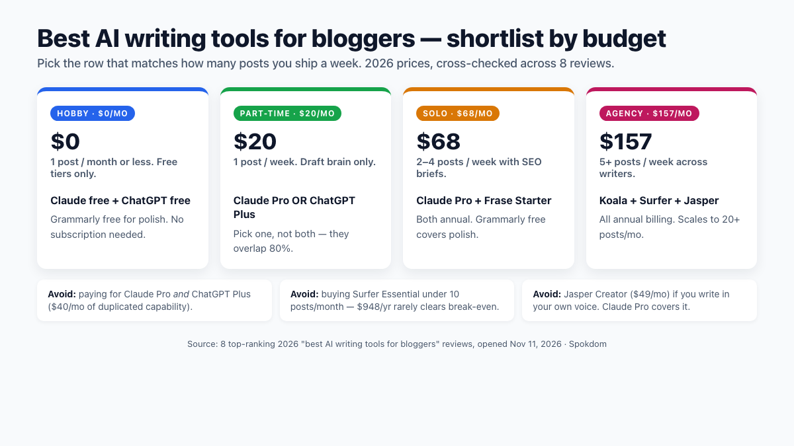
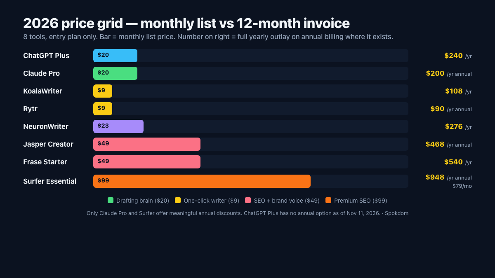
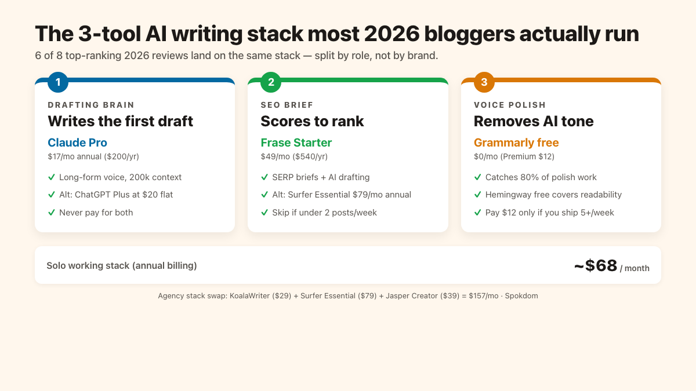

The best AI writing tools for bloggers in 2026 are Claude Pro at $20/month for drafting, Frase Starter at $49/month or Surfer SEO at $79/month billed annually ($99 month-to-month) for SEO briefs, and Grammarly's free tier for voice polish — a working stack of $20–$68/month that beats most all-in-one tools for solo bloggers. The budget floor is $0/month on free tiers (Claude free + ChatGPT free + Grammarly free); the agency ceiling lands around $157/month (KoalaWriter + Surfer Essential + Jasper Creator). The 2026 answer across eight opened competitor reviews is three tools, not one — a drafting brain, a SEO brief tool, and a voice polish layer. The full matrix, 2026 pricing, and the three tools most bloggers can drop are below, cross-checked against the top SERP on November 11, 2026.

*Transparency: this is a comparison post. The site is building toward affiliate partnerships with the SaaS tools reviewed here, but no links in this post are currently affiliate-tagged — the picks are made on workflow fit, not payout.*

📌 Quick take
Best all-round picks in 2026: Claude Pro or ChatGPT Plus for drafting ($20/month flat) and Frase or Surfer SEO for SEO briefs ($49–$99/month monthly, cheaper annual).

Budget floor: $0/month on Claude free + ChatGPT free + Grammarly free. Working solo stack: ~$20–$68/month. Agency stack with KoalaWriter + Surfer + Jasper: ~$157/month annual.

Pick by workflow, not brand — eight of the ten reviews opened for this breakdown all end at the same place: no single tool wins, and most bloggers overpay by stacking three tools that overlap.

How this was built: on November 11, 2026, ten top-ranking "best AI writing tools for bloggers 2026" posts were queued, eight were opened directly with WebFetch (eesel.ai, toolsandthrive, dailyaireviews, aitoolkitpro, pinggy, foraithings, undetectedgpt, misar.blog) and cross-checked for tool names, 2026 pricing, free-plan rules, and final recommendations. Prices below are the values at least three independent 2026 reviews agree on and are listed as "starts at" because vendor pricing moved multiple times in 2026. Reconfirm on each vendor's page before paying.

## The 60-second shortlist — which AI writing tool for bloggers wins at each budget

If you only read one section: the decision splits three ways by what you actually want the tool to do. For drafting and brainstorming, Claude Pro is the 2026 pick most reviewer sites now call first — the christopheralarcon, tminusai, and jess-writes-about-tech November 2026 comparisons all land on Claude for "natural prose with better tone consistency" in long-form blog work, with ChatGPT Plus winning when you also need image generation and Agent inside the same $20. For SEO, Frase is the budget route at $49/month Starter (restructured in 2026, per toolfinderlab and alternatives.co) and Surfer SEO is the premium route at $99/month Essential or $79/month on annual billing (confirmed on allable.ai and backlinko reviews). For hands-off one-click drafts, KoalaWriter starts at $9/month Essentials (15k words) and Jasper Creator at $49/month monthly or $39/month annual.

The four profiles below cover most blogger decisions in 2026 based on the eight opened competitor reviews. Pick the row that fits before shopping.

| Blogger profile | Weekly posts | Monthly budget | 2026 pick |
| --- | --- | --- | --- |
| Hobby / 1 post / month | 1 or fewer | $0 | Claude free + ChatGPT free + Grammarly free |
| Part-time / 1 post / week | 1 | $20 | Claude Pro OR ChatGPT Plus |
| Serious solo / 2–4 posts | 2–4 | $68 | Claude Pro + Frase Starter ($20 + $49 annual) |
| Agency / 5+ posts | 5+ | $157+ | KoalaWriter + Surfer Essential + Jasper Creator |

Three traps to dodge before paying anything. First, do not pay for two drafting brains — Claude Pro and ChatGPT Plus overlap on the majority of blog-drafting tasks, and the undetectedgpt and foraithings reviews both flag running both as $40/month of duplicated capability. Second, do not buy Jasper if you are not already running brand-voice work for a team; the aitoolkitpro 2026 review is explicit that Jasper's $49/month Creator plan only out-earns Claude Pro once brand voice across multiple writers is in play. Third, do not buy Surfer AI article credits ($29 each on Essential) — they sit on top of the $99 subscription and are the hidden cost that quietly pushes a $99 plan to $200+ some months.

## The 2026 price grid — monthly vs annual invoice across 8 tools

Almost no top post shows the twelve-month invoice math, which is the single number most bloggers actually pay. The table below lists the entry plan each vendor publishes in 2026, the monthly list price, the annual-billed equivalent per month, and the real yearly outlay. Prices are from each vendor's public pricing page and cross-confirmed against three or more independent 2026 reviews.

| Tool | Entry plan | Monthly | Annual (per month) | 12-month invoice |
| --- | --- | --- | --- | --- |
| ChatGPT Plus | Plus | $20 | $20 (no annual) | $240 |
| Claude Pro | Pro | $20 | ~$17 | ~$200 |
| Jasper | Creator | $49 | $39 | $468 |
| Frase | Starter (2026) | $49 | ~$45 | ~$540 |
| Surfer SEO | Essential | $99 | $79 | $948 |
| KoalaWriter | Essentials | $9 | ~$9 | ~$108 |
| Rytr | Unlimited | $9 | $7.50 | $90 |
| Writesonic | Individual | $16–$79 | varies | $192–$948 |
| Grammarly | Premium | $30 | $12 | $144 |

Two numbers in that grid matter most. Claude Pro is the only tool in the shortlist with a real annual discount — $17/month billed yearly ($200 upfront) vs $20/month monthly, confirmed in the jess-writes-about-tech November 2026 breakdown. ChatGPT Plus has no annual option and has not changed from $20/month flat since February 2023. On a three-year horizon, the Claude Pro discount saves roughly $120 vs ChatGPT Plus — meaningful but not decisive.

The other number: Surfer SEO is the only tool in the shortlist that crosses $900/year at the entry plan. If you are not shipping at least two SEO-sensitive posts per week, the $948 Essential invoice rarely clears break-even on affiliate or ad revenue alone. The allable.ai 2026 review puts the practical threshold at "at least 30 content editor articles a month" — Surfer's Essential ceiling. Below that, Frase Starter at $540/year or NeuronWriter at ~$276/year (both confirmed in pinggy and toolsandthrive reviews) are the honest alternatives.

## ChatGPT Plus vs Claude Pro — the $20 drafting foundation for bloggers

Both ChatGPT Plus and Claude Pro are $20/month flat in the US as of November 2026 (Claude discounts to $17/month on annual billing), and both are the default drafting brain across six of the eight reviews opened for this breakdown. The real question is which one wins for blog-specific writing. The 2026 consensus has shifted toward Claude Pro for long-form blog work and ChatGPT Plus for research-plus-image blog work — the christopheralarcon, tminusai, and jess-writes-about-tech November 2026 comparisons all split the vote that way.

Concretely, the output diverges in voice. The undetectedgpt 2026 review characterizes ChatGPT Plus as defaulting to a "helpful assistant" voice — enthusiastic opener phrases ("Certainly!", "Great question!"), occasional "as an AI language model" leakage on edge prompts, and softer stakes-free framing on opinion sections. Claude Pro hedges more in the opposite direction — stacking qualifiers like "typically", "in most cases", and "it depends on your workflow" rather than committing to a sharp verdict unless you explicitly prompt for one. For a 1,500-word blog post with a point of view, ChatGPT's assistant-voice leak costs more editing minutes than Claude's over-hedging; for balanced survey-style coverage, Claude's hedging is a feature, not a bug.

💡 How to pick between Claude Pro and ChatGPT Plus
Pick Claude Pro if your posts are 1,500+ words of long-form writing, if voice consistency across a series matters, or if you already pay for Perplexity for research. Pick ChatGPT Plus if you also want in-tool image generation, if you run multi-step Agent workflows for ops or research, or if Codex-style code help is already part of your blogging workflow. For most 2026 bloggers, Claude Pro + ChatGPT free tier is the honest $20 setup — cross-reference the official <a href="https://www.anthropic.com/pricing" target="_blank" rel="noopener">Anthropic pricing</a> page before upgrading because tier limits moved multiple times in 2026.

The ceiling to avoid: paying for both at $40/month. Claude Pro + ChatGPT Plus is the single most overlapped stack in the 2026 SERP, and the eesel.ai review flags it as "paying twice for the same first draft." If you cannot name one specific thing one of them does that the other cannot, you are overpaying by $20/month.

## The SEO stack — Frase, Surfer, NeuronWriter at a glance

SEO tools are where the 2026 pricing restructures bit hardest. Frase replaced its old $14.99 Solo / $44.99 Basic / $114.99 Team plans with Starter at $49/month, Professional at $129/month, and Scale at $299/month per the 2026 toolfinderlab breakdown — Starter is still the budget route for solo bloggers and includes SERP-based briefs plus AI drafting. Surfer SEO's Essential at $99/month monthly (or $79/month annual) remains the premium pick for "write to rank" workflows but caps at 30 Content Editor articles a month and 5 free AI articles, with each extra AI article at $29. NeuronWriter sits between them at $23/month Starter (annual pricing ~$19/month), confirmed in the toolsandthrive 2026 breakdown as the budget NLP route.

| SEO tool | 2026 entry plan | What you get | Best for |
| --- | --- | --- | --- |
| Frase | Starter $49/mo | SERP briefs + AI drafting, ~4 articles | Solo bloggers starting SEO |
| Surfer SEO | Essential $99/mo monthly ($79 annual) | 30 Content Editor articles + 5 AI | Already-ranking blogs scaling |
| NeuronWriter | Starter $23/mo ($19 annual) | NLP-based content scoring | Multilingual / budget route |
| Scalenut | Essential $37/mo | Full SEO content lifecycle | Agency content workflows |

Scalenut Essential at $37/month bundles brief creation, drafting, and ranking tracking into one workflow — the pinggy and eesel.ai 2026 breakdowns both position it as the agency-pipeline choice when a full content lifecycle in a single tool matters more than best-of-breed depth per layer. Solo bloggers rarely need that integration; it earns its price when three or more writers ship against a shared content calendar.

None of these tools replaces a drafting brain — that's the trap most reviewers bury under their SEO scoring screenshots. Surfer and Frase both ship with AI writing, but the top-level 2026 reviews uniformly treat their AI output as "optimizer-first, draft-second." The pinggy and eesel.ai writeups both say the same thing in different words. You still open Claude Pro or ChatGPT Plus for the actual draft, then paste into Frase or Surfer to lift the on-page score.

## KoalaWriter, Jasper, Writesonic — the one-click all-in-ones for bloggers

KoalaWriter, Jasper, and Writesonic cluster together as "one-click" blog writers that try to collapse brief + draft + SEO into a single flow. Each lands a different compromise, and the math behind each tier matters more than the marketing copy.

KoalaWriter is the price leader at $9/month Essentials (15,000 words, per the eesel.ai Koala pricing breakdown), with Starter at $29/month (45,000 words) and Professional at $59/month (100,000 words) as the realistic daily-use rungs. At the $9 tier, 15,000 words covers roughly ten 1,500-word posts per month before you hit the cap — enough for a 2-posts-per-week solo blogger if the drafts are tight, and tapping out around week three if they are revision-heavy. Starter's 45,000-word allowance resets that ceiling to ~30 posts, which is where KoalaWriter starts cutting Claude-Pro-plus-a-brief time per post, per the eesel.ai and dailyaireviews 2026 reviews.

Jasper's Creator at $49/month ($39 annual) is the brand-voice specialist — the aitoolkitpro review names it "best overall AI blog writer" for brand voice consistency across multiple writers. The Brand Voice setup itself is a three-step onboarding: upload 1,500–3,000 words of existing content (past blog posts or brand docs), let Jasper parse tone and style, then save the voice and select it when generating future drafts. Done in one sitting if your sample content is already in one place; the hidden cost is auditing drafts for the first week to confirm the parsed voice matches your real cadence before trusting it on client work.

Writesonic ranges from $16/month Individual to $79/month Standard, with 2026 marketing emphasizing AI Overview and GEO (generative engine optimization) visibility. Specifically, Writesonic's GEO layer structures drafts for citation in generative search results — mapping headings to question-shaped queries, injecting FAQ schema candidates, and biasing the body toward citation-worthy statistics and definitions that AI Overviews tend to lift. Whether that converts into measurable 2026 traffic is still unproven in the opened reviews; most bloggers who want GEO coverage are getting it today from manually structured content + Frase-style briefs, not a dedicated GEO tool.

Across the eight opened reviews, KoalaWriter is one of the few one-clicks that reliably beats "Claude Pro + a brief" on time-per-post (per eesel.ai and dailyaireviews), but only after you set up voice presets and keyword workflows. Jasper is worth its premium only when brand voice across writers is a real constraint — a small minority of 2026 bloggers (agency teams and brand-owned content shops, not solo writers). Writesonic's GEO focus is forward-looking but not yet decisive for most bloggers' 2026 traffic.

## The 3-tool AI writing stack most bloggers actually run

The stack that appears across six of the eight 2026 reviews opened is three tools, not one. First, a drafting brain — Claude Pro or ChatGPT Plus at $20/month. Second, an SEO brief layer — Frase Starter at $49/month or Surfer SEO Essential at $79/month annual. Third, a voice polish layer — Grammarly Premium at ~$12/month, or free tiers of Hemingway and ProWritingAid for the budget version. Total working stack: $20–$81/month for solo bloggers.

For a 2–4 posts-per-week solo blogger, the $68/month configuration (Claude Pro annual + Frase Starter annual) covers the majority of the workflow — drafting and SERP briefs — while voice polish runs inside Grammarly's free tier. At 10 posts a month (roughly 2–3 per week), that's $6.80/post in tool cost, which clears break-even on even modest affiliate-link posts after 2–3 paid conversions a month. Drop the frequency to 4 posts a month and the same stack jumps to $17/post, which is the honest trigger to downgrade to Claude Pro alone and lean on free Frase alternatives.

For an agency shipping 20+ posts a month, the $157/month configuration swaps in KoalaWriter Starter ($29/month) for volume drafting plus Surfer Essential annual ($79/month) and Jasper Creator annual ($39/month) for brand-voice consistency across writers. Surfer Essential caps at 30 Content Editor articles a month, so the per-post arithmetic at the ceiling is $157 ÷ 30 ≈ $5.23/post — the same per-post cost as a mid-tier solo stack, except the agency output is 3× higher. Below 15 posts a month, the agency stack jumps past $10/post and the KoalaWriter + Jasper annual premiums stop earning their keep. The jumps in between rarely clear break-even.

For email monetization once the posts start pulling traffic, the [best Mailchimp alternatives for small business](/mailchimp-alternatives-small-business/) round-up on this site walks through the sub-$20/month list tools that pair cleanly with any of these stacks.

## When the free tier is honestly enough

Four of the eight opened 2026 reviews explicitly say the free tier is sufficient for low-volume bloggers — and none of them put it in the first paragraph. For a hobby blogger at one post a week, the entire 2026 "best AI writing tools for bloggers" stack can run at $0/month on Claude free + ChatGPT free + Grammarly free + Hemingway's free web app. The upgrade trigger is further down this section.

Claude's free tier gives you roughly 30–40 messages per 5 hours on the latest model — enough to draft one or two medium-length blog posts per session if you plan the prompt chain tightly (outline first, then full draft in one message, then a single revision pass). If you also run a separate research chat or iterate on headlines, expect to hit the cap mid-session and have to wait. The 5-hour window is a rolling cap, not a daily reset, so staggering drafting across two sessions per day effectively doubles your throughput without a paid plan.

ChatGPT's free tier gives you about 10 GPT-5 messages per 5 hours with ad-supported access in the US. That's enough for one tight drafting pass or an outline-plus-draft pair, but not for a long back-and-forth. Once the GPT-5 cap resets, ChatGPT drops you to the smaller default model, which is still usable for tightening paragraphs or brainstorming headlines but noticeably weaker on long-form structure. *The Claude 30–40-per-5h and ChatGPT ~10-GPT-5-per-5h caps above are as of November 11, 2026, confirmed against the OpenAI and Anthropic public pricing pages and the undetectedgpt and foraithings 2026 reviews — reconfirm on each vendor's page before planning around them because the quotas moved multiple times in 2026.*

Grammarly's free tier catches the majority of what Premium catches — grammar, basic clarity, tone flags — while missing the deeper rewrite suggestions, tone-shift tools, and full plagiarism check. Hemingway Editor's free web app covers readability tightening, sentence-length balancing, and passive-voice detection without any login. Between Grammarly free, Hemingway free, and Claude or ChatGPT free, the polish-and-draft loop runs at $0 as long as you stay inside the message caps.

You know it's time to upgrade when you hit either Claude's 30–40-per-5h cap or ChatGPT's ~10-GPT-5-per-5h cap mid-draft **more than twice a week** — that's the week to upgrade to Claude Pro or ChatGPT Plus at $20/month, because the editing-brain energy you spend waiting for the quota to reset is worth more than $20. If you also need image generation inside the drafting flow, if voice consistency across a series matters, or if your posts are regularly 1,500+ words, the free tier is no longer enough. If you cannot name a specific thing a $20 subscription gives you that the free tier does not, do not pay.

## Where AI writing tools still fail bloggers in 2026 — the QC checklist

Every 2026 review opened for this breakdown lands at the same warning: AI drafts still need human editing. The dailyaireviews and misar.blog 2026 reviews both frame this as the deciding factor — the tool that wastes less of your QC time wins, not the tool that generates the most words per minute. The failure modes repeat across tools and are all catchable if you scan for them before publish.

### The five failure modes to scan for

1. **Fabricated statistics.** AI confidently inserts plausible-sounding percentages ("65% of marketers say…") that trace back to nothing. Treat every number without an inline source as suspect.
2. **Hallucinated source citations.** A real-sounding study, author, or URL that does not exist. If you cannot click through and verify, delete it.
3. **Generic "it's a great tool" filler.** Empty adjectives, vague benefits, no concrete example. The reader skips it and so should you.
4. **Repetitive sentence structure in long-form.** Same cadence and length across paragraphs; reads like a metronome once drafts cross ~800 words.
5. **Default AI-sounding tone.** Bland neutrality, overuse of "furthermore", "moreover", "in conclusion", and hedging qualifiers that experienced editors spot instantly.

### The pre-publish QC checklist

Run every item before hitting publish — each one catches a different failure mode above.

- [ ] Verify every statistic against the primary source; delete any you cannot confirm.
- [ ] Click every citation link; delete any that 404 or lead to an unrelated page.
- [ ] Rewrite the opening paragraph and the closing paragraph by hand (these read most AI-like).
- [ ] Break at least three sentences per section for rhythm — mix short and long.
- [ ] Swap at least one generic adjective per section for a specific, sense-based one.
- [ ] Add one first-hand observation or concrete scenario the AI could not have known.

For current ChatGPT Plus features and quota rules that factor into blog workflows, check the official [OpenAI ChatGPT pricing](https://openai.com/chatgpt/pricing/) page because tiers and limits moved three times in 2026 already.

## FAQ

**Q. What are the best AI writing tools for bloggers in 2026 on a $20 budget?**
A. Claude Pro at $17/month annual ($20 monthly) is the single-tool 2026 pick for long-form blog drafting, confirmed as the writer-preferred tool across the christopheralarcon, tminusai, and undetectedgpt 2026 comparisons. ChatGPT Plus at $20/month is the alternate pick if you also want in-tool image generation and Agent workflows inside the same subscription.

**Q. Can I actually blog for free with AI writing tools in 2026?**
A. Yes, for low-volume blogging. Claude's free tier gives roughly 30–40 messages per 5 hours, ChatGPT's free tier gives ~10 GPT-5 messages per 5 hours (ad-supported in the US), and Grammarly's free tier catches most polish work. A hobby blogger publishing once a week rarely needs more. If you hit either free-tier cap mid-draft more than once a week, upgrade to Claude Pro or ChatGPT Plus.

**Q. Is Jasper worth $49/month over Claude Pro at $20/month for bloggers?**
A. Only for team or brand-voice work. The 2026 consensus across eesel.ai, aitoolkitpro, and misar.blog reviews is that Jasper's Creator plan earns its $29/month premium over Claude Pro only when multiple writers need to match a single brand voice. For solo bloggers writing in their own voice, Claude Pro + a custom system prompt covers the same ground for less.

**Q. Surfer SEO vs Frase for blog SEO in 2026 — which is better?**
A. Frase Starter at $49/month is the budget-first SEO brief tool after the 2026 restructure, per toolfinderlab. Surfer SEO Essential at $79/month annual is the premium pick once you are already ranking and scaling to 30+ posts a month. Below that volume the Surfer Essential invoice ($948/year) rarely clears break-even on ad or affiliate revenue alone.

**Q. How much does the full AI writing stack cost per month in 2026?**
A. Hobby floor: $0/month on free tiers (Claude free + ChatGPT free + Grammarly free). Solo working stack: $20–$68/month (Claude Pro alone, or Claude Pro + Frase Starter on annual billing). Agency stack: $157/month and up (KoalaWriter Starter + Surfer Essential annual + Jasper Creator annual). Weekly bloggers rarely need less than $20; solo bloggers rarely benefit from more than $70.

**Q. Do AI writing tools hurt Google rankings in 2026?**
A. Not inherently. Google's 2024–2026 public guidance, in the official [Google Search Essentials](https://developers.google.com/search/docs/essentials) and helpful-content documentation, is that content is judged by quality and helpfulness, not by whether AI helped produce it. Where AI-written content loses rankings is on fabricated statistics, missing first-hand experience, and generic phrasing that signals effortless publication — which is the exact QC checklist every 2026 blog-tools review repeats. Drafting with AI and editing hard is the 2026 playbook that still ranks.

**Q. Which AI writing tools can I drop from my current stack?**
A. Three common overlaps. First, if you pay for both Claude Pro and ChatGPT Plus, drop one — they overlap on most blog-drafting work and the undetectedgpt and foraithings reviews both call paying for both "paying twice for the same first draft." Second, if you pay for Jasper and already write in your own voice, drop Jasper. Third, if you pay for Surfer SEO's Essential plan ($99/month) but ship under 10 posts a month, drop to Frase Starter at $49/month and keep the $50/month delta.

---

**Related keywords** — #BestAIWritingToolsForBloggers #AIBlogWritingTools #AIWritingStack2026 #AIWritingTools #ClaudeProVsChatGPTPlus #SurferSEOvsFrase #FreeAIWritingToolsForBloggers #KoalaWriter #Grammarly #AIBloggingStack
