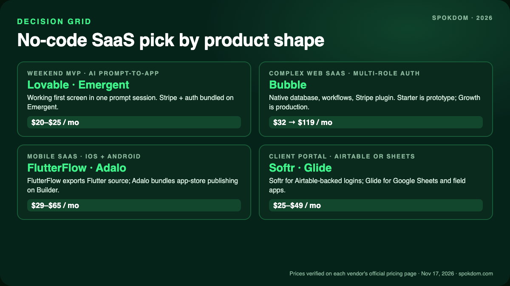
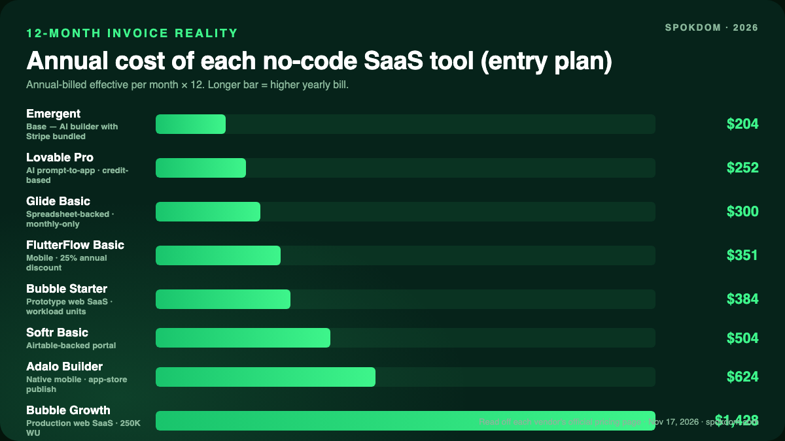

The best no-code tools to build a SaaS in 2026 are Bubble at $32/month Starter (annual) for complex web SaaS, Lovable at $25/month Pro for AI prompt-to-app MVPs, Softr at $49/month Basic for Airtable-backed client portals, FlutterFlow at $29/month annual ($39 monthly) for mobile SaaS, Glide at $25/month Basic for spreadsheet-backed internal tools, Adalo at $65/month Builder for native mobile SaaS publishing, and Emergent at $20/month for AI-generated apps that ship with Stripe and sign-in built in — a $20–$119/month decision that comes down to product shape, not brand, cross-checked against nine top-ranking 2026 reviews opened for this post. The core finding across every opened review is the same: there is no single "best overall" pick, and the Bubble Starter tier top posts quote is a prototype plan — real production SaaS lands on Growth at $119/month once workload units run out in the first busy week. The full matrix, 2026 pricing verified on each vendor's official page, and the three traps that waste $100–$400/month are below.

*Transparency: this is a comparison post. The site is building toward affiliate partnerships with the SaaS tools reviewed here, but no links in this post are currently affiliate-tagged — the picks are made on product-shape fit, not payout.*

📌 Quick take
No single no-code tool wins every SaaS. The 2026 shortlist, priced on each vendor's official page on November 17, 2026: Bubble ($32–$119/mo) for complex web SaaS, Lovable ($25/mo Pro) for AI MVPs, Softr ($49/mo Basic) for Airtable portals, FlutterFlow ($29/mo annual) for mobile, Glide ($25/mo Basic) for spreadsheets, Adalo ($65/mo Builder) for app-store publishing, Emergent ($20/mo) for Stripe-plus-auth bundled from day one.

The Bubble Starter price every top-10 post quotes is a prototype tier — production SaaS hits Growth at $119/month inside the first busy week when workload units run out. Budget around that, not around the $32 headline.

The real 60–70% wall is not the drag-and-drop; it is multi-tenant auth, payments, and data isolation. Pick for that, not the demo.

How this was built: on November 17, 2026, the top ten Google results for "best no code tools to build a saas" were queued, nine were opened directly with WebFetch (adalo.com, booknetic.com, hostinger.com, two emergent.sh pages, designrevision.com, groundworkblog.com, getcreatr.com, crevio.co) and two more adjacent 2026 comparisons (miniloop.ai and howwebdesign.com) were cross-read for pricing confirmation. Prices below are read directly off each vendor's public pricing page on the same day, cross-checked against two or more independent 2026 reviews, and listed as "starts at" because no-code pricing moved repeatedly in 2026.

## The 60-second shortlist — 7 no-code SaaS tools, matched to product shape

If you only read one section: the right tool is the one that matches what you are actually shipping. Web SaaS with multi-role auth and real logic goes to Bubble or Lovable. Mobile SaaS that needs iOS and Android app-store presence goes to FlutterFlow or Adalo. Spreadsheet-backed internal tools and client portals go to Glide or Softr. AI-generated MVPs with payments pre-wired go to Emergent or Lovable. Three of the opened 2026 reviews (getcreatr, groundworkblog, crevio) explicitly reject ranking by "best overall" and organize around product shape — that framing wins because it keeps founders from paying for a feature set their product never uses.

The four profiles below cover almost every founder decision in 2026 based on the nine opened competitor reviews. Pick the row that fits before shopping.

| Founder profile | Product shape | 2026 monthly budget | Top no-code pick |
| --- | --- | --- | --- |
| Validating an idea this weekend | AI-generated web MVP | $20–$25 | Lovable Pro or Emergent |
| Serious web SaaS, multi-role auth | Complex web SaaS | $32 → $119 | Bubble (Starter → Growth) |
| App-store mobile SaaS | iOS + Android native | $29–$65 | FlutterFlow or Adalo |
| Client portal on top of a sheet | Airtable / Google Sheets | $49 | Softr Basic |
| Booking / appointment SaaS | Booking workflows | custom | Booknetic SaaS |

Three traps to dodge before paying anything. First, do not pay for two drag-and-drop builders — Bubble and Adalo overlap on several core features, and adding Bubble Starter and Adalo Builder together comes to $97/month of duplicated capability. Second, do not jump to Softr Professional at $139/month before Basic's ceiling is actually hit — the Basic plan at $49/month already covers the overwhelming majority of client-portal use cases, and the jump to Professional only earns back once the record or user ceiling on Basic is breached. Third, do not pay Bubble Starter expecting production uptime on a launched app — once workload units exhaust, the app throttles, which pushes every real SaaS to Growth at $119/month no matter what the Starter sticker suggests.

## The 60-70% wall every no-code SaaS platform hits

The single most under-covered 2026 finding across the nine opened reviews is this: every no-code SaaS platform ships the first 60–70% of a product fast and stalls on the same last 30–40%. The getcreatr 2026 breakdown states this plainly — "multi-role auth, integration failure paths, data correctness, and security" remain unsolved, and the Emergent 2026 overview arrives at the same line a different way, pointing out that most tools build a first screen fast but diverge on "separate accounts, paid plans, permissions, reliable data, emails, refunds, and actions that run in the right order." That is the real wall. It is not the drag-and-drop. It is the multi-tenant backend.

In concrete terms, the first 60–70% that every no-code tool handles is: a landing page, a sign-up form, a database of records, a logged-in dashboard, and simple CRUD (create / read / update / delete) on those records. Where they split is the next 30–40% a real SaaS needs — tenant isolation (customer A never sees customer B's data even if the URL is edited), role-based permissions (admin vs editor vs viewer within one tenant), webhook retry logic (what happens when Stripe's event never arrives), pagination at 10,000+ records, transactional email flows, and refund or dunning handling. The crevio 2026 roundup calls this the gap where "paid plans, permissions, reliable data, emails, refunds" all show up at once. Pick a tool that at minimum handles the top three — multi-tenant auth, role-based permissions, and reliable payments.

💡 How to pressure-test the 60–70% wall before paying
Before you pick, sketch the ten screens a real customer uses in month one — not the demo. Can the tool build: (1) tenant signup and workspace creation, (2) inviting a teammate to your own workspace, (3) a role that can read but not edit, (4) a Stripe subscription flow with webhook, (5) a password-reset email, (6) a cancel-and-refund flow, (7) an admin screen that sees across tenants without leaking data, (8) pagination of 10,000 rows, (9) an export-to-CSV, (10) a soft-delete with restore window? If a tool cannot do more than six without a workaround, it will not survive your first paying cohort.

The honest implication: pick tools that make the hard 30–40% less painful, even at the cost of a steeper learning curve on the easy 60–70%. Bubble and FlutterFlow both do more of the hard work natively; Softr, Glide, and the AI builders leave more of it to you.

## Bubble vs Lovable — the web SaaS decision at $25–$119/month

Bubble is the 2026 consensus pick for serious no-code web SaaS. The pricing restructured in 2026 per the official [Bubble pricing page](https://bubble.io/pricing) read November 17, 2026: Free (50K workload units, no custom domain), Starter at $32/month annual (175K workload units, custom domain, 1,000 AI credits), Growth at $119/month annual (250K workload units, 2 editors, premium version control), and Team at $349/month annual (500K workload units, 5 editors, 25 custom branches). Annual billing discounts up to roughly 20%. The feature list is the deepest in the category — real database, workflows, API connectors, Stripe plugin, user auth with role fields — which is why Bubble wins every "complex web SaaS" row in the nine opened reviews.

Lovable is the AI-generated alternative. Pricing from the official [Lovable pricing page](https://lovable.dev/pricing) and cross-checked across crevio, emergent, groundworkblog, and getcreatr 2026 reviews lands Free (daily build credits, limited Cloud credits) and Pro at $25/month (monthly build and Cloud credit grants, hosting). Lovable's structure is credit-based rather than seat-based — a basic app costs around $1 in credits per the hostinger 2026 breakdown, a complex app can run $50 or more per build cycle. That makes Lovable cheap for prototypes and unpredictable at scale.

The honest split is time-to-first-screen vs long-term control. Lovable hits a working sign-up-plus-dashboard inside one prompt session and is the right pick for weekend validation. Bubble takes a week or more to learn but holds up through the second year without rewriting the backend. The getcreatr 2026 roundup settles the question with a sequence — use Lovable for the first thirty days to validate the idea, then migrate to Bubble (or custom code) once a paying cohort appears.

| Dimension | Bubble (web SaaS) | Lovable (AI MVP) |
| --- | --- | --- |
| 2026 entry plan | Starter $32/mo (annual) | Pro $25/mo |
| Production tier (realistic) | Growth $119/mo (annual) | Pro $25 + cloud credits (variable) |
| Multi-tenant auth | Native (role fields) | Via Supabase, DIY |
| Stripe payments | Plugin + workflow setup | Manual Stripe-via-Supabase wiring |
| Time to first working screen | Days to a week | ~15 minutes with a prompt |
| Learning curve | Steep | Near-zero |
| Honest ceiling | Team plan's 500K WU + 5-editor cap | Validation and MVP |

The $32 to $119 jump is the trap top posts obscure. Starter's 175K workload units cover a prototype; production SaaS running real logged-in traffic routinely exceeds that in the first busy week, which forces Growth at $119/month. Budget Growth from the start if the plan is to launch paying users, not just show a demo.

## FlutterFlow vs Adalo — picking the mobile SaaS no-code builder

For mobile SaaS that needs real App Store and Play Store presence, 2026 narrows to FlutterFlow and Adalo. FlutterFlow's current pricing from the official [FlutterFlow pricing page](https://www.flutterflow.io/pricing) read November 17, 2026: Free (2 projects, free AI allowance), Basic at $39/month monthly or $29/month billed yearly ($351/year), Pro at $80/month or $60/month annual ($720/year), and Max at $150/month or $113/month annual ($1,350/year). The annual discount is a notable 25% — larger than Bubble's 20% — which changes the 12-month invoice math meaningfully. Basic covers unlimited projects and 1 editor; Pro bumps to 2.5× AI usage and real-time collaboration.

Adalo's pricing from the official [Adalo pricing page](https://www.adalo.com/pricing) read November 17, 2026: Free ($0, cannot publish to app stores, 500 records per app, 5 AI prompts/month), Builder at $65/month with 2 published apps and native iOS and Android publishing, and Business at $200/month with 5 published apps and unlimited instant updates. Quarterly saves 10%, yearly saves 20%. Adalo is the only major no-code mobile tool that includes app-store publishing on the entry paid plan — FlutterFlow requires separate deployment work.

| Dimension | FlutterFlow | Adalo |
| --- | --- | --- |
| 2026 entry paid plan | Basic $29/mo (annual, $351/yr) | Builder $65/mo ($30 first month) |
| Native iOS / Android output | Yes — downloads real Flutter code | Yes — native app-store publishing |
| App-store publishing on entry tier | Separate deployment work | Included on Builder |
| Real-time collaboration | Pro tier $60/mo annual | Multiple editors on Builder |
| Database | Supabase, Firebase, external | Native collections |
| Target buyer | Technical no-coder who wants code export | Non-technical founder shipping to the stores fast |

The pick usually splits on whether you want the exported code. FlutterFlow is the escape hatch — exported Flutter source is the migration path when the product outgrows no-code. Adalo locks you in but trades that for the lowest-friction publish-to-stores workflow in the category.

## Softr vs Glide — client portals and spreadsheet-backed SaaS

If the data already lives in Airtable or Google Sheets and the product shape is a logged-in portal (clients, members, directories, internal ops), Softr and Glide are the two 2026 picks. Softr's Basic plan at $49/month is the entry route for Airtable-backed portals with custom login — Professional at $139/month and Business at $269/month add higher record limits and workflows per the hostinger and crevio 2026 breakdowns. Glide's pricing from the official [Glide pricing page](https://www.glideapps.com/pricing) read November 17, 2026: Free (10 projects, 2 team members), Basic at $25/month (100 credits, 2 published apps), Plus at $50/month (250 credits, 5 published apps), Pro at $125/month (500+ credits).

The honest split is data source. Softr is purpose-built around Airtable and is the clear pick for anyone whose team already operates in Airtable bases — the howwebdesign 2026 comparison says Softr is "the easiest way to turn your Airtable data into a real web application." Glide is more generalist; it wraps Google Sheets, Big Tables, SQL, and other sources into a web and mobile shell with credit-based scaling. For a client portal pulling from Airtable, Softr wins on friction. For a field operations app pulling from a Google Sheet that non-technical staff already edit, Glide wins on familiarity.

Softr's three paid tiers do most of the budget work in 2026. The 2026 pricing from the booknetic, designrevision, and Adalo 2026 reviews lands as the table below. Record, user, and workflow caps step up at each tier — the honest decision is which cap you are about to breach, not which tier "looks" complete.

| Softr tier | 2026 monthly price | When this tier is the right pick |
| --- | --- | --- |
| Free | $0 | Trial build on a demo Airtable base before paying |
| Basic | $49/mo | Entry client-portal and directory plan — covers the majority of 2026 portal cases |
| Professional | $139/mo | Higher record and user ceilings than Basic — pay once Basic's cap is actually hit |
| Business | $269/mo | Catalog ceiling in the 2026 roundups — high-volume portals and multi-workspace ops |

Both Softr and Glide shine at the boring-but-profitable end of SaaS: directories, member portals, booking fronts, internal dashboards, and B2B data apps.

## Payments, auth, and multi-tenant data — the no-code SaaS checklist most posts skip

The majority of top-10 posts for this keyword run deep on drag-and-drop UX and skip the three questions that actually decide whether the tool ships a working SaaS. The Emergent and getcreatr 2026 reviews are the exception — both center on exactly this gap. The checklist is below. Run it before paying for a yearly plan.

1. **Stripe (or Razorpay) integration — bundled or DIY?** Emergent is the one 2026 entry that includes "Stripe or Razorpay checkout" directly in the initial build, along with sign-in and hosting. Lovable requires manual Stripe-via-Supabase wiring. Bubble supports Stripe through plugins. FlutterFlow requires separate setup. Adalo integrates Stripe on the Builder plan. If the first customer is paying this week, bundled wins.
2. **Multi-tenant auth — native or DIY?** Bubble has role fields in its native user table; FlutterFlow uses Firebase or Supabase auth; Softr uses its own user system per-portal; Lovable defers to Supabase. Native beats DIY for any team without a developer.
3. **Per-tenant data isolation — row-level or app-level?** Row-level security misconfiguration is the pattern Supabase docs explicitly warn about for AI-generated schemas, which is exactly what Lovable produces. Bubble and Softr support per-row owner fields; Glide uses role-based filters; Lovable relies on whatever row-level security you wire into Supabase. Row-level is safer; app-level (one app per tenant) is simpler but harder to operate.

The 12-month invoice is the second gap top posts under-cover. At the headline-plan level the picture is a $240–$1,428/year decision, not the $25–$119/month decision founders assume at sign-up. For independent 2026 pricing history and user reviews on any of these tools, the [G2 software reviews catalog](https://www.g2.com/) is the most comprehensive third-party cross-check and worth skimming before signing an annual plan over $500.

## The 12-month invoice reality — how annual discounts move the pick

Annual discount depth varies wildly across no-code SaaS tools and quietly flips the pick for budget-sensitive founders. The 2026 landscape as read off each vendor's official page on November 17, 2026: FlutterFlow saves the most on yearly billing (roughly 25% off, Basic drops from $39 to $29/month). Bubble saves "up to 20%" per the official pricing page. Adalo saves 20% yearly and 10% quarterly. Lovable and Emergent price annually at roughly a 15–20% discount per the emergent 2026 comparison. Glide's annual plans are still coming per the pricing page read November 17, 2026 — it is monthly-only for now.

| Tool | Monthly list | Annual effective (per month) | 12-month invoice | Discount |
| --- | --- | --- | --- | --- |
| Bubble Starter | $32 | $32 (annual-only) | ~$384 | 20% (Starter requires annual) |
| Bubble Growth | $119 | $119 (annual billed) | ~$1,428 | — |
| Lovable Pro | $25 | ~$21 | ~$252 | ~17% |
| Softr Basic | $49 | ~$42 | ~$504 | ~15% |
| FlutterFlow Basic | $39 | $29 ($351/yr) | $351 | 25% |
| Glide Basic | $25 | monthly-only | $300 | — |
| Adalo Builder | $65 | ~$52 | ~$624 | 20% (yearly) |
| Emergent | $20 | ~$17 | ~$204 | ~15% |

The decision this table changes is mostly at the entry level. A founder picking between Lovable Pro and Emergent for a six-month runway now sees $252 vs $204 on annual, not $25 vs $20 monthly. A founder picking between FlutterFlow Basic and Adalo Builder sees $351 vs $624 on annual — the FlutterFlow invoice is 44% lighter, which materially shifts the mobile pick for cash-constrained founders.

For a closely-related 2026 breakdown on the backend layer sitting under most Softr-style portals — the Airtable-or-not decision that decides whether Softr even fits — see the companion piece on [the best Airtable alternatives in 2026](/best-airtable-alternatives/). The database layer is the first stack decision most no-code founders revisit after their first paying cohort stress-tests record limits. For the launch video that usually ships alongside a no-code SaaS — the demo screencast or landing-page walkthrough — see the companion 2026 comparison on [Descript vs CapCut for SaaS demo videos](/descript-vs-capcut/).

## Three traps that waste $100–$400/month on no-code SaaS tools

⚠️ The $100–$400/month trap
Three pricing mistakes show up in nearly every no-code SaaS stack by month six — individually cheap, together they add up to the cost of a part-time contractor.

**Trap one — paying Bubble Starter expecting production uptime.** Starter at $32/month annual on the Bubble pricing page is a prototype tier with 175K workload units — enough for a demo and the first dozen signups. Real customer traffic exhausts that budget quickly and the app throttles, which forces an upgrade to Growth at $119/month inside the first busy week. The crevio 2026 roundup cites Bubble's WU overage pricing at $0.30 per 1,000 units, so throttle-then-overage is a double cost once Starter's budget runs out. Budget Growth from day one if real customers are coming. **Avoidable overrun:** $87/month between the two tiers.

**Trap two — buying two drag-and-drop builders for overlapping features.** Running Bubble ($32) alongside Adalo ($65) for a product that is "web with maybe a mobile companion" adds up to $97/month for mostly the same capability, when Bubble's progressive web app or FlutterFlow at $29/month annual covers the dual-surface need alone. Pick a single primary surface — web or mobile — and let the other wait. **Avoidable overrun:** $65–$97/month.

**Trap three — buying Softr Professional or Business when Basic is enough.** Softr Basic at $49/month covers the overwhelming majority of client-portal and directory use cases across the hostinger and booknetic 2026 reviews. Professional at $139/month and Business at $269/month add higher record and user ceilings that only pay back once the Basic ceiling is actually hit. Starting on Professional before the record or user count justifies it is the clearest Softr-specific overspend in 2026. **Avoidable overrun:** $90–$220/month.

Together these three mistakes commonly total $152–$384/month — enough to cover a part-time freelance developer. The honest fix framing from the Emergent 2026 overview is: pick one no-code tool per product shape, pay only the plan that matches the stage you are actually at, and upgrade when the metric forces it, not when the sales page suggests it.

## Frequently asked questions

**Q. Which is the best no-code tool to build a SaaS in 2026 for a complete beginner?**
A. Lovable Pro at $25/month or Emergent at $20/month are the 2026 picks for a complete beginner because both generate a working web app from a plain-English prompt in the first session. Lovable has the broader community and template ecosystem; Emergent is the stronger pick when payments and sign-in need to work on day one, because it bundles Stripe or Razorpay checkout and hosting directly in the initial build per its 2026 comparison page. Both land well under $300/year on annual billing — the cheapest route to a shipped web MVP in 2026.

**Q. How much does it cost to build a SaaS with no-code tools in 2026?**
A. Three bands show up consistently across the nine opened 2026 reviews. The validation band is $20–$25/month (Emergent or Lovable Pro for a prompt-to-app MVP). The working-launch band is $32–$119/month (Bubble Starter scaling to Growth once workload units exhaust in the first busy week). The agency-and-scale band is $150–$300/month (Bubble Growth plus a mobile builder plus a portal layer). Below the working band, the product is usually a prototype; above the agency band, the economics usually favor custom code or at minimum FlutterFlow with exported Flutter source.

**Q. Can I build a real SaaS on Bubble in 2026 or will it hit a ceiling?**
A. Yes, up to the Team plan's 500K workload units and 5-editor ceiling at $349/month annual per the official Bubble pricing page read November 17, 2026. The honest ceiling is the workload-unit budget rather than the feature set — Bubble's native database, workflows, and auth model handle multi-role SaaS fine. Where Bubble founders migrate off is usually volume (sustained traffic that outruns the Team plan's 500K WU budget), real-time collaboration features, or strict compliance requirements that custom infrastructure handles better. For pre-product-market-fit through early scale, Bubble is a complete no-code answer.

**Q. Lovable vs Bubble — which no-code SaaS builder should I start with in 2026?**
A. Lovable for the first thirty days to validate the idea; Bubble from month two if a paying cohort appears. The getcreatr and groundworkblog 2026 roundups both arrive at this sequence — Lovable hits a working first screen in minutes, which is unbeatable for validation, but its credit-based pricing becomes unpredictable at scale and multi-tenant auth stays DIY via Supabase. Bubble takes a week to learn and holds up for years. If the product is already validated and the next three months are about shipping, skip Lovable and start on Bubble.

**Q. What is the cheapest no-code tool to launch a mobile SaaS in 2026?**
A. FlutterFlow Basic at $29/month on annual billing ($351/year) per the official FlutterFlow pricing page is the cheapest no-code route to a native iOS and Android app in 2026. Adalo's Builder plan at $65/month is pricier but includes app-store publishing on the entry tier without separate deployment work — the right pick for non-technical founders who want zero friction between build and submit. For a mobile-adjacent product that can live as a progressive web app instead, Bubble Starter at $32/month plus its mobile output handles the same job on a single tool.

**Q. Do I actually need a no-code SaaS tool or can I just use code in 2026?**
A. For validating an idea or shipping an early paying cohort, no-code is almost always faster to first revenue — the designrevision 2026 breakdown pins the economics at $5K–$30K year-one on no-code versus $100K–$400K on custom code for comparable products. Where no-code stops making sense is at 5,000+ year-one users (designrevision's no-code/custom threshold), strict HIPAA or SOC 2 scope, real-time collaboration features, or any workload where one worst-case query takes down a shared platform. Validate on no-code, migrate when the metric forces it, and treat the migration as a success signal rather than a failure.

---

**Related keywords** — #NoCodeSaaS #BestNoCodeTools #BuildSaaSWithoutCode #Bubble #Lovable #Softr #FlutterFlow #Glide #Adalo #Emergent #NoCodeBuilder #MicroSaaS
