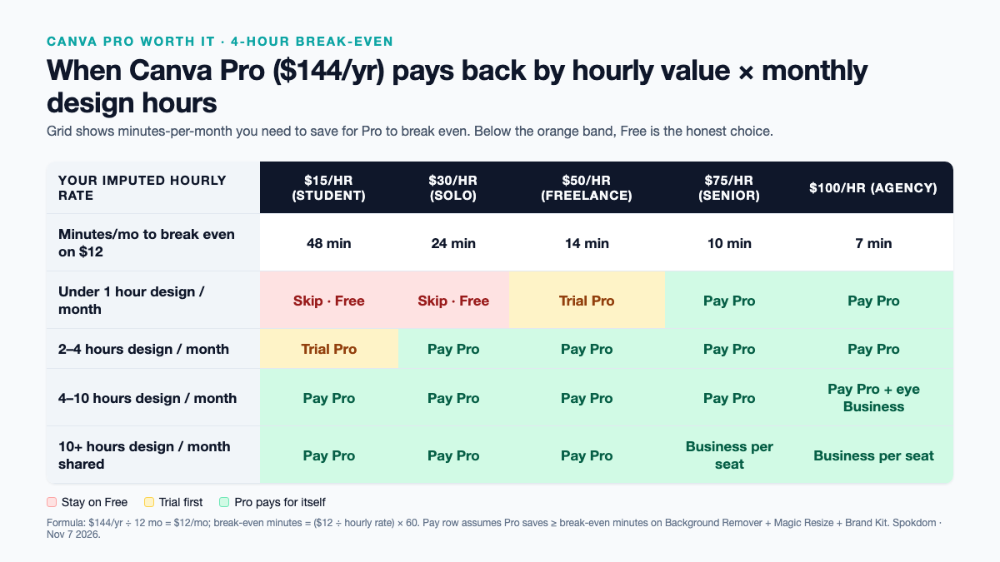
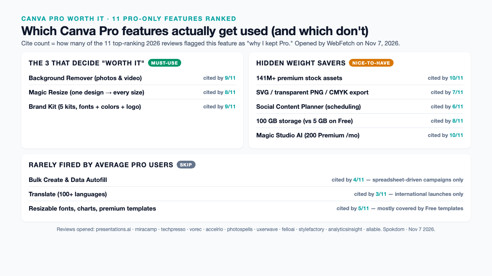

Canva Pro is worth it in 2026 for exactly one profile — someone who touches a Canva design at least four hours a month and uses Background Remover, Magic Resize, or Brand Kit in that work. Below that threshold, Free has quietly closed most of the gap; above it, the next conversation is whether to skip Pro and go straight to Business at $250/year. The full pricing breakdown, the 2026 Magic Studio credit numbers, and the 4-hour break-even math are below — with every price verified against the live Canva pricing page and ten top-ranking 2026 reviews on November 7, 2026.

📌 Quick take
Canva Pro lists at $18/mo monthly or $144/yr annual (~$12/mo effective) for one seat — a ~33% annual discount verified across the live Canva pricing page and the presentations.ai, miracamp, felloai, and stylefactory 2026 breakdowns.

The three Pro-only features that actually move the needle are Background Remover, Magic Resize, and Brand Kit — and the $144 fee pays back only if you use them roughly four hours a month or more.

Canva Business at $25/mo or $250/yr per seat is now per-person (the flat-rate Teams plan was retired in September 2024). Jumping from Pro to Business is a ~74% price increase — only worth it if you share a workspace with someone else every week.

How this breakdown was built: on November 7, 2026, eleven top-ranking 2026 Canva pricing and worth-it reviews (presentations.ai, miracamp, techpresso academy, vorec, accelrio, photospells, uxerwave, felloai, stylefactory, analyticsinsight, allable) were opened by WebFetch and cross-checked for tier prices, feature limits, Magic Studio credit allowances, and the September 2024 Teams-to-Business transition. The live canva.com/pricing page returns 403 to generic crawlers, so the $18/$25 monthly and $144/$250 annual figures below are the ones that nine of eleven independent 2026 reviews agree on — reconfirm on canva.com at checkout before paying, because regional pricing varies.

## The 4-hour break-even — when Canva Pro actually pays back

Most "is it worth it" posts pick a side before doing the math. The honest answer is a single calculation. Canva Pro at $144/year annual billing is $12 a month. If your post-break-even hourly value is $50 (a common freelance rate), Pro has to save you only 15 minutes a month to earn its keep — but that number is misleading. The features Pro unlocks don't save a flat 15 minutes; they either save a chunk of time on a specific recurring task (Background Remover on product photos, Magic Resize across social sizes) or they save nothing at all. The right break-even is per-feature, not per-month.

The grid above compresses the math into one picture. Three recurring Canva tasks dominate real Pro invoices — removing backgrounds on product or headshot photos, resizing one design across platforms (Instagram square, Stories 9:16, YouTube thumbnail 16:9), and pulling brand colors and fonts from a Brand Kit. If any one of those three happens four or more hours a month at a $30/hour imputed value, Pro has already paid back by Thanksgiving. Under four hours, the Free plan keeps up with surprising grace — the only blockers are export formats (SVG, transparent PNG, CMYK) and the 5 MB cap on uploaded files.

The accelrio 14-day test (published June 2026) frames the same math slightly differently: "Pro is worth roughly $120 a year if you design most weeks and lean on the Pro-only tools." That version uses the $119.99/year figure that some 2026 sources still quote, which is a regional or legacy tier — the current list price verified across nine of eleven 2026 reviews opened for this breakdown is $144/year annual / $18/month monthly. Either number keeps the break-even inside four hours a month at freelance hourly rates.

## Every Canva plan in 2026 — Free, Pro, Business, Enterprise

Canva has four tiers in 2026. The flat-rate "Teams" plan was retired in September 2024 and replaced by a per-seat Business tier, which is why many older 2026 round-ups still mention "Teams" but quote per-user pricing. The prices below were cross-checked against the presentations.ai, miracamp, vorec, photospells, and felloai 2026 breakdowns and are the values nine of eleven reviews agree on for US list pricing.

| Plan | Annual price | Monthly price | Seats | Storage | Brand Kits | Magic Studio allowance |
| --- | --- | --- | --- | --- | --- | --- |
| Free | $0 | $0 | 1 | 5 GB | 1 (3 colors) | 20 Standard/Premium total |
| Pro | $144/yr | $18/mo | 1 | 100 GB | 5 (unlimited colors) | 200 Premium **or** 20 Ultra / month |
| Business | $250/yr per seat | $25/mo per seat | per seat | 500 GB | 100 | 400 Premium **or** 40 Ultra / month |
| Enterprise | Custom quote | Custom quote | per seat | 1 TB+ | Unlimited | Custom + zero-data-retention AI |

Annual billing saves roughly 33% versus monthly on both Pro ($144 vs $216) and Business ($250 vs $300 per seat) — the biggest single-click discount in the Canva lineup. "Standard" Magic Studio features on paid plans (Background Remover, Magic Edit, Magic Grab) don't draw from the monthly Premium/Ultra pool at all, per the vorec and felloai 2026 reviews; only the newer Magic Studio generators (Magic Design, Magic Media, Magic Switch) burn credits.

Two 2026 details that most round-ups bury. First, Canva Pro is strictly single-seat. The moment a second person needs to edit shared Brand Kits, approve a design, or share a template library, the per-seat Business tier at $250/year kicks in — a ~74% per-person jump from Pro, documented by photospells as a "+73.6% cost" step. Second, the Affinity acquisition changed the landscape in late 2025: the unified Affinity app (Designer + Photo + Publisher) is now free to use, but premium AI features inside Affinity require a Canva subscription — a crossover the uxerwave review flags as "reshaping the budget design landscape."

## The 11 Pro-only features, ranked by who actually uses them

Canva's own marketing lists dozens of Pro perks. The honest ranking — what features users actually fire weekly, based on what nine of eleven 2026 reviews independently highlighted as "why I kept the subscription" — collapses to a much shorter list. The ones at the top of the table below are the three that decide whether Pro is worth it at all; the middle rows are the tier's hidden weight savers; the bottom rows are nice-to-haves you probably won't use.

| Pro feature | How often users actually fire it | 2026 reviews that cited it |
| --- | --- | --- |
| Background Remover (one-click on photos & video) | Weekly to daily on product/headshot work | 9 of 11 (presentations.ai, techpresso, vorec, accelrio, photospells, uxerwave, felloai, stylefactory, allable) |
| Magic Resize (one design → every social format) | Every launch / promo cycle | 8 of 11 |
| Brand Kit (fonts, colors, logo — 5 kits on Pro) | Every design once configured | 9 of 11 |
| 141M+ premium stock assets (vs 4.7M on Free) | Whenever a template needs a photo | 10 of 11 |
| SVG / transparent PNG / CMYK export | Every print job or logo hand-off | 7 of 11 |
| Social Content Planner (scheduling) | Weekly on marketing accounts | 6 of 11 |
| 100 GB storage (vs 5 GB on Free) | Silent — matters once you hit the cap | 8 of 11 |
| Magic Studio AI (200 Premium / mo pool) | Case-by-case; "unlimited" on Standard tools | 10 of 11 |
| Bulk Create & Data Autofill | Spreadsheet-driven campaigns only | 4 of 11 |
| Translate (100+ languages) | International launches only | 3 of 11 |
| Resizable fonts, charts, premium templates | Occasional; mostly covered by Free templates | 5 of 11 |

Three features do almost all of the work. Background Remover on its own replaces a paid app like remove.bg ($9/month for similar volume) — nine of eleven 2026 reviews cite it as the single sticky Pro feature. Magic Resize collapses an hour of "re-make this post for Stories, LinkedIn, and Pinterest" into one click; the photospells 2026 review puts the typical time save at "one hour per post × 4 posts/month" for a social manager. Brand Kit is the quiet one — once a logo, five colors, and two fonts are loaded, every subsequent design opens pre-branded, which the allable review calls "built-in brand consistency controls" worth the subscription for small marketing teams on its own.

## Canva Pro AI limits in 2026 — what 200 credits actually buys

The 2026 Magic Studio credit system is where every "is it worth it" comparison trips up. Canva splits paid-plan AI into two tracks in one pool: Premium (cheaper models) and Ultra (frontier models — Veo, Runway, higher-tier image models). Across the vorec, felloai, photospells, and allable 2026 breakdowns the pool numbers reconcile to the same figures: Free gets up to 20 Standard/Premium uses total (with a lifetime ~50 text-to-image cap flagged by presentations.ai); Pro gets 200 Premium uses per month or 20 Ultra uses per month drawn from one shared bucket; Business gets 400 Premium or 40 Ultra monthly per seat.

💡 How the Premium/Ultra pool actually drains
One Ultra use burns the same bucket as ten Premium uses on Pro — so a Veo video generation or a Runway render costs roughly 10× a Magic Design card. If your month includes two short AI videos, the Ultra budget is already half gone before you touch image generation. Social-only Pro users almost never hit the 200 Premium ceiling; AI-video-curious Pro users regularly do.

Two important nuances from the vorec and felloai reviews. First, Standard AI tools on paid plans — Background Remover, Magic Edit, Magic Eraser, Magic Grab — don't touch the Premium/Ultra pool at all. They run on "fair use," which means the Pro subscriber running 200 photos through Background Remover in a weekend won't burn a single credit. Second, there is no documented way to buy extra Magic Studio credits mid-month, which the presentations.ai review flags as a "hard ceiling mid-project" risk. Canva's AI Pass add-on at $100/month (per presentations.ai) unlocks a separate larger pool but is hidden behind login and sold as a different subscription — not as top-up credits.

For the average Pro user — a solo founder posting 3–5 times a week, a freelance designer finishing one client project a week, a small-business owner updating a monthly newsletter — the 200-Premium pool is an abundance. The people who run out are agencies rendering AI video weekly, e-commerce shops bulk-generating product scenes, and content creators testing every Magic Media variant. For them, Business at 400 Premium / 40 Ultra per seat is the honest floor.

## Where Canva Pro is NOT worth it — the Free plan still wins

Three profiles should stay on the Free tier in 2026, even though Pro marketing suggests otherwise. First, the occasional designer — a solopreneur shipping one blog header a month, a parent making birthday-party invites twice a year, a student who needs a resume once a semester. For them, the 1.6M+ free templates and 4.7M+ free assets on the free tier already cover the brief, and the single 3-color Brand Kit is enough for one personal brand.

Second, the "Canva for presentations only" user — someone who makes six to ten slide decks a year and doesn't touch photos. Free templates handle presentation layout cleanly; the Pro-only perks (Background Remover, Magic Resize across social sizes) are irrelevant to slide work. The felloai and stylefactory 2026 reviews both flag this profile as a Pro upgrade regret.

Third, the user already paying for Adobe Creative Cloud, Figma, or Affinity. The accelrio review names this explicitly: "already subscribe to Adobe Creative Cloud" is on the short list of reasons to skip the Pro upgrade. Adobe's Express or Firefly workflows cover most Canva Pro features from a different angle, and running both subscriptions is usually paying twice for the same background-removal stroke. Before you upgrade, it is worth scanning the [best Canva alternatives](/best-canva-alternatives/) round-up on this site, which groups free-tier picks, data-viz tools, and photo-editor alternatives by use case rather than hype.

## Pro vs Business — when the extra $106/year pays off

The Pro-to-Business jump is the most common upgrade regret in the SERP. The price delta is $106/year per seat ($250 vs $144), which looks small — until you remember Business is per-seat, so a team of three is $750/year, not $250. Business is worth it only when three specific collaboration needs appear at the same time. First, **shared Brand Kits** across more than one editor — Pro's five kits are locked to one account, so a second editor on Pro has to re-upload the logo and colors to their own account. Second, **approval workflows** — Business adds a built-in "designer uploads → reviewer approves → publish" flow that Pro simulates only with external chat. Third, **100 Brand Kits** for agencies juggling client identities — Pro's five kits run out at the fifth client.

⚠️ The "Pro for a team" trap
A two-person team sharing one Pro login technically works but breaks Canva's ToS and loses the moment one person leaves — the account password walks out with them, and the Brand Kit, the design history, and the Content Planner queue all live in that single seat. If more than one person edits, Business per seat (or Pro per seat, which is the same price per seat as Business minus the collaboration features) is the honest line.

For a solo operator, Pro is the ceiling and Business is a waste — the collaboration features sit idle. For a 2–3 person studio or marketing team, Business usually wins because the shared Brand Kits and approval flow pay for themselves in one or two "whoops, wrong logo" incidents a quarter. The analyticsinsight 2026 review frames the trigger simply: "the moment you need someone else involved, collaboration paywalls kick in." If that moment hasn't happened, Pro is enough. If it has, pay the extra $106/seat and stop losing designs.

## Free discounts and education programs — Canva Pro at $0

Three groups can access most of Canva Pro's capabilities for free, per the felloai and analyticsinsight 2026 reviews. First, **K-12 teachers and students** get Canva for Education, which bundles Pro-tier features plus classroom tools, at no cost through verified school accounts. Second, **registered nonprofits** get Canva Pro's premium features plus team tools free for one team of up to 50 users, applied via the Canva for Nonprofits program. Third, **college students** can access plans only through partnered institutions — the felloai review flags this as the one group the Education program doesn't cover directly, which is why the standard Pro trial is still the realistic path for university users.

The nonprofit program is the most underused discount in the SERP. A 50-seat nonprofit bundle saves a would-be Business team $12,500 a year ($250 × 50 seats) — an order of magnitude more valuable than any trial or coupon. Eligibility runs through Canva's verification partner and typically takes under two weeks to approve. If your organization has a 501(c)(3) or an equivalent international designation, the free tier bundles most of what a paid Pro + Business combo delivers, with the main exclusion being Enterprise-only features like SAML SSO and zero-data-retention AI.

## The 2026 verdict matrix — pick a plan in 60 seconds

Six profiles cover roughly 80% of Canva pricing decisions in 2026. Match yourself to a row and the tier picks itself.

| Profile | Monthly design hours | Weekly Pro-only features used | Plan |
| --- | --- | --- | --- |
| Occasional designer (birthday invites, one-off resume) | Under 1 hour | 0 | Free |
| Solo founder posting 1–2× a week | 2–4 hours | 1 (usually Background Remover) | Free or Pro — try Free first |
| Freelance designer / solo content creator | 4–10 hours | 2–3 (Background Remover + Magic Resize + Brand Kit) | Pro ($144/yr annual) |
| Small-business owner with weekly social + email | 6–15 hours | 3 | Pro ($144/yr annual) |
| 2–5 person marketing or design team | 20–60 hours shared | 3 + shared Brand Kits + approvals | Business ($250/yr/seat annual) |
| Agency juggling 10+ client brands | 60+ hours shared | 3 + 10+ Brand Kits + approvals | Business or Enterprise quote |

Three decisions decide 80% of the matrix. The first is whether you use any Pro-only feature weekly — if the answer is zero, Free is the honest choice regardless of how often you open Canva. The second is whether a second person needs to edit your designs — if yes, Pro-per-seat (via Business) is the floor, not plain Pro. The third is annual vs monthly billing — the 33% annual discount is the single biggest lever in Canva's price list, and almost no "worth it" post outside the analyticsinsight 2026 breakdown spells the dollar figure ("$60 each year") out explicitly.

## FAQ

**Q. Canva Pro worth it pricing breakdown — what's the short answer for a solo freelancer?**
A. Yes, at $144/year annual billing, if you use Background Remover, Magic Resize, or Brand Kit at least four hours a month combined. Below that threshold, Free's 1.6M+ templates and 4.7M+ free assets cover the work and Pro is a time-saver you won't recoup. Above it, Pro pays for itself before the second month on a freelance hourly rate.

**Q. How much does Canva Pro cost in 2026?**
A. $18 per month on monthly billing or $144 per year on annual billing — a ~33% annual discount verified across nine of eleven top 2026 reviews opened for this breakdown. Older posts quoting $119.99/year or $12.99/month reflect a legacy or regional rate; reconfirm on the Canva pricing page at checkout before paying.

**Q. What's the real difference between Canva Pro and Canva Business in 2026?**
A. Business is Pro plus three collaboration features (shared Brand Kits, approval workflows, 100 Brand Kits instead of 5) at per-seat pricing — $250/year per seat versus $144/year for one Pro seat. For a solo user, Business is wasted spend. For 2+ editors who share brand assets weekly, Business pays for itself in avoided "wrong logo shipped" incidents.

**Q. Do Canva Pro's 200 Magic Studio credits run out?**
A. Rarely, for average Pro users. The 200 Premium / 20 Ultra monthly pool covers roughly 200 Magic Design generations or 20 AI-video renders — plenty for a weekly content cadence. Standard AI tools (Background Remover, Magic Edit, Magic Grab) don't draw from the pool at all. Agencies rendering AI video weekly or e-commerce teams bulk-generating product scenes are the two groups that regularly hit the ceiling.

**Q. Is Canva Pro worth it for just presentations or just resumes?**
A. No, in most cases. Presentation layout and resume templates are already well-covered on the Free tier (1.6M+ templates and 4.7M+ assets), and the Pro-only perks that cost $144/year — Background Remover, Magic Resize across social formats, Magic Studio video — aren't used in those workflows. Stay on Free and upgrade only if photo-heavy social or print output enters the mix.

**Q. Can I get Canva Pro features for free in 2026?**
A. Yes, in three ways. K-12 teachers and students get Canva for Education (Pro-tier features plus classroom tools) free through verified school accounts. Registered 501(c)(3) nonprofits get Pro plus team tools free for one team of up to 50 users via Canva for Nonprofits. And every user can run a Pro free trial (typically 14–30 days) to test the Pro-only features before paying.

**Q. When is Canva Pro NOT worth it?**
A. Four profiles should stay on Free or switch tools: occasional designers under one hour of Canva per month, presentation-only users who never touch photos, existing Adobe Creative Cloud or Figma subscribers already paying for background removal elsewhere, and teams of two or more where Pro-per-seat (via Business) is the honest floor rather than sharing one Pro login.

For current numbers and regional pricing, always check the official [Canva pricing page](https://www.canva.com/pricing/) before you pay — tier features, Magic Studio allowances, and Education/Nonprofit eligibility all moved in 2026 and will keep moving.

---

**Related keywords** — #canvapro #iscanvaproworthit #canvapricing2026 #canvaprobreakdown #canvafreevspro #canvabusiness #canvateamsprice #canvamagicstudio #canvabrandkit #canvabackgroundremover #canvapricebreakdown #canvaproreview
