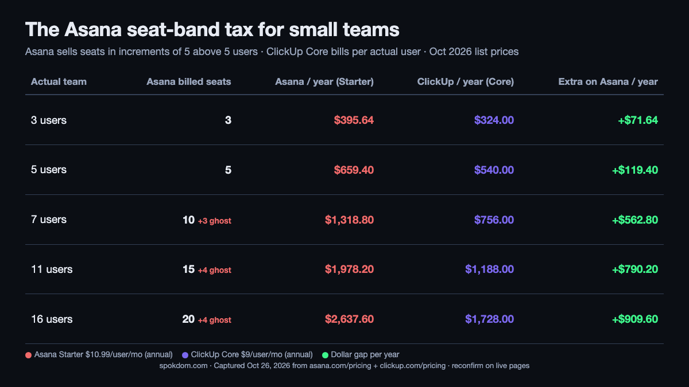
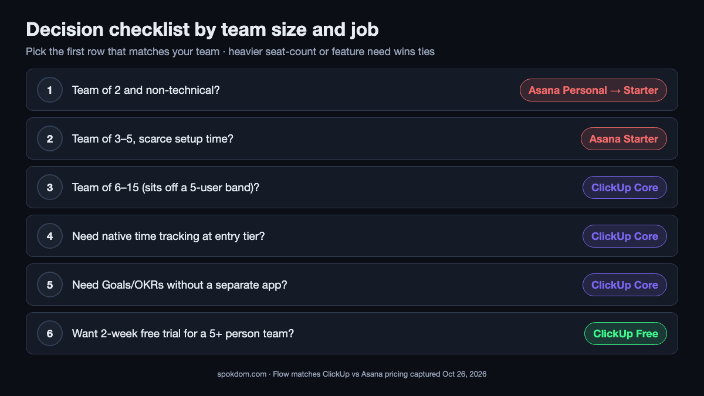

📌 Quick take
For most teams under 10 people, ClickUp is the cheaper, more flexible pick — mostly because Asana sells seats in blocks of 5 above the first 5 users, so a 7-person team pays for 10 and an 11-person team pays for 15.

Choose Asana if your team is 2–5 people, non-technical, and you want "day-one calm" over configuration. Choose ClickUp if your team sits awkwardly on a seat-band edge or needs native time tracking, Goals, and docs without upgrading two tiers.

Both free plans exist, but only ClickUp Free can host a full 5-person evaluation. Asana Personal caps at 2 seats.

ClickUp vs Asana for small teams has one answer the top comparisons bury: Asana charges for seats you do not have, and ClickUp does not. As of October 26, 2026, Asana's own pricing page spells out that beyond 5 users seats are sold in increments of 5, so a team of 7 or 11 pays for 10 or 15. ClickUp bills exactly the number of members you add. That one rule flips the "Asana is only a couple of dollars more" line that most roundups use.

How this comparison was built: on October 26, 2026 I captured both official pricing pages, read eleven top-ranking comparisons, cross-checked the Asana seat-band wording against its live FAQ, and priced four common small-team shapes (3, 5, 7, 11 users) against both billing meters. No month-long production run on either account, so treat the dollar figures as a planning model and reconfirm them on the live pricing pages before you commit a card.

## ClickUp vs Asana for small teams in one line

For a 2-to-5 person team that wants to open the tool and start working without a setup day, Asana Starter is the right pick despite the higher sticker price — adoption speed is worth $12 a month on a 4-person team. For a 6-to-15 person team, ClickUp wins on price (because of the Asana seat-band rule), on free-plan evaluation (because ClickUp Free hosts unlimited members and Asana Personal caps at 2), and on feature breadth at the first paid tier (native time tracking, Goals, Gantt without jumping to Advanced).

The split happens almost exactly at the 5-user line because that is where Asana's billing math changes. Below 5, both tools price per actual seat and the Asana premium stays small. At 6 users Asana starts charging for 10 seats, and the gap widens from "a few dollars" to roughly $500–$800 a year on the entry paid tier.

The honest short answer: Asana for tiny non-technical teams, ClickUp for anything from 6 up or any team that needs time tracking, Goals, or docs inside one tool. Both brands are stable enough that the choice is reversible later — but you only reverse it if you have the configuration time, so pick on team size first.

## The seat-band trap that only Asana has for small teams

Asana's pricing page FAQ (captured October 26, 2026) spells out the seat-purchase rules in exact text: "Between 2 and 5 total users: add seats in increments of 1. Up to 30 total users: add seats in increments of 5. Up to 100 total users: add seats in increments of 10." That means a 7-person team on Starter is billed for 10 seats, an 11-person team for 15, and a 16-person team for 20. ClickUp has no equivalent rule; its paid plans bill per-user to the exact head count.

The practical effect at Starter list price ($10.99/user/month, billed annually):

| Actual team | Asana billed seats | Asana / month | Asana / year | ClickUp Core (same team) | Extra on Asana / year |
| --- | --- | --- | --- | --- | --- |
| 3 | 3 | $32.97 | $395.64 | $324 | +$71.64 |
| 5 | 5 | $54.95 | $659.40 | $540 | +$119.40 |
| 7 | 10 | $109.90 | $1,318.80 | $756 | +$562.80 |
| 11 | 15 | $164.85 | $1,978.20 | $1,188 | +$790.20 |
| 16 | 20 | $219.80 | $2,637.60 | $1,728 | +$909.60 |

The jump between 5 and 7 users is where the seat-band premium starts biting. At 7 users, Asana costs about $47 more per month than ClickUp Core, or roughly $560 a year. At 11 users the gap widens to about $66 more per month. Several top comparison posts quote the "$11 vs $7" per-user list price as if that were the whole gap — the real small-team cost difference is one or two tiers larger because the Asana meter is counting empty seats.

Asana does this on purpose; the stepped billing is designed to make seat growth feel smooth from a sales-ops perspective. For a buyer it means you should either grow in multiples of 5 above the first 5 (so you are not paying for ghost seats for long) or avoid the structure entirely by picking a per-user tool.

## Pricing for small teams: October 2026 captures

The two pricing pages I captured on October 26, 2026 both ran promotional pricing. Here are the live numbers next to each other, with the caveat that ClickUp's lower-tier plan was renamed from "Unlimited" to "Core" during 2026 and many 2026 comparison posts still quote the older "$7 Unlimited" price. The current ClickUp page shows "$9 annual, $12 regular" on the Core card.

| Tier (annual billing) | ClickUp (Oct 26 2026 capture) | Asana (Oct 26 2026 capture) |
| --- | --- | --- |
| Free | Free Forever — unlimited members, 60MB storage, 5 Spaces, 100 automation runs/mo | Personal — **2 seats**, unlimited tasks, 100MB per file, 100+ integrations |
| Entry paid | Core $9/user/mo (list $12) — Gantt, 1,000 automations, Goals, native time tracking, 1K AI credits pooled | Starter $10.99/user/mo — Timeline, reporting dashboards, unlimited automations, custom fields, custom templates |
| Mid paid | Business $17/user/mo (list $25) — advanced dashboards, 10,000 automations, Resource Management, Timesheets | Advanced $24.99/user/mo — portfolios, Goals, workload, approvals, proofing |
| AI | Brain AI add-on $9/user/mo on top of any paid plan; Brain MAX $100/user/mo | Asana AI included in all paid plans; $0.50/request packs or $0.60 pay-as-you-go |

A few honest flags on the table. First, ClickUp's "Unlimited $7" number still appears in Monday.com's blog, Gmelius, Zenpilot, and ClickUp's own blog as of this writing; the live pricing page shows "Core $9" instead. Treat the $7 figure as legacy pricing that some content has not caught up with yet, and confirm the number on [ClickUp official pricing](https://clickup.com/pricing) before you buy. Second, Asana lists AI as "included on all paid plans," but there are per-request limits and pay-as-you-go overage; it is not strictly unlimited.

💡 How to read the price tags without getting fooled
Both tools post the <b>annual</b> per-user price as the headline. Monthly billing is 25–35% higher on both: ClickUp Core is $12/user/mo monthly vs $9 annual; Asana Starter is $13.49 monthly vs $10.99 annual. Small teams almost always benefit from annual billing because the cost gap grows with seat count, and seat count on a small team changes less than once a quarter.

The second trap: both free plans impose different kinds of limits. ClickUp Free limits <b>features</b> (storage, automations, Spaces) while allowing <b>unlimited members</b>. Asana Personal flips that: 2 seats maximum, but no feature cap on what those two people can do.

## Free plan for a 5-person trial: ClickUp wins

If you want the whole team to test the tool for two weeks before paying anyone, ClickUp Free is the only option that actually works for a team of 3-plus. Asana's Personal plan is capped at 2 users on the current pricing page, which means an actual 5-person team cannot evaluate Asana on the free plan without a trial. ClickUp Free hosts unlimited members and unlimited guests at no charge, so a 10-person team can run two weeks of real work inside the free tier before anyone enters a credit card.

The trade-off is that ClickUp Free limits what those members can do: 60MB of storage total, 5 Spaces, 100 automation runs a month, 5 active rules, 1 Form, 3 whiteboards, 90-day message history, and 1-day activity-view history. For a short evaluation that is not a problem. For a permanent "pretend we don't need to pay" plan, the storage limit will bite within a month if anyone uploads a video or a few design files.

Asana's Personal plan, for the 2 users who fit, is actually more generous on features: unlimited tasks and projects, list/board/calendar views, 100MB per file, time tracking via integrations, and 100+ integrations. If a solo founder plus a part-time VA is the whole team, Asana Personal can run for free indefinitely. Everyone else evaluates on ClickUp Free, migrates intent to Asana Starter if Asana wins, and avoids the Personal plan entirely.

## Feature matrix: who wins each small-team criterion

Treat the matrix as a tie-breaker, not a scoreboard. For most small teams, two or three rows will dominate the decision; the rest are nice-to-haves.

| Criterion | ClickUp Core | Asana Starter | Why it matters for small teams |
| --- | --- | --- | --- |
| Native time tracking | ✓ | ✗ (Advanced $24.99) | Agencies and freelancers can bill without a plug-in |
| Goals / OKRs | ✓ (Core) | ✗ (Advanced only) | Keeps a small team aligned without a separate OKR app |
| Gantt / Timeline | ✓ | ✓ | Both include it at entry paid tier |
| Workload view | ✗ (Business $17) | ✗ (Advanced $24.99) | Both gate it; ClickUp's gate is cheaper |
| Automations/month | 1,000 | Unlimited | Asana's cap is formally unlimited, in practice both are plenty for a small team |
| Native docs / whiteboards | ✓ | ✗ | Replaces a Notion or Miro subscription for teams on tight budgets |
| Learning curve | Moderate | Low | Asana's defaults onboard non-technical teams in hours |
| Mobile app polish | Good | Excellent | Asana's mobile UX is consistently the top-rated by G2 reviewers |
| Integrations breadth | 1,000+ | 100+ | Both cover the common SaaS; ClickUp wins on long-tail apps |
| Per-user billing | ✓ exact seat count | ✗ seat bands of 5 above 5 users | The hidden small-team cost driver |

ClickUp wins on raw feature count at the entry tier, which is why its advocates (including its own blog) stack six features into "ClickUp replaces Asana, Notion, and Toggl at a lower price." Asana wins on the two rows that drive adoption: learning curve and mobile polish. For a non-technical 4-person team, those two rows outweigh everything else; for anyone else, the feature-and-price rows usually tip ClickUp.

⚠️ One line of fine print both tools share
Both have changed pricing in 2026. ClickUp consolidated its lower paid tiers (Unlimited → Core, with a price adjustment) during the year, and Asana adjusted monthly billing by about $1/seat. Always reconfirm the current numbers on <a href="https://clickup.com/pricing">ClickUp official pricing</a> and Asana's pricing page before you build a cost model, and screenshot the version you are buying so you can prove what you agreed to if the page moves.

## AI pricing a 7-person team actually pays

The AI story is where sticker-price intuition breaks. Asana includes AI in every paid plan at no extra per-seat cost; ClickUp charges $9/user/month on top of any paid plan for Brain AI, or $100/user/month for the full Brain MAX tier. For a 7-person team, that math shifts the gap in a non-obvious direction.

Running the numbers at list price for a 7-person team on annual billing:

- **ClickUp Core without AI:** 7 × $9 = $63/mo = **$756/year**
- **ClickUp Core + Brain AI add-on:** 7 × ($9 + $9) = $126/mo = **$1,512/year**
- **Asana Starter (AI included):** 10 billed seats × $10.99 = $109.90/mo = **$1,318.80/year**
- **Asana Advanced (AI included):** 10 billed seats × $24.99 = $249.90/mo = **$2,998.80/year**

Without any AI, ClickUp is about $563 a year cheaper. Turn on Brain AI across the team and ClickUp becomes about $193 a year more expensive than Asana Starter, because the add-on is per seat and the Asana seat-band tax is capped. Turn on Brain MAX and ClickUp jumps far above Asana Advanced. The common competitor claim "ClickUp saves you $1,559 a year" uses Business vs Advanced at 10 users with no AI; once AI is in the mix the gap collapses to a few hundred dollars either way.

For most small teams the honest answer is: skip the AI add-on until you have a specific workflow for it. The headline tools in Brain and Asana AI — summaries, status updates, smart search — are useful but rarely critical for a 5-person team. Save the $756/year and revisit at the end of the first quarter.

## Three real small-team workflows priced

The best way to settle ClickUp vs Asana for small teams is to run the actual job through both meters on paper before buying. Three common small-team shapes, priced on October 2026 annual pricing:

**Workflow A — 4-person agency tracking client projects + billable hours.** The team needs tasks, docs, native time tracking, and client-facing status updates. Both tools charge for 4 seats exactly in this range. On ClickUp Core: 4 × $9 = $36/mo = $432/yr, and time tracking is built in. On Asana Starter: 4 × $10.99 = $43.96/mo = $527.52/yr, plus either Advanced ($100/mo = $1,200/yr) for native tracking or a Toggl plug-in. **Winner: ClickUp Core** — $432/yr for a complete solution vs $527/yr-plus for a solution still missing time tracking.

**Workflow B — 7-person marketing team running campaigns + content calendar.** No time tracking needed. The team wants Timeline/Gantt, forms for intake requests, and dashboards. On ClickUp Core: 7 × $9 = $63/mo = $756/yr. On Asana Starter: 10 billed seats × $10.99 = $109.90/mo = $1,318.80/yr. The $563/yr gap is the Asana seat-band tax on 3 ghost seats. If the team actively prefers Asana for adoption, Advanced is $300/mo = $3,600/yr — a different conversation. **Winner: ClickUp Core**, unless Asana's calmer UX will cut setup time by two weeks.

**Workflow C — 3-person solo founder + 2 contractors.** Simple task lists, light docs, no reporting. On ClickUp Free: all 3 can fit in the free plan and never pay. On Asana Personal: only 2 of the 3 fit; the third needs Starter at a 2-seat minimum, so the real bill is $10.99 × 2 billed seats = $21.98/mo = $263.76/yr for one person's access, or the whole team moves to Starter at $395.64/yr. **Winner: ClickUp Free** — the only free option that actually hosts the whole team.

The pattern across all three: if the team is 2 people, Asana wins on free; if the team is 3-plus or sits on a seat-band edge, ClickUp wins on price and often on built-in features. The gap narrows only when the team is a specific multiple of 5 (5, 10, 15) and does not need time tracking, Goals, or docs — a narrower sweet spot than most roundups admit.

## Decision checklist by team size and job

Pick the first row that matches your team. If two match, use the one that reflects the heavier dollar commitment — seat-count cost compounds much faster than any feature-list difference.

1. Is your team 2 people and non-technical? → **Asana Personal (free), then Starter if you grow past 2.**
2. Is your team 3–5 people and non-technical? → **Asana Starter** if setup time is scarce; **ClickUp Core** if budget is scarce.
3. Is your team 6–15 people? → **ClickUp Core** by default (Asana seat-band tax starts biting hard).
4. Do you need native time tracking at entry tier? → **ClickUp Core** (Asana requires Advanced $24.99).
5. Do you need Goals/OKRs tracking without a separate app? → **ClickUp Core** (Asana requires Advanced).
6. Do you want zero configuration and the "cleanest" daily UX? → **Asana Starter**, worth the premium.

Most small ops teams end up on ClickUp Core because rows 3–5 stack. Most 2–4 person creative teams end up on Asana Starter because rows 1–2 and row 6 stack. Teams that need both logic depth and calm UX usually run Asana for client-facing projects and ClickUp for internal ops — more common than any single-tool answer suggests.

## When to run both, and when to migrate

Running both tools in parallel is more common than the vendor blogs suggest. A 6-person team can keep client-facing project boards in Asana (because clients open Asana's clean mobile view without complaint) and run internal ops, docs, Goals, and time tracking in ClickUp (because the entry-tier breadth beats paying for Asana Advanced). The combined bill at list prices is roughly $5 × $10.99 + 6 × $9 = $108.95/mo = $1,307.40/yr, cheaper than Asana Advanced for the same team and almost identical to ClickUp Business alone.

Migrating one way or the other is a bigger commitment than most roundups admit. There is no one-click importer in either direction; a serious migration means rebuilding task structure, re-educating the team, and running both tools for a few weeks in parallel until the output matches. For a stable small team that is already working, the cheaper decision is to stay put unless the current tool is costing you two full seats worth of frustration a month. For comparable thinking on another small-team collaboration pick, our guide to the [best Notion alternatives for small teams](/best-notion-alternatives-small-teams/) walks the same decision framework for the docs-first side of the stack.

If you are starting fresh and your team is 2–4 people, start on Asana Starter. If your team is 5-plus, start on ClickUp Free, run the real work for two weeks, and upgrade to Core when a specific feature (storage, automations, Gantt) starts blocking you. The one thing not to do is migrate on principle. ClickUp bills per actual user, Asana sells seats in blocks of 5 above the first 5, and either meter can win depending on your exact head count and whether you need built-in time tracking.

## FAQ

**Q. ClickUp vs Asana for small teams — which is better for a 5-person team?**
A. Both work. Asana Starter is better if the 5 people are non-technical and the team wants to open the tool and start working the same day; the $10.99/user/month covers Timeline, reporting dashboards, and unlimited guests. ClickUp Core is better if the team wants native time tracking, Goals, or docs inside the same tool, or if budget is tighter — Core is $9/user/month and the gap at exactly 5 users is only about $10/month.

**Q. Why does Asana cost so much more at 7 or 11 users?**
A. Asana sells seats in increments of 5 above the first 5 users, per its own pricing-page FAQ. A 7-person team is billed for 10 seats, an 11-person team for 15. That turns a $2 per-user list-price gap into roughly $47 per month at 7 users and $66 per month at 11 users, which is $563 and $790 per year respectively compared to ClickUp's exact-seat billing.

**Q. Can a whole 5-person team evaluate Asana on the free plan?**
A. No. Asana Personal (the free plan) is capped at 2 users on the current pricing page. For a 5-person evaluation, either run a Starter trial or evaluate on ClickUp Free first — ClickUp Free hosts unlimited members and unlimited guests, which makes it the only free option that fits a real small team.

**Q. Does Asana include AI in Starter, or do I pay extra like with ClickUp?**
A. Asana includes AI in all paid plans at no per-seat upcharge, with per-request limits and $0.50-per-request packs or $0.60-per-request pay-as-you-go for overage. ClickUp charges $9/user/month for Brain AI as an add-on, or $100/user/month for the full Brain MAX tier. For a 7-person team, turning on ClickUp Brain AI flips the pricing lead from ClickUp to Asana by a few hundred dollars a year.

**Q. Which has the shorter learning curve for a non-technical team?**
A. Asana. Multiple top comparisons and G2 user reviews put Asana's time-to-productivity in hours, while ClickUp's is measured in days once you factor in configuring Spaces, custom fields, views, and automations. Asana's defaults are opinionated enough that non-technical teams rarely need to touch settings; ClickUp's flexibility assumes the team is willing to tune it.

**Q. Should I switch from Asana to ClickUp to save money?**
A. Only if your team sits off a seat-band multiple of 5 (so 6, 7, 8, 9 or 11, 12, 13, 14 users), or if you need features Starter does not include (native time tracking, Goals, native docs). Below 5 or exactly at 5/10/15 users without those feature needs, the Asana premium is small enough that migration cost usually dominates. The honest answer to ClickUp vs Asana for small teams in 2026 is "whichever meter costs less for your exact head count and your top one or two features" — only clear after you price your real team against both billing rules.

---

**Related keywords** — #clickupvsasana #asanavsclickup #clickupvsasanaforsmallteams #asanapricing2026 #clickuppricing2026 #asanaseatbands #clickupfreeplan #clickupcore #asanastarter #projectmanagementtools #smallteamsaas #asanaalternatives
