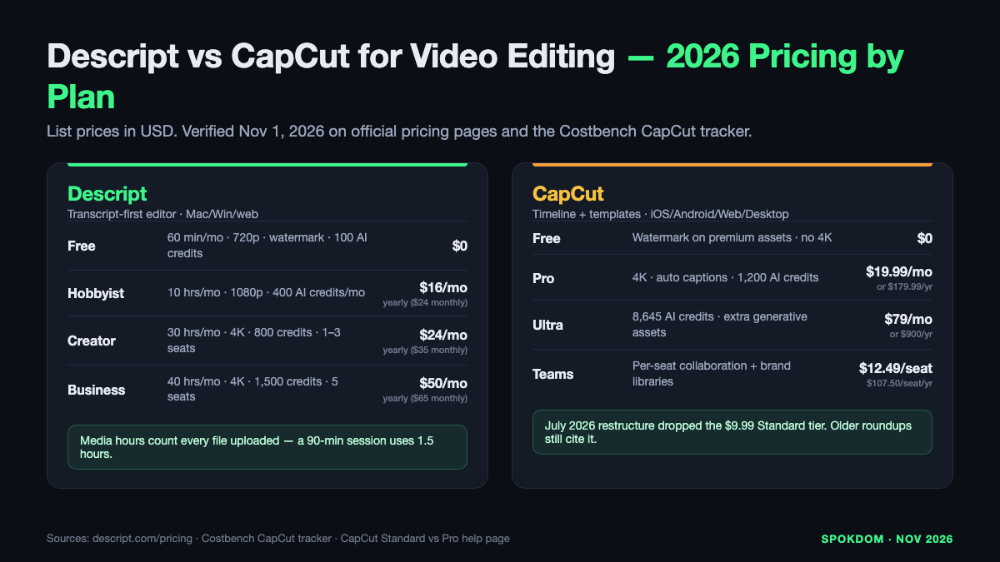
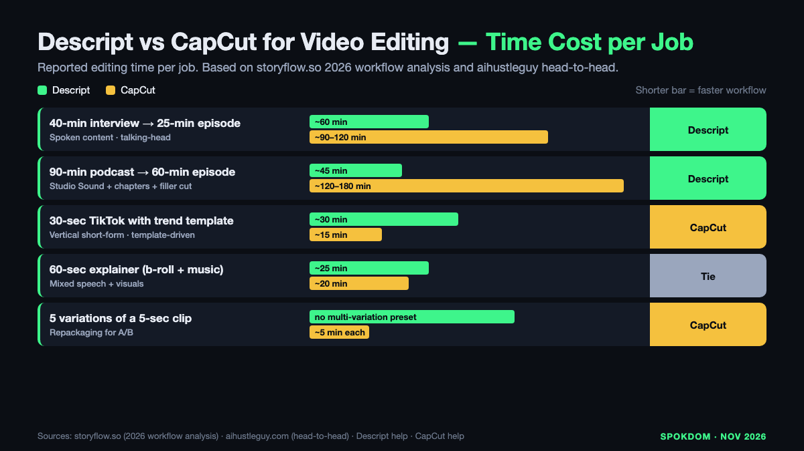

Descript vs CapCut for video editing is not really a tools comparison in 2026 — it's a bottleneck choice. Descript edits video by editing the transcript, so the slow part of a 40-minute interview (listening for the bad take) collapses into reading. CapCut edits video on a timeline packed with templates and effects, so the slow part of a 60-second vertical (visual styling that matches the trend) collapses into drag-and-drop. On the official Descript pricing page as of November 1, 2026, Hobbyist is $16/mo billed yearly and Creator is $24/mo billed yearly; CapCut Pro is $19.99/mo or $179.99/year on the Costbench tracker and the hyperautomationlabs breakdown, both captured in October 2026. The right pick is whichever editor kills *your* bottleneck first.

📌 Quick take
Descript wins video editing jobs where the slow part is listening — podcasts, interviews, screen tutorials, long YouTube talk tracks. Transcript editing turns a 40-minute interview rough-cut into a reading pass.

CapCut wins video editing jobs where the slow part is styling — TikToks, Reels, YouTube Shorts, and anything that lives on a phone. Templates, captions, and effects ship a vertical in minutes.

Default pick for 2026: Descript Hobbyist ($16/mo yearly) if you record speech weekly; CapCut Free + Pro ($19.99/mo) if you post vertical content weekly. Run both at $192 + $180 = $372/yr only if you ship both every week.

How this comparison was built: on November 1, 2026 the live Descript pricing page, the Costbench CapCut tracker, the CapCut Standard vs Pro help page, and ten top-ranking 2026 comparison posts (storyflow, aihustleguy, voxota, fahimai, ngram, blitzcut, hyperautomationlabs, genesysgrowth, borumi, videogen) were opened by WebFetch and cross-checked for pricing, plan limits, and workflow claims. No production project ran on either account for this piece, so the dollar figures are a planning model — reconfirm them at checkout before buying.

## Descript vs CapCut for video editing — the real problem to solve

Both tools edit video. That is the only shared sentence. Descript is a transcript editor that also outputs video. CapCut is a timeline editor that also handles captions. The bottleneck each one removes is different, so the right question is not "which is better" but "which bottleneck slows me down most this week."

The transcript bottleneck shows up in long spoken video — a 40-minute podcast, a 90-minute webinar, a 20-minute tutorial, a four-camera interview. Finding the three sentences to cut requires scrubbing through audio, which is the slow part. Descript solves this by printing the audio as a document; a cut in the transcript is a cut in the video, confirmed on the storyflow 2026 workflow analysis which times a 40-minute transcript-based rough cut at roughly an hour. The ngram and aihustleguy breakdowns use the same framing: when the slow part is listening, Descript's structural editor is the fastest tool on the market.

The styling bottleneck shows up in short vertical video — a 30-second TikTok, a 15-second Reel, a 60-second Short. The source clip is already short; the slow part is matching the trending template, syncing captions to the beat, and layering stickers and effects. CapCut solves this by shipping thousands of templates, animated caption presets, and beat-detection tools, confirmed across the fahimai, genesysgrowth, and voxota 2026 breakdowns. The storyflow timing reference puts three vertical variations at roughly 15 minutes each in CapCut versus "significantly longer" in general-purpose tools.

## The bottleneck test — three problems and the editor that kills each

Instead of a feature matrix as the first move, pick the problem that costs you the most hours this month and see which editor removes it.

**Problem 1: "I spent two hours cutting ums out of a 40-minute interview."** Descript removes this problem outright. Its filler-word removal scans the transcript, highlights every "um", "uh", and "you know," and lets you cut all of them in one pass. The feature exists on CapCut as a timeline cleanup tool but requires scrubbing audio to find each one; Descript finds them by reading. The aihustleguy workflow test clocked a full Descript rough-cut-plus-captions in 28 minutes against CapCut's 34 minutes on the same long-form source, where CapCut "still felt sloppy" at the end.

**Problem 2: "I need five vertical variations of the same clip, each with trend-matched captions."** CapCut removes this problem outright. Its template library ships with vertical-first captions, beat-synced effects, and one-tap duplication of the same project with different styles. Descript can reframe horizontal clips to vertical and auto-generate captions, but the template depth is small — the voxota and hyperautomationlabs breakdowns both describe CapCut's advantage here as "huge template, effect, and music library for short-form video."

**Problem 3: "I'm editing on a phone during my commute."** CapCut removes this problem; Descript cannot. Descript ships Mac, Windows, and web browser clients; the Descript system requirements page says the tool is not officially supported on mobile browsers or tablets. CapCut runs identical workflows across iOS, Android, web, Mac, and Windows, confirmed on the CapCut Standard vs Pro help page. If the edit must happen on a phone, the comparison is over.

## 2026 pricing by plan — what you actually pay to kill each bottleneck

The headline numbers, as of November 1, 2026, cross-checked on each platform's live pricing surface and the Costbench tracker: Descript Free $0 with a 720p export cap and watermark, Hobbyist $16/mo billed yearly ($24 monthly), Creator $24/mo billed yearly ($35 monthly), Business $50/mo billed yearly ($65 monthly); CapCut Free $0 with watermarks on premium assets, Pro $19.99/mo or $179.99/year, Ultra $79/mo or $900/year, Teams $12.49/user/mo. The cheaper CapCut Standard tier at $9.99/mo that still appears in several 2026 blog comparisons was removed from CapCut's pricing page in the July 2026 restructure, per the Costbench pricing tracker — comparisons that still quote it are stale.

| Plan | Descript | CapCut | What this unlocks |
| --- | --- | --- | --- |
| Free | $0, 60 min/mo, 720p, watermarked, 100 one-time AI credits | $0, watermarks on premium assets, no 4K | Prototype only — not a shippable channel plan on either side |
| Entry paid | $16/mo yearly (Hobbyist): 10 hrs/mo, 1080p, 400 AI credits/mo | $19.99/mo or $179.99/yr (Pro): 4K, 1,200 AI credits, auto captions | Descript is cheaper on sticker; CapCut unlocks 4K at this tier |
| Mid tier | $24/mo yearly (Creator): 30 hrs/mo, 4K, 800 AI credits, 1–3 seats | $79/mo or $900/yr (Ultra): extra AI credits, no new core features | Descript's Creator is the real "weekly podcast" plan; Ultra buys credits, not capability |
| Team | $50/mo yearly (Business): 40 hrs/mo, up to 5 seats, 1,500 AI credits | $12.49/user/mo (Teams): collaboration + brand libraries | Teams is per-seat; Business is per-plan |
| Watermark on paid | Removed on every paid plan | Removed on Pro and above | Both platforms gate watermark removal behind the entry paid tier |
| Core editing model | Transcript-first; timeline present but secondary | Timeline-first; transcript cutting present but secondary | The feature axis the whole decision runs on |

Two 2026 facts most comparison posts miss. First, CapCut auto captions moved behind the Pro paywall in the 2025–2026 pricing restructure — confirmed on CapCut's own Standard vs Pro help page (auto captions listed under Pro's AI tools) and on Descript's blog post dated after the change. Some older roundups still describe auto captions as "free on CapCut," which is now wrong for most workflows. Second, Descript's media-hour meter counts every file you upload or record, transcribed or not, so a 90-minute podcast session consumes about one and a half of the Creator plan's 30 monthly hours — the aihustleguy test and the blitzcut pricing tracker both flag this as the real limit for weekly podcasters, not export resolution.

The flip point in cost is not a magic number — it is a workflow. One standalone talking-head channel at a weekly cadence runs on Descript Hobbyist ($192/yr). One standalone vertical channel at a weekly cadence runs on CapCut Pro ($179.99/yr). A creator shipping both runs both, totaling $371.99/yr. Running both is not a defeat — it is the honest answer when the two bottlenecks sit on the same desk.

## Workflow time cost — the real metric for the editing match

Pricing is noisy; time is clean. The storyflow 2026 workflow analysis and the aihustleguy head-to-head both put concrete numbers on the same editing job.

| Editing job | Descript (reported) | CapCut (reported) | Who wins and why |
| --- | --- | --- | --- |
| 40-min interview → 25-min episode | ~60 min transcript-based rough cut (storyflow) | ~90–120 min timeline scrub (aihustleguy "34 min long-form felt sloppy") | Descript — the whole slow step is reading, not listening |
| 90-min podcast → 60-min episode + chapters | ~45 min cut + auto chapters + filler removal | ~2–3 hours timeline + manual chapter markers | Descript — Studio Sound + filler removal save another 30 min |
| 30-sec TikTok with trend template | ~30 min (small template library, manual caption styling) | ~15 min each (storyflow baseline, template + caption presets) | CapCut — the trending template is the whole product |
| 60-sec explainer with b-roll + music | ~25 min if source is spoken (transcript cut first) | ~20 min with templates and stock library | Tie — CapCut faster on styling, Descript faster if script is dense |
| 5-second repackage × 5 variations | Clip tool exists but no multi-variation preset | ~5 min each with CapCut project duplication | CapCut — variation is a one-tap operation |

The gap in long-form is bigger than the top comparison posts show because they measure a 60-second clip and apply it to any length. On a 25-minute final episode, saving half the editing time is two to three hours a week; on a 60-second vertical, saving half is three to seven minutes. The dollar value of those hours — minimum-wage math at $15/hr — gives you a second budget line beyond the plan sticker: Descript at $16/mo saves about $60/week for a weekly podcaster, which pays the yearly cost in four weeks.

The two edges are not symmetrical. CapCut's template library gives it a *ceiling* that Descript cannot reach for pure social; Descript's transcript editor gives it a *floor* that CapCut cannot reach for long-form. Buying one when your bottleneck is the other is a tax paid in weekly hours.

## Feature matrix for a single video editing job

Both ship a competent editor, both auto-generate captions, both export MP4. The matrix below is where the two tools stop being substitutes.

| Capability | Descript | CapCut (Pro) | Why it matters for video editing |
| --- | --- | --- | --- |
| Transcript-based cutting | First-class interface | Secondary tool inside timeline | Descript's text UI finds a line in seconds; CapCut's needs the audio |
| Timeline editor | Present, secondary | First-class interface | For visual styling, CapCut's canvas is the point |
| Filler-word removal | One-pass across whole transcript | Timeline scrub required | Saves 15–40 min on a long interview per aihustleguy |
| Studio Sound (audio cleanup) | Native, one toggle | Basic noise reduction + voice tools | Removes room echo without re-recording |
| Auto captions | Native, all paid plans | Pro and above (moved from free in 2025–2026) | CapCut's historical free captions no longer apply |
| Templates library | Small, utility | Thousands, trend-driven | Vertical content lives on CapCut's library |
| Short-form reframing | Built-in with auto-reframe | Vertical-native canvas | CapCut designs vertical first; Descript reframes horizontal |
| AI co-pilot | Underlord (edits from instructions) | AI avatars, caption styling, generative assets | Different jobs — Descript's agent cuts; CapCut's assets style |
| Mobile app | None (desktop/web only) | iOS + Android identical to desktop | Phone-only editing requires CapCut |
| 4K export | Creator ($24/mo yearly) and above | Pro ($19.99/mo) and above | CapCut unlocks 4K $5 cheaper than Descript's 4K tier |
| Team seats | 3 (Creator) · 5 (Business) · more on Enterprise | $12.49/seat on Teams | Different pricing shapes for teams |
| Content license (default) | You retain rights; narrower platform license | Platform license is broader (see next section) | Dealbreaker for client NDA footage |

Descript wins six rows that matter most for spoken content. CapCut wins six rows that matter most for vertical short-form. The two "ties" (export + team seats) are coincidental and should not sway a decision.

💡 How to read the "free CapCut" claim in 2026
CapCut Free still exists, but the historical "no watermark, free auto captions" positioning is partly outdated. The Standard vs Pro help page lists auto captions among Pro's AI tools, and multiple 2026 trackers confirm the 2025 pricing restructure moved captions, 4K export, and watermark-free output behind Pro ($19.99/mo). Treat CapCut Pro, not Free, as the realistic starting point for a channel.

## CapCut's content license — the editing problem no one lists

Pricing is the loud problem; the content license is the quiet one. CapCut's terms of service grant a "non-exclusive, royalty-free, transferable, sub-licensable, perpetual and worldwide license" to the user content uploaded for editing, with the US-specific terms granting the TikTok USDS Joint Venture a comparable scope. CapCut was pulled from US app stores in January 2025 alongside TikTok and later restored under the TikTok USDS Joint Venture structure announced January 23, 2026, which also covers Lemon8. The platform is legally available in the US; the license is the open question.

For your own social content, this is a normal platform trade-off — YouTube, Instagram, and TikTok use broad license language too. For client footage under an NDA, unreleased product video, or any raw footage you have contractually agreed not to re-license, the "sub-licensable, perpetual, worldwide" scope is more than most clients would accept. Descript's defaults are narrower: content stays yours, the platform's license runs to the functions needed to render the project. For client work where legal cover matters, Descript's defaults are safer, or the edit stays on a local tool.

The honest test for a weekly workflow: open the client contract or NDA, search for the phrase "cloud processing" or "third-party sub-license," and see whether the license you're about to grant CapCut (or any cloud editor) is covered. If the contract is silent on cloud processing, log the question with the client before you upload. The ngram and genesysgrowth 2026 breakdowns both flag the content license as the reason CapCut is "unsuitable for proprietary campaign materials or client work requiring consent." Treat the terms the way you treat Stripe fees in our [beehiiv vs Substack for newsletters](/beehiiv-vs-substack-for-newsletters/) breakdown — a line item that only shows up when the volume gets real.

⚠️ The 2026 pricing-page drift
Both platforms moved pricing during 2026. Descript keeps the four-plan ladder intact; CapCut's July 2026 restructure dropped the $9.99 Standard tier and raised the top tier materially (Ultra at $79/mo). Several 2026 blog comparisons still quote the retired Standard price. Always reconfirm on <a href="https://www.descript.com/">Descript's official site</a> and in CapCut's in-app checkout for your region — regional CapCut pricing varies and app-store subscriptions have been reported more expensive than CapCut.com in some regions during 2026.

## Three real editing jobs priced for 2026

The best way to settle Descript vs CapCut for video editing is to price your actual job against both meters.

**Shape A — The weekly podcaster at 25 min per episode.** 2–3 hours of raw audio per week, one talking-head export, no vertical variations needed. Descript Hobbyist: $16/mo yearly = $192/yr, 10 media hours covers four episodes a month comfortably. CapCut Pro: $19.99/mo yearly = $179.99/yr, timeline-only editing of the same recording typically runs 2–3× longer per episode per the storyflow timing. **Winner: Descript** on both sticker and time — the two to three weekly hours saved pay the Hobbyist plan within the first month of a weekly cadence.

**Shape B — The daily TikTok creator shipping five variations.** Five 15–60-second vertical clips a day, five variations each, template-driven. CapCut Pro: $19.99/mo yearly = $179.99/yr covers unlimited templates, 4K export, and project duplication for variations. Descript Hobbyist: $16/mo yearly = $192/yr handles basic vertical edits but with a thin template library and no beat-synced caption presets. **Winner: CapCut** — $12/yr cheaper and the template library is the actual job.

**Shape C — The hybrid creator: one weekly podcast plus three Shorts cut from each episode.** Both tools, run in series: Descript cuts the hour-long rough cut from the podcast transcript, then exports a 25-minute final; three ~60-second clip highlights get piped to CapCut for vertical reformatting, trend captions, and template styling. Descript Hobbyist + CapCut Pro: $371.99/yr annual. **Winner: both tools** — the dual stack costs ~$30/mo, less than most mid-tier plans alone, and each tool kills its own bottleneck without stealing the other's job.

The pattern across all three: Descript wins when the editing is listening-heavy; CapCut wins when the editing is styling-heavy; both win when the week's output includes both.

## Decision rules by output format

Pick the first rule that matches your output this quarter, not the one that matches an aspirational channel plan 18 months out.

1. Weekly podcast or long-form interview? → **Descript Hobbyist at $16/mo yearly** — the transcript editor is a different category of fast.
2. Weekly talking-head YouTube over 15 minutes? → **Descript Hobbyist** on 1080p, upgrade to Creator ($24/mo yearly) when you cross 10 media hours a month or need 4K.
3. Daily TikTok, Reels, or Shorts with trend-matched visuals? → **CapCut Pro at $19.99/mo** — the template library is the whole product.
4. Phone-only editing on a commute or on location? → **CapCut Pro** — Descript has no mobile app.
5. Client or NDA footage you cannot grant a broad license to? → **Descript or a local editor** — the CapCut license is too broad for most consent-restricted work.
6. Both long-form and short-form every week? → **Both tools, $371.99/yr annual** — run Descript first, pipe Shorts to CapCut.
7. Prototyping a channel idea before paying? → **Descript Free (60 min, 720p, watermark) + CapCut Free** — enough for a two-week test, not enough to publish on either side.

Most podcasters who follow the time math pay Descript Hobbyist within the first month and treat the $16/mo as a labor hedge, not software. Most TikTok creators pay CapCut Pro within the first week of a channel because the free tier's watermark and auto-caption gate make a professional feed impossible without it.

## When to start on which — and when to add the other

If the first video you ship this quarter is spoken, start on Descript. Hobbyist at $16/mo yearly covers four weekly podcast episodes or three weekly YouTube tutorials. Add CapCut Pro only when the Shorts/Reels extracted from each episode become a recurring job, and only after the primary channel is paying.

If the first video you ship this quarter is vertical, start on CapCut. Pro at $19.99/mo covers unlimited daily verticals with 4K export, unlimited templates, and project duplication for variations. Add Descript only when you record a long-form piece that will produce five or more verticals — the transcript cut saves more time than any CapCut shortcut on a 40-minute source.

The one trap in either direction: do not try to make Descript do CapCut's job on vertical short-form, and do not try to make CapCut do Descript's job on 40-minute speech content. The tools are built for opposite bottlenecks, and the fastest way to burn a week is to force the wrong one. The dollar cost of running both at the right time ($371.99/yr) is almost always cheaper than the hour cost of running the wrong one for a month.

## FAQ

**Q. Descript vs CapCut for video editing — which is actually cheaper for weekly content?**
A. For a weekly podcast or long-form YouTube talking-head, Descript Hobbyist at $16/mo billed yearly ($192/yr) is cheaper than CapCut Pro at $19.99/mo billed yearly ($179.99/yr by the Costbench tracker) once you factor the two to three hours per episode Descript saves. For daily short-form, CapCut Pro is cheaper per shipped video because the template library eliminates most of the styling time Descript cannot shortcut.

**Q. Is CapCut's free plan still watermark-free in 2026?**
A. Partly. CapCut Free removes watermarks on standard exports but adds them on premium templates, Pro-labeled effects, and generative AI assets, per the CapCut Standard vs Pro help page. Auto captions moved behind the Pro paywall in the 2025–2026 restructure, confirmed on the help page and Descript's blog post from after the change, so the historical "free CapCut captions" positioning no longer fits most workflows.

**Q. Can Descript edit vertical TikToks and Shorts?**
A. Yes but not as fast as CapCut. Descript includes an auto-reframe tool that turns horizontal clips into 9:16 vertical and auto-generates captions on every paid plan, but its template library is small and does not match CapCut's beat-synced effect presets. For Shorts cut from a long interview Descript already edited, Descript is fine; for original vertical content built around a trending template, CapCut is faster per the voxota and hyperautomationlabs 2026 breakdowns.

**Q. How many hours of video can I edit on Descript's cheapest paid plan?**
A. Descript Hobbyist at $16/mo billed yearly ships 10 media hours per month and 400 AI credits per month, per the official Descript pricing page as of November 1, 2026. Media hours count every file uploaded or recorded in Descript, transcribed or not, so a two-hour recorded session uses two media hours whether or not you keep it. Weekly podcasters pushing beyond four 90-minute sessions a month upgrade to Creator ($24/mo yearly, 30 hours).

**Q. Is CapCut safe for client video editing work in 2026?**
A. Legally available in the US under the TikTok USDS Joint Venture structure announced January 23, 2026, but the content license is broad — "non-exclusive, royalty-free, transferable, sub-licensable, perpetual and worldwide" on the current terms of service. For client footage under NDA or unreleased product video, that scope is wider than most contracts allow. For your own social content, it is a normal platform trade-off; for consent-restricted client work, edit locally or in a tool with narrower terms such as Descript.

**Q. Should I run both Descript and CapCut together?**
A. Only if you publish long-form and short-form every week. The two tools together cost about $371.99/yr on annual billing (Descript Hobbyist $192 + CapCut Pro $179.99), which is justified when a 25-minute podcast or interview feeds three or more vertical Shorts the same week. For single-format creators, the second subscription is a tax, not a tool.

---

**Related keywords** — #descriptvscapcut #capcutvsdescript #descriptvscapcutforvideoediting #descriptpricing2026 #capcutpricing2026 #videoeditingworkflow #podcastvideoediting #shortformvideoediting #capcutprovsdescriptcreator #textbasedvideoediting #capcuttermsofservice #descriptunderlord
