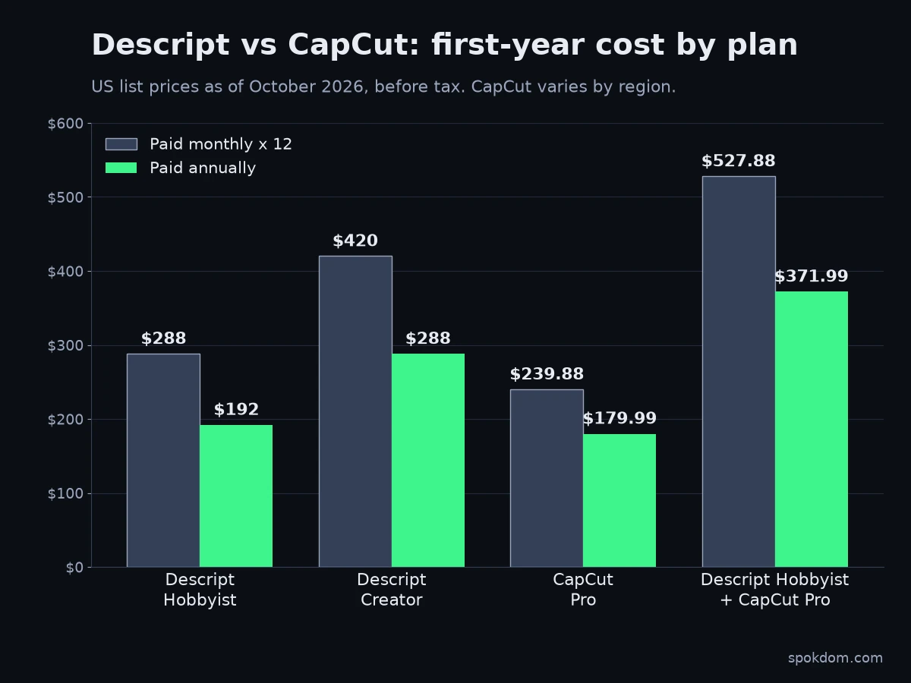

Descript vs CapCut comes down to one question: is your video mostly people talking, or mostly visuals moving? Descript edits video by editing a transcript, so it wins for podcasts, interviews, and talking-head YouTube. CapCut is a timeline editor packed with templates and effects, so it wins for TikTok, Reels, and Shorts, and it runs on your phone.

I went through the current top-ranking comparisons for this matchup, and almost every one is written by a third video tool that ends by pitching itself. Few list real prices, and two contradict each other on watermarks. So I compared both on their own pricing pages, help centers, and terms of service as of October 2026. This is a paper comparison plus general familiarity with both editors, not a months-long lab test, so confirm prices at checkout.

📌 Quick take
Pick Descript if you edit long, spoken content on a laptop: transcript editing, filler-word removal, and Studio Sound save the most time there.

Pick CapCut if you make short vertical videos, edit on your phone, or post mostly to TikTok: its template library goes further, though auto captions now generally need a paid plan.

Descript's free plan exports at 720p with a watermark. CapCut's free plan is looser, but read its content license before you upload client footage.

## Descript vs CapCut at a glance

Here's the short version in one table. Prices are US list prices as of October 2026. Descript's come from its official pricing page; CapCut's monthly prices come from [CapCut's own pricing page](https://article.capcut.com/pricing), which says displayed prices are for reference and the final price appears after sign-in. The Pro annual price comes from [Costbench's CapCut tracker](https://costbench.com/software/video-editing/capcut/) (checked October 10, 2026).

| | Descript | CapCut |
|---|---|---|
| Core editing model | Edit the transcript, video follows | Visual timeline with tracks |
| Platforms | Mac, Windows, web browser | iOS, Android, web, Mac, Windows |
| Free plan | 1 media hour/month, 720p, watermarked | Basic editing and free templates |
| Entry paid plan | Hobbyist $16/mo annual ($24 monthly) | Pro $19.99/mo or $179.99/yr |
| Next tier up | Creator $24/mo annual ($35 monthly) | Ultra $79/mo (mostly extra AI credits) |
| Top export | 4K on Creator and Business | 4K on Pro (per 2026 pricing guides) |
| Audio cleanup | Studio Sound, filler-word removal | Basic noise reduction and voice tools |
| Templates and effects | Small library | Very large, trend-driven library |
| Team seats | Creator up to 3, Business up to 5 | Teams plan, $12.49 per seat/mo |
| Best for | Podcasts, interviews, tutorials | Shorts, Reels, TikTok, mobile edits |

## What's the real difference between Descript and CapCut?

Descript treats your video like a document; CapCut treats it like a stack of layers. In Descript you upload a recording, it transcribes it, and deleting a sentence from the text deletes it from the video. That's fast for anything driven by speech, because finding a bad take is as easy as reading.

CapCut starts from the timeline. You drag clips, trim, stack text and stickers, add transitions, and apply effects. It does have transcript-based cutting and auto captions, but they sit inside a visual editor rather than defining it. Descript's own comparison page puts it bluntly: "CapCut has text-based editing, but good luck finding it." Vendor bias aside, the point stands: in CapCut, text editing is one feature; in Descript, it's the whole interface.

The practical result: Descript is quicker for the rough cut of a 40-minute interview, and CapCut is quicker for the visual finish of a 30-second clip. Neither one fully replaces the other.

## Which is better for podcasts and talking-head videos?

Descript, for most people. Spoken content is where transcript editing pays off, and Descript layers three tools on top of it. Filler-word removal finds every "um" and "you know" so you can cut them in one pass. Studio Sound cleans up echo and room noise from a laptop mic. And Underlord, Descript's AI editing assistant, can take on routine edits from a typed request.

Transcription covers 25 languages on every plan, including free, according to Descript's pricing page. Accuracy depends heavily on your audio. No independent benchmark comparing the two tools' transcripts turned up, so treat any "X% accurate" claim in a vendor roundup with suspicion. Record a 5-minute test in your real setup and read the transcript yourself.

Where Descript is weaker: heavy visual styling. Its effects and template library is small next to CapCut's, and there is no phone app. Descript's [system requirements page](https://help.descript.com/getting-started/descript-system-requirements) says it isn't officially supported on mobile browsers or tablets, so editing happens in the Mac or Windows desktop app or in the browser, where Chrome, Edge, and Opera are the officially supported ones.

## Which is better for TikTok, Reels, and YouTube Shorts?

CapCut. It was built for short vertical video and it shows: a large library of trending templates, animated captions, beat-synced effects, and editing that works the same on a phone as on a desktop. Its direct TikTok connection (both come from the ByteDance family) is a genuine convenience if that's where you post.

Descript can make Shorts too. Its clip tools can pull highlights from a long recording and reframe them vertically. But it's the better pick only when the Shorts are cut from long talking videos you already edit in Descript. For original short-form content, the template depth tips it to CapCut.

## Where does each free plan stop being free?

Descript's free plan stops being useful the moment you publish. It gives you 1 media hour per month, 720p export, and a watermark, plus 100 one-time AI credits. Descript's FAQ says the free plan "includes everything you need to record, edit and mix audio and video content", which is true for testing. But media hours count every file you upload or record, transcribed or not, so a single long interview can use up the month.

CapCut's free plan goes further, with an asterisk. Its help center says exports can be watermark-free "depending on the editing features you use," and that certain advanced templates, effects, and stock elements add a watermark in the free version. Third-party reviews disagree on whether every free export is branded, so do one short test export before you plan a channel around it. The usual culprits are a template's ending clip and Pro-labeled assets. Auto captions have also tightened: CapCut's own [Standard vs Pro help page](https://www.capcut.com/help/capcut-standard-vs-pro) lists auto captions among Pro's AI tools, and [Descript's blog](https://descript.com/blog/article/capcut-captions-arent-free-anymore-heres-a-better-option) reports they left the free plan, though some reviews still describe a capped free allowance as of October 2026.

⚠️ Watch the paywall timing
On both tools you can hit the limit mid-project: a Descript upload that pushes you past your media hours, or a CapCut Pro effect you only discover at export. Check the plan limits before you start a client edit, not after.

## What does a year of each actually cost?

First-year totals below use list prices, because the monthly-vs-annual gap is bigger than most roundups admit. Figures are US list prices as of October 2026, before tax. Descript's come from [its official pricing page](https://www.descript.com/pricing); CapCut's monthly price comes from [CapCut's pricing page](https://article.capcut.com/pricing) and the annual price from [Costbench's tracker](https://costbench.com/software/video-editing/capcut/). Confirm in CapCut's in-app checkout for your region.

| Setup | Paid monthly for 12 months | Paid annually |
|---|---|---|
| Descript Hobbyist (1080p, 10 hrs/mo) | $288 | $192 |
| Descript Creator (4K, 30 hrs/mo) | $420 | $288 |
| CapCut Pro | $239.88 | $179.99 |
| Descript Hobbyist + CapCut Pro | $527.88 | $371.99 |

If you already hold an older CapCut annual plan, check your renewal price: [Newsweek reported in February 2026](https://newsweek.com/app-used-millions-nearly-doubles-subscription-price-overnight-11535999) that some annual Pro plans were moving from around $77 to $179.99 a year at renewal, starting as early as February 20, 2026.

Two things jump out. First, Descript's annual discount (up to 35%, per its pricing page) is larger than CapCut's, so if you're committing to Descript, annual billing matters more. Second, running both tools costs roughly $372 a year on annual billing. That's worth it only if you publish long-form and short-form every week. CapCut prices vary noticeably by country and by where you subscribe; several 2026 guides report app-store subscriptions costing more than buying on capcut.com.

## Is CapCut safe to use for client work in 2026?

It's legal and available in the US, but the content license deserves a careful read. CapCut was pulled from US app stores in January 2025 alongside TikTok and later restored. On January 23, 2026, TikTok's newsroom announced the TikTok USDS Joint Venture and, as reported at the time, said its safeguards also extend to CapCut and Lemon8. US users are governed by separate CapCut US terms.

The licensing question is older than that deal. CapCut's June 2025 terms update drew criticism from creators and lawyers. [CapCut's terms of service](https://www.capcut.com/clause/terms-of-service), last updated April 15, 2026, still contain it. The "General Terms – All Users" version grants "a non-exclusive, royalty-free, transferable, sub-licensable, perpetual and worldwide license to use your User Content." The "General Terms – All United States Users" version, carrying the same April 15, 2026 date, grants the TikTok USDS Joint Venture an "unconditional, non-exclusive, royalty-free, fully transferable" license with the same perpetual, worldwide scope. YouTube and Instagram use broad license language too, but a cloud editor also holds your unpublished raw footage.

My take: for your own social content, this is a normal platform trade-off. For client footage under an NDA, or unreleased product video, keep that material in a tool with narrower terms or edit locally, and read the version of the terms that applies in your country.

## Who should pick which

For a typical solo creator, choose by format, not by feature lists.

| If you mostly make… | Pick | Why |
|---|---|---|
| Podcasts or video interviews | Descript | Transcript editing and Studio Sound save the most hours |
| Talking-head YouTube tutorials | Descript | Cut by reading; Hobbyist covers 1080p |
| TikTok, Reels, Shorts from scratch | CapCut | Templates, effects, phone editing; free covers basics, Pro adds 4K |
| Phone-only editing | CapCut | Descript has no mobile app |
| Client or NDA footage | Descript (or a local editor) | Narrower content risk than CapCut's license |
| Long-form plus weekly short clips | Both, or Descript alone | Descript clips first; add CapCut only for heavy styling |

Here's what I'd skip: paying for both on day one. Start with the tool that matches your main format, use its free tier for one real project, and add the second only when you feel a specific gap. If you're also recording walkthrough videos for clients, my [free Loom alternatives guide](/free-loom-alternatives/) covers the screen-recording side.

## FAQ

**Q. Is Descript better than CapCut for YouTube?**
A. For talking-head, tutorial, and podcast-style YouTube, yes, because transcript editing makes long spoken edits faster. For visually heavy videos or Shorts made from scratch, CapCut's templates and effects are the better fit.

**Q. Does CapCut have text-based editing like Descript?**
A. Yes, CapCut includes transcript-based cutting and auto captions (limited or paid), but they sit inside a visual timeline editor. Descript builds its entire interface around the transcript, so it's faster for dialogue-heavy edits.

**Q. Is Descript's free plan enough to start a podcast?**
A. Only for testing. As of October 2026 the free plan includes 1 media hour per month, 720p export, and a watermark. Most weekly podcasts will need Hobbyist or higher.

**Q. How much is CapCut Pro compared to Descript?**
A. As of October 2026, CapCut's US pricing page lists Pro at $19.99 a month (trackers report $179.99 a year), versus $16–24 a month for Descript Hobbyist depending on billing. Pro is the cheapest paid CapCut plan on its pricing page. The roughly $9.99 Standard tier was sold earlier in 2026 but is no longer on CapCut's pricing page as of October 2026 (it may still appear in some app stores). Prices vary by region, so confirm at checkout.

**Q. Can I use CapCut and Descript together?**
A. Yes. A common split is a rough cut and audio cleanup in Descript, then visual finishing for short clips in CapCut. Just budget about $372 a year for both on annual billing.

---

**Related keywords** — #descriptvscapcut #capcutvsdescript #descriptpricing #capcutpro #textbasedvideoediting #podcastvideoediting #shortformvideoeditor #capcutterms #descriptfreeplan #videoeditingforcreators
