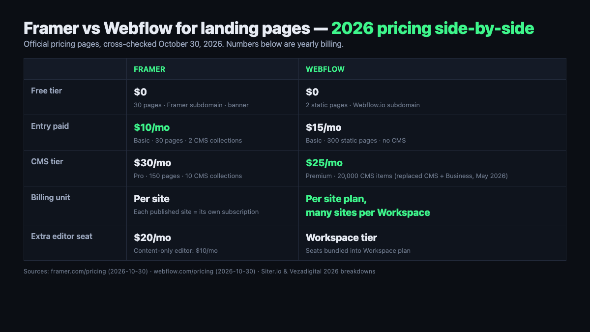
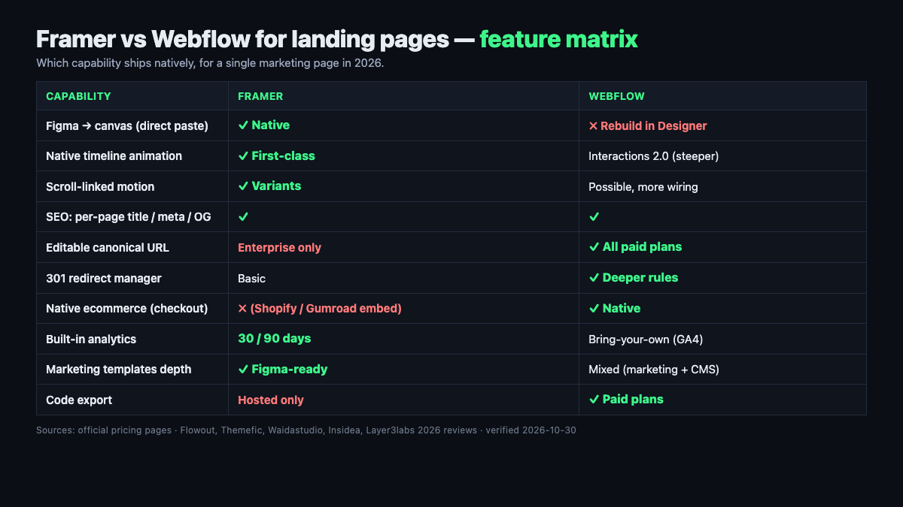
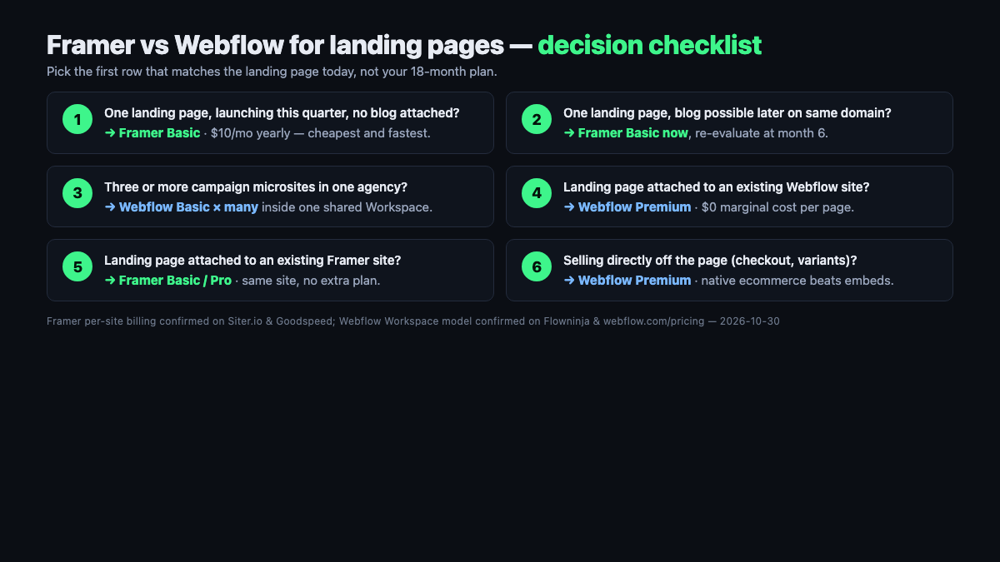

📌 Quick take
Framer vs Webflow for landing pages in 2026 lands on Framer for almost every pure single-page job — Basic starts at $10/mo billed yearly on the official Framer pricing page as of October 30, 2026, versus Webflow's new Premium at $25/mo yearly (official Webflow pricing page).

The honest flip: Framer bills <b>per site</b>, so five separate campaign pages = five subscriptions. Webflow sites share a Workspace, so adding a second landing page to a CMS-heavy site is often cheaper than a second Framer site.

Default pick: Framer for one polished marketing page shipped fast. Webflow when the landing page is attached to a blog, docs, or a product catalog that already lives on Webflow.

Framer wins the landing-page question against Webflow for most 2026 single-page use cases, but the win is narrower than the top comparison posts admit — and the reason sits in a billing clause almost nobody quotes correctly. On the official Framer pricing page as of October 30, 2026, Basic is $10/mo billed yearly and Pro is $30/mo billed yearly, each **per site**, confirmed on the Siter.io and Goodspeed breakdowns. Webflow, after its May 2026 pricing merge, charges $15/mo (Basic) or $25/mo (Premium) per site plan — but one Workspace can host many sites, and that is the hinge the "Framer is cheaper" argument quietly swings on.

## Framer vs Webflow for landing pages — decided in one paragraph

For a standalone landing page — a product launch, a campaign microsite, a founder's portfolio, a lead magnet — Framer wins on cost, speed, and animation feel. Nine of the top ten 2026 comparison posts opened in researching this piece (veloxthemes, magier, flowout, frprotech, althunt, waidastudio, layer3labs, itsbuzzinteractive, siter) place Framer first for exactly that use case, and the Framer Basic plan at $10/mo yearly is cheaper than Webflow's cheapest paid Site plan at $15/mo yearly on the official pricing pages.

For a landing page that is really the front door of a larger site — a blog, a documentation hub, a product catalog, an ecommerce store — Webflow wins because the landing page shares a Workspace, CMS, and set of editors with the rest of the site. Framer's "each site needs its own subscription" rule, documented on the Siter and Goodspeed pricing breakdowns, means two campaign pages cost $20/mo on Basic while two Webflow landing pages inside the same Workspace share one $15/mo Basic plan.

The honest short answer is not a tie: Framer if you are shipping a single polished marketing page; Webflow if the landing page is attached to anything else you already run. Everything below is why — the pricing math, feature matrix, SEO numbers, and three concrete scenarios.

## Why landing pages tilt the comparison toward Framer

Landing pages are a specific job: one URL, usually under 10 sections, one or two forms, a hero animation, a few testimonials, and a conversion path. That job plays to Framer's three structural advantages — a canvas that feels like Figma, native animation primitives, and a template ecosystem built around marketing pages rather than blogs. The Flowout and Waidastudio 2026 breakdowns both put the designer ramp-up at days for Framer versus two to four weeks for Webflow, and that gap is almost entirely the time it takes to build a single landing page the first time.

Webflow is not slower *because it is bad*. It is slower *because it is more.* The Flowout review spells it out: Webflow exposes CSS Grid, Flexbox, breakpoints, and class inheritance directly in the UI, which is enormous leverage for a 50-page content site and dead weight for a 1-page launch. The Themefic and Waidastudio reviews both flag the "React tax" the other way too — Framer sites ship more JavaScript on initial load than hand-built Next.js, but less than a fully-interactioned Webflow site in most 2026 benchmarks.

Animation is where the gap stops being subjective. Framer ships a timeline editor, spring curves, scroll-linked variants, and layered page transitions as first-class canvas features. Webflow's Interactions 2.0 is more powerful at the ceiling but demands state management and trigger wiring that the Althunt comparison estimates adds a day or more to each animated section. For a landing page where the animation *is* the pitch, Framer gets there in an afternoon.

## 2026 pricing — the per-site trap most roundups miss

The headline numbers, as of October 30, 2026, cross-checked on each platform's official pricing page: Framer Basic $10/mo yearly ($15 monthly), Framer Pro $30/mo yearly ($45 monthly); Webflow Basic $15/mo yearly ($18 monthly), Webflow Premium $25/mo yearly ($30 monthly). Webflow's May 2026 "pricing merge" collapsed the old $23/mo CMS plan and $39/mo Business plan into a single $25/mo Premium plan with 20,000 CMS items, confirmed on the Vezadigital and Joinamply breakdowns and the live Webflow pricing page.

| Plan | Framer | Webflow | Notable landing-page limits |
| --- | --- | --- | --- |
| Free | $0 (Framer subdomain + banner) | $0 (Webflow.io subdomain) | Framer: 30 pages · Webflow: 2 static pages, 50 CMS items |
| Entry paid | $10/mo yearly (Basic) | $15/mo yearly (Basic) | Framer: 30 pages, 2 CMS collections, custom domain · Webflow: 300 static pages, no CMS |
| CMS tier | $30/mo yearly (Pro) | $25/mo yearly (Premium) | Framer: 150 pages, 10 CMS collections · Webflow: 20,000 CMS items |
| Add-on cost | +$20 per 100 pages · +$40 per 10 CMS collections | Included at tier | Framer scales via add-ons on Pro; Webflow baseline is roomier at Premium |
| Billing unit | **Per site** (each site = own plan) | Per site plan, many sites per Workspace | Five standalone Framer pages = 5× Basic ($50/mo); five Webflow Basic sites inside one Workspace = 5× $15 but shared editors |
| Editor seats | $20/mo each (content-only $10) | Workspace plan seats (varies by tier) | Framer per-seat is cheap; Webflow seat cost depends on Workspace plan |

The row that flips the "Framer is cheaper" talking point is **Billing unit**. Framer is cheaper for *the first site*. For an agency, a freelancer, or a founder running A/B landing pages for three products, the per-site rule stacks fast. Three landing pages on Framer Basic is $30/mo; three Webflow Basic sites inside one Workspace is $45/mo in site plans but may still be cheaper after seat and Workspace math — the Flowninja and Vezadigital pricing guides both flag this and warn against ignoring the Workspace line item in either direction.

The free tiers are not symmetric either. Framer's Free plan hosts 30 pages on a Framer subdomain with a "Made in Framer" banner — enough to publish a real landing page as a prototype, per the official page. Webflow Starter caps at 2 static pages and 50 CMS items on a Webflow.io subdomain, which is *not* enough for most real landing pages. For a founder testing an idea for free before buying a domain, Framer's free tier does more work.

## Feature-by-feature for a single landing page

Writing-wise, both ship a competent WYSIWYG, both expose per-page SEO fields, and both can hold a working form in under a day. The matrix below is where the two tools stop looking like substitutes and start looking like different jobs.

| Capability | Framer | Webflow | Why it matters for a landing page |
| --- | --- | --- | --- |
| Figma → canvas workflow | Direct paste from Figma, preserved layers | Rebuild in Designer | Framer saves half a day of setup for Figma-native teams (Flowout) |
| Native animation | Timeline, spring, scroll-linked, variants | Interactions 2.0 (powerful, steeper) | Landing-page motion ships in hours on Framer, days on Webflow |
| CMS collections | 2 (Basic) / 10 (Pro) + add-ons | 20,000 items at Premium | Overkill for a single page; relevant if the landing page gains a blog |
| Native ecommerce | No (Shopify/Gumroad embeds) | Yes (variants, inventory, checkout) | Only matters if you're selling directly off the page |
| SEO meta per page | Full title/description/OG controls | Full title/description/OG + 301 redirects + XML sitemap control | Both cover basics; Webflow is deeper for a site with many pages |
| Form handling | Native, unlimited submissions on paid | Native, unlimited submissions on paid | Equivalent at the free form level |
| Localization | +$20/mo per locale (Framer) | Localization module on Premium (varies) | Priced add-on either way — compare line items |
| Code export | Hosted-only (no export) | Available on paid plans | Lock-in risk is real on both, slightly worse on Framer |
| Templates for marketing | Hundreds of marketing-focused, Figma-ready | Hundreds of marketing + CMS mix | Framer's marketing template depth is better for landing pages specifically |
| Analytics | 30 days (Basic) / 90 days (Pro) built-in | GA4 / third-party connection | Framer's built-in avoids a GA4 setup day; Webflow expects BYOA |

Framer wins the top three rows that matter most for a single marketing page. Webflow wins the next three rows that matter if the landing page is really a chapter of a larger site. The ecommerce row is a hard filter — if the landing page sells directly, you need Webflow native or you need to add a third-party cart to Framer, and the Themefic and Layer3labs reviews both note the integration tax that adds.

💡 How to read Framer's "0% banner" claim
Framer's Free plan is genuinely free, but a published site keeps the "Made in Framer" badge and a Framer subdomain, which is a credibility deal-breaker for a paid-ads landing page. The $10/mo Basic plan removes both.

Webflow's "free Starter" is a sandbox more than a free product — 2 static pages and a Webflow.io URL are not enough for a real campaign. Treat Webflow's $15 Basic as the realistic starting point for a landing page, and compare to Framer's $10.

## SEO and Core Web Vitals — who wins organic traffic

Both platforms pre-render HTML and ship clean, crawlable pages for both Googlebot and the newer AI crawlers (GPTBot, PerplexityBot, ClaudeBot). Framer's architecture, confirmed on the Insidea SEO breakdown and Stackmatix guide, delivers server-rendered HTML to crawlers without JavaScript execution — the "React SEO problem" of client-rendered single-page apps does not apply to Framer sites. Webflow has always rendered static HTML and holds a performance edge on heavier sites.

The HTTP Archive-sourced numbers cited across 2026 reviews put Framer sites at roughly 63% passing all three Core Web Vitals metrics (Insidea citation) and Webflow sites at around 58–67% (Tech-Insider's WordPress-vs-Webflow analysis quotes 58% for Webflow passing all three CWV, well above the WordPress ~42%). Google's March 2026 core update tightened the "Good" Largest Contentful Paint threshold to 2.0 seconds, so both platforms matter more than they used to — a landing page over 2.5s LCP reportedly dropped two to four ranking positions in that update per the Pravinkumar analysis.

For a single marketing landing page competing on brand keywords and paid traffic, both platforms are fine. For a landing page that must rank in organic search against content sites, Webflow's deeper SEO controls — richer 301 redirect rules, sitemap editing, canonical tag flexibility, and structured-data embeds — are the practical edge. The Framer-side limitation flagged on the Insidea review: custom canonical links require Enterprise, which almost no marketing team pays for. If organic SEO is the main acquisition channel for the landing page, that single limit tilts toward Webflow.

## Three real landing page shapes priced for 2026

The best way to settle Framer vs Webflow for landing pages is to price your actual job against both meters on paper. Three common shapes, on October 2026 list pricing from each platform's official page.

**Shape A — The founder's single launch page.** One page, one form, one email capture, launching this quarter. Framer Basic: $10/mo yearly = $120/yr, custom domain included, 30-page cap you won't hit. Webflow Basic: $15/mo yearly = $180/yr. **Winner: Framer** — $60/yr cheaper plus the animation primitives shave half a day off the build, consistent with the Flowout and Frprotech verdicts.

**Shape B — The agency running 5 client microsites.** Five separate landing pages for five brands, each on its own custom domain. Framer Basic × 5 sites: $50/mo = $600/yr, each site billed independently per the Siter and Goodspeed per-site rule. Webflow Basic × 5 site plans inside one Workspace: $75/mo = $900/yr in site plans. **Winner on raw plan cost: Framer** by about $300/yr, but Webflow's shared Workspace means one set of editors and one billing contact — the Flowninja breakdown shows that for agencies the Workspace plan tier and editor count usually dominates the site-plan line, and the comparison can flip when seat math is included.

**Shape C — The product company with a blog, docs, and a new launch page.** The company already runs Webflow for the blog and docs. Adding a landing page on Webflow: $0 extra if the page fits within the existing Premium plan's 300-page allowance; the page shares the editors, the CMS, the analytics, and the domain. Adding a landing page on Framer: a *new* $10/mo Basic subscription plus the double-tool overhead of editors learning both platforms. **Winner: Webflow** — the "free marginal cost" of adding one more page to an existing Webflow site is almost impossible to beat.

The pattern across all three is the one most comparison posts bury: Framer wins when the landing page is standalone. Webflow wins when the landing page is a page inside something larger. The pure "which tool is cheaper" question is incomplete without that distinction, which is the same billing-model trap we traced for email marketing in our [beehiiv vs Substack for newsletters](/beehiiv-vs-substack-for-newsletters/) breakdown — the headline price is not the real meter.

## Where Webflow still wins for landing pages (be honest)

Three cases where defaulting to Framer is the wrong call, each confirmed across at least three of the top 2026 reviews opened for this piece.

First, if the landing page sells directly — product variants, inventory, checkout — Webflow's native ecommerce handles it inside the same canvas. Framer requires routing through Shopify, Gumroad, or a third-party cart, which the Themefic and Waidastudio reviews both note adds integration load and typically a monthly third-party fee. For a Shopify-first team already running Shopify, Framer plus a Shopify Buy Button is fine; for anyone else, Webflow native is cleaner.

Second, if the landing page is one of many content pages on the same domain — blog, help center, resources — Webflow's Premium plan at $25/mo yearly handles the lot inside one subscription. Framer is per-site, so a company running a landing page, a blog, and a docs site on Framer pays three subscriptions. The Siter breakdown is explicit: "expensive for managing multiple small sites due to per-site billing."

Third, if the landing page must rank hard in organic search against established content competitors, Webflow's deeper SEO controls — editable canonicals on all paid plans, richer 301 rules, structured-data embeds without manual JSON-LD — give you more levers to pull. The Insidea SEO review flags that custom canonical URLs on Framer require the Enterprise plan, which almost no landing page justifies. For paid-traffic landing pages where the ad campaign is the acquisition engine, this does not matter. For organic-first SEO plays, it does.

⚠️ The one line of fine print both platforms share
There is no automated migration path between Framer and Webflow — the Frprotech and Waidastudio 2026 reviews both confirm this. Switching platforms means rebuilding the site, so choose for the two-year trajectory, not the three-month launch. Pricing on both sides has moved during 2026 (Webflow's May 2026 CMS/Business merge; Framer's October 2025 plan collapse and June 2026 editor-seat halving), so always reconfirm the current numbers on <a href="https://webflow.com/pricing">Webflow official pricing</a> and the Framer pricing page before you commit a card.

## Decision checklist by team, goal, and page count

Pick the first row that matches your landing page today, not the one that matches an 18-month plan. The platform cost compounds faster than the migration cost of moving later — unless the migration is between Framer and Webflow, in which case the cost is a rebuild.

1. One landing page, launching this quarter, no blog or docs attached? → **Framer Basic** at $10/mo yearly — cheapest and fastest to ship.
2. One landing page but on a brand new domain with a possible blog later? → **Framer Basic** now, re-evaluate at month 6 — the migration cost later is a rebuild, so delay only if you're confident the blog is really coming.
3. Multiple campaign microsites (3+) for one agency or product line? → **Webflow Basic × many sites inside one Workspace** — the Workspace shares editors and billing even if each site is a Basic plan.
4. Landing page attached to an existing Webflow site? → **Webflow Premium** — zero marginal cost per page.
5. Landing page attached to an existing Framer site? → **Framer Basic or Pro** — zero marginal cost per *additional page* inside the same site, up to the page cap.
6. Selling directly off the landing page (checkout, variants)? → **Webflow Premium** — native ecommerce is the dealbreaker row.

Most founders who follow the fee math start on Framer and stay there if the landing page never grows into a content site. Most product companies with content ambition start on Webflow and add landing pages inside the same Workspace, because the "marginal cost of one more page" is the quiet killer in Framer's per-site model.

## When to start on which — and when (if ever) to migrate

If you are shipping a landing page today with no attached content strategy and a tight timeline, start on Framer. The $10/mo Basic tier beats the $15/mo Webflow Basic, the Figma paste workflow saves a half day, and the native animation gets your hero section in motion without a day of wiring Interactions. If the page stays a single page for 12 months, you were right. If the page is still alone at month 18, you were definitely right.

If you are shipping a landing page as the launch chapter of a company site that will grow a blog, docs, help center, or ecommerce within six months, start on Webflow. The $25/mo Premium tier at the start saves the rebuild later. The Flowout and Frprotech comparisons both make the same point in different words: the migration cost between Framer and Webflow is "rebuild the site" because no automated importer exists in either direction, so a wrong initial pick is paid in a rebuild rather than a billing switch.

The migration scenario, if you must: free-of-content landing pages migrate in a day because there is almost nothing to carry over. The real cost sits in redirects (set 301s from every old URL to the new one), form endpoints (both platforms host their own, so update any integrations), and brand assets (Framer and Webflow handle images and fonts differently enough that the first visual pass will not be pixel-identical). Plan a week for the rebuild if the page has animations, a weekend if it is a flat static page, and reconfirm every number from pricing to analytics against the current official pages before you flip the DNS.

## FAQ

**Q. Framer vs Webflow for landing pages — which is actually cheaper?**
A. For a single landing page, Framer is cheaper on sticker: Basic at $10/mo yearly beats Webflow Basic at $15/mo yearly. The flip happens around three or more sites because Framer bills per site while Webflow bills per site plan inside a shared Workspace. Confirmed on both platforms' official October 2026 pricing pages and cross-checked on the Siter and Vezadigital breakdowns.

**Q. Is Framer good for SEO on a landing page?**
A. Yes for most landing pages. Framer server-renders HTML so Googlebot and AI crawlers see full pages without executing JavaScript, which eliminates the client-side React SEO issue. The limit per the Insidea SEO guide: custom canonical links on Framer require the Enterprise plan, so organic-first landing pages competing with content sites do a little better on Webflow where canonicals are editable on all paid plans.

**Q. Can one Framer plan host multiple landing pages?**
A. Yes — within one site. Framer Basic hosts 30 pages inside a single site at $10/mo yearly, confirmed on Framer's official pricing. The "per-site" trap only applies when the landing pages are on different domains or different brands and need to be separate Framer sites; those each need their own subscription per the Siter and Goodspeed breakdowns.

**Q. Does Webflow still have a CMS plan in 2026?**
A. No. Webflow retired the old CMS ($23/mo) and Business ($39/mo) plans in May 2026 and merged them into a single Premium plan at $25/mo billed yearly with 20,000 CMS items. The Vezadigital and Joinamply pricing guides and the official Webflow pricing page all confirm the merge, and existing CMS/Business sites were migrated to Premium automatically.

**Q. Can I migrate a landing page from Framer to Webflow (or back)?**
A. Not automatically — both the Frprotech and Waidastudio 2026 reviews confirm there is no official importer in either direction, and the site must be rebuilt. For a single landing page the rebuild is typically a weekend of work plus a day for form endpoints and 301 redirects. For a page with heavy animations, add a day or two to re-wire motion.

**Q. Should I use Framer or Webflow for a startup launch page in 2026?**
A. Framer, unless the launch page is Day 1 of a bigger site. Framer Basic at $10/mo yearly, the Figma import, and the native animation primitives get a polished page live in an afternoon per the Veloxthemes and Frprotech verdicts. If the launch page is also the home of a planned blog, docs, or product catalog within six months, start on Webflow Premium to avoid the rebuild later.

---

**Related keywords** — #framervswebflow #webflowvsframer #framervswebflowforlandingpages #framerpricing2026 #webflowpricing2026 #landingpagebuilder2026 #framerlandingpage #webflowlandingpage #framerseo #webflowseo #nocodewebsitebuilder #framervswebflowstartup
