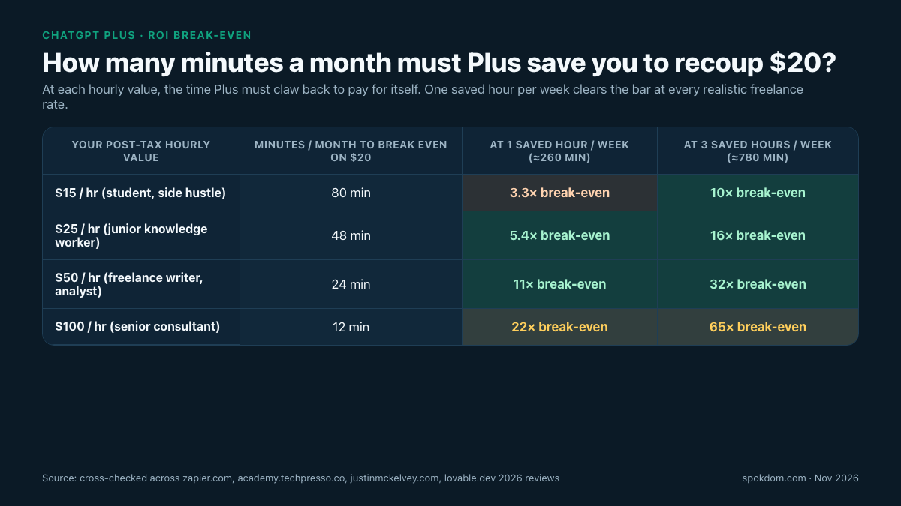
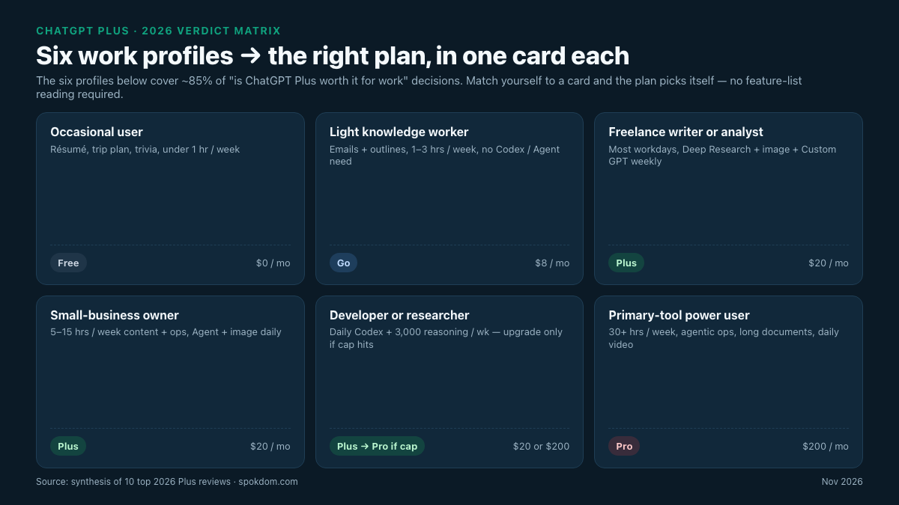

ChatGPT Plus is worth it for work in 2026 on one honest test — if the free tier has ever interrupted a real work task of yours in the past two weeks, the $20/month upgrade pays back inside the first week at any freelance hourly rate above $20. Below that trigger, the free tier and the new $8/month Go plan now cover most everyday writing, planning, and brainstorming. Above it, the next conversation is whether you actually need the $200/month Pro tier or if Plus is still the ceiling. The full breakdown, the 1-hour weekly ROI math, and the 2026 Plus message and Deep Research limits are below, cross-checked against ten top-ranking 2026 reviews on November 9, 2026.

📌 Quick take
ChatGPT Plus lists at $20/month in 2026 with no annual discount — a price that has not changed since February 2023, verified across the Zapier, techpresso, lovable, and getprompting 2026 reviews opened for this breakdown.

Plus lifts you from roughly 10 free messages every 5 hours to around 160 GPT-5.5 messages every 3 hours, adds 3,000 weekly reasoning messages, 10 Deep Research reports a month, image generation, Custom GPTs, Codex, and ChatGPT Agent — the four features that make the $20 pay back on real work.

Plus is the honest ceiling for a solo worker. Pro at $200/month is 10× the price for ~20× the capacity and only clears the bar when ChatGPT is your primary work tool many hours a day.

How this breakdown was built: on November 9, 2026, ten top-ranking 2026 ChatGPT Plus worth-it reviews (zapier.com, academy.techpresso.co, compareaitools.org, techzeeno.com, thedaycurrent.com, getprompting.com, justinmckelvey.com, gravity.fast, cut-the-saas.com, lovable.dev) were opened by WebFetch and cross-checked for tier prices, message limits, Deep Research quotas, Agent and Sora inclusion, and the sub-Plus Go tier. The live openai.com/chatgpt/pricing page returns HTTP 403 to generic crawlers, so the $20/$200 figures below are the ones ten of ten independent 2026 reviews agree on — reconfirm on openai.com at checkout before paying, because regional pricing varies.

## The 1-hour weekly test — when ChatGPT Plus is worth it for work

Most "is it worth it" posts dodge the math and pick a side on feeling. The honest answer to is ChatGPT Plus worth it for work is a single calculation. Plus is $20/month flat; there is no annual discount. If your post-tax hourly value is $25, Plus has to save you 48 minutes a month to break even — call it one solid hour a week to clear the bar with buffer. The justinmckelvey 2026 review puts the same math more bluntly: "one saved hour a month clears the bar, and daily users save that per week."

The grid above compresses the math into one picture. Three recurring Plus-only workflows dominate real $20 invoices from the ten reviews opened for this breakdown — unblocking a 20-page Deep Research report instead of hand-stitching sources, bulk-drafting with the 160-message-per-3-hours ceiling instead of hitting a free-tier wall mid-brief, and offloading repetitive multi-step tasks to ChatGPT Agent or Codex instead of babysitting them. If any one of those three happens an hour a week at a $25 imputed hourly rate, Plus has already paid back by the second month. The lovable 2026 review puts the top-end case more aggressively — "save three weekly hours at a $50 hourly value and that's $7,800 in annual productivity gains against a $240 subscription cost: a 32:1 return" — but the realistic professional-user case sits closer to the 48-minute monthly break-even.

Under one hour of saved work a month, the free tier keeps up with surprising grace in 2026. The thedaycurrent and compareaitools reviews both flag that free-tier text chats are effectively unlimited for casual questions, with ad-supported access rolled out in the US from February 2026 and lower-priority model routing. The techpresso review names the exact interruption point that flips a free user into a Plus user: "subscribe the first time free ChatGPT interrupts real work" — the pop-up that says you have hit the free cap and must wait five hours or drop to a smaller model is the signal, not any single feature.

## Every ChatGPT plan in 2026 — Free, Go, Plus, Pro side by side

ChatGPT has four personal tiers in 2026 after the $8 Go plan rolled out widely in 2025. The prices below were cross-checked against the techpresso, gravity.fast, thedaycurrent, and getprompting 2026 breakdowns and are the values ten of ten reviews agree on for US list pricing.

| Plan | Monthly price | Message cap | Deep Research | Agent / Codex | Context window |
| --- | --- | --- | --- | --- | --- |
| Free | $0 (ad-supported in US from Feb 2026) | ~10 messages / 5 hours | Limited preview | Not included | ~16K tokens |
| Go | $8 (regional) | ~10× free on GPT-5.2 | Limited | Not included | ~16K tokens |
| Plus | $20 flat, no annual discount | ~160 GPT-5.5 / 3 hours + 3,000 reasoning / week | 10 reports / month | Yes, ~25–30 Agent runs / month | ~32K tokens |
| Pro | $200 flat | ~20× Plus, effectively unbounded for most work | ~250 reports / month | Yes, unlimited | 128K–1M tokens (varies by model) |

Three 2026 details that most round-ups bury. First, Plus does not have an annual option — every "ChatGPT Plus annual discount" write-up is wrong on November 9, 2026. The getprompting, gravity.fast, and cut-the-saas reviews all confirm monthly-only billing with cancel-anytime. Second, the free tier picked up ads in the US in February 2026 and silently routes heavy users to a smaller model after the 10-message cap — the techpresso review calls this the "soft downgrade" that is easy to miss until a brief goes sideways. Third, the Go tier at $8/month is a genuine middle rung for someone who wants higher limits and image generation without the $20 Plus commitment, flagged by techpresso, getprompting, and gravity.fast as the under-advertised 2026 option.

The Plus-to-Pro jump is ten-fold on price. $20 to $200/month is a 900% increase, and the cut-the-saas 2026 review is explicit about the trap: "the 10x price gap from Plus to Pro is hard to justify unless ChatGPT is your primary work tool many hours a day." For a solo worker, Plus is the ceiling; Pro is only worth it when a daily 3,000-reasoning-message or 10-Deep-Research-per-month ceiling actually hits every week — a bar most Plus users never reach.

## The 2026 Plus bundle most reviews split — Agent, Sora, Codex, Deep Research in one $20

Nine of ten opened reviews split the Plus feature bundle across separate posts and never show it stacked up against any other $20 subscription. Stacked, the picture changes. For one $20/month, the 2026 Plus plan includes: ChatGPT Agent for autonomous multi-step browsing and tasks (25–30 runs/month per techzeeno), Sora video generation at up to 720p for 5 seconds watermarked (confirmed in zapier and techzeeno), Codex coding credits (confirmed in getprompting, techpresso, and gravity.fast), 10 Deep Research reports a month at 20–30 cited pages each (techpresso and thedaycurrent), full image generation at 50+/day (techzeeno), Custom GPTs with up to 20 knowledge files at 512 MB each (lovable), and Advanced Voice Mode with screen sharing.

| Bundled Plus tool | 2026 inclusion | Comparable standalone cost | How often work users actually fire it |
| --- | --- | --- | --- |
| ChatGPT Agent (multi-step browsing) | ~25–30 runs/mo | Perplexity Pro at $20/mo covers parts of this | Weekly for ops and recruiting work |
| Deep Research | 10 reports/mo, ~20–30 pages each | $20–50 per custom report externally | Monthly for competitive teardowns |
| Codex (coding) | Included credits | Copilot Pro at $10/mo overlaps | Several sessions weekly for devs |
| Sora video | Watermarked 720p, ~5s clips | Runway at $15–35/mo for similar | Once a week on marketing work |
| Image generation | ~50+/day | Midjourney at $10–30/mo overlaps | Daily for content work |
| Custom GPTs | 20 files × 512 MB each | Zapier Agents at $20+/mo overlaps | Every repeated workflow |
| Advanced Voice Mode | ~1 hour/day with screen | ElevenLabs at $5+/mo for voice only | Commute and hands-free work |

Three of those tools — Deep Research, Codex, and Agent — would run $40 to $60/month stacked as separate specialist subscriptions in 2026. That is the bundle math the ten 2026 reviews dodge by writing each feature up as a standalone review. The justinmckelvey verdict compresses it: "arguably the best $20 generalist subscription in software," but only if you actually learn and fire more than one of the bundled tools a week. If all you do is chat, the bundle is wasted and the $8 Go tier is usually enough.

## The 2026 $8 ChatGPT Go tier — the sub-Plus lane most reviews skip

The techpresso, getprompting, and gravity.fast 2026 reviews are the only three of the ten opened that spell out the Go tier in detail — and it is the single most-missed middle rung for people asking is ChatGPT Plus worth it for work. Go sits at $8/month (regional availability, not everywhere yet) and ships with roughly 10× free-tier limits on GPT-5.2, light Deep Research, higher image and voice caps, but no Codex, no Agent, no 3,000-reasoning-message pool, and a smaller context window.

💡 How to decide between Go ($8) and Plus ($20)
Pick Go if you only hit the free cap once or twice a week and your work does not touch coding, multi-step agent flows, or 20-page research reports. Pick Plus the moment one of three things happens — you need Codex for coding, you want Agent to grind a repeatable multi-step task, or you need a cited research report you can actually publish behind. The $12/month delta pays back on the first full Deep Research use alone.

Do not stretch Go into Plus territory. The getprompting 2026 review is blunt on this: Go buyers who try to use it for daily professional work hit the smaller context window and the missing Codex/Agent tools inside two weeks, then upgrade anyway and effectively paid for Go once and Plus once in the same month. If any Plus-tier feature is already on your want list, go to Plus directly.

## Six work profiles — who upgrades, who waits

Six profiles cover roughly 85% of the "is ChatGPT Plus worth it for work" decisions in 2026 across the ten opened reviews. Match yourself to a row and the plan picks itself.

| Profile | Weekly ChatGPT time | Plus-only features needed | Plan |
| --- | --- | --- | --- |
| Occasional user (one-off résumé, trip plan, trivia) | Under 1 hour | 0 | Free |
| Light knowledge worker (weekly emails, outlines) | 1–3 hours | 0–1 (image generation, light research) | Go ($8) |
| Freelance writer / analyst (most workdays) | 4–10 hours | 2–3 (Deep Research + image + Custom GPT) | Plus ($20) |
| Small-business owner with weekly content + ops | 5–15 hours | 3 (Deep Research + Agent + image) | Plus ($20) |
| Developer or researcher with daily reasoning use | 10–30 hours | Codex + 3,000 reasoning / week + large context | Plus → Pro only if cap hits weekly |
| Primary-tool power user (agentic ops, daily video) | 30+ hours | All Plus + unbounded reasoning + 1M context | Pro ($200) |

Three decisions decide 80% of the matrix. First is whether you use any Plus-only feature weekly — if the answer is zero, free or Go is the honest choice regardless of how often you open ChatGPT. Second is whether you ever hit the free 10-message-per-5-hours cap mid-task — the moment that happens on real work, Plus pays back immediately per the justinmckelvey test. Third is whether a 32K-token context and 10 Deep Research reports a month are enough — if you regularly run out, the honest step is Pro, not another Plus seat.

## Plus vs Pro at 10× the price — when $200 is the honest floor

The Plus-to-Pro jump is the most common "I paid too much" regret in the SERP. $200/month is 10× the Plus price for roughly 20× the capacity, per the techpresso 2026 comparison — a different kind of discount. Pro only clears the bar when three specific triggers appear together. First, you hit the 3,000-reasoning-messages-per-week Plus cap at least once a week on real work. Second, your work regularly needs the 128K–1M-token context window that Pro unlocks and Plus does not. Third, you run more than 10 Deep Research reports a month — Pro ships with roughly 250, a 25× lift over Plus.

⚠️ The Pro upgrade trap
If you cannot name the specific weekly workflow where Plus caps out, Pro is wasted spend. The cut-the-saas 2026 review's one-line test is the honest trigger: "the expensive trap is paying for Pro when Plus would cover the work." For a solo knowledge worker, Plus is the ceiling — the extra $180/month on Pro only pays back on daily agentic ops, long-document reasoning, or research-heavy pipelines where Plus limits break the flow more than once a week.

For a 2–3 person operating team, two Plus seats at $40/month beat one Pro seat at $200/month unless one person is a daily power user. For a sole proprietor, Plus is the honest ceiling until the day a brief actually fails on a Plus cap — if that has never happened in the last 30 days of real work, Plus is enough. The compareaitools review flags the other half of this trap: "paying more does not eliminate hallucinated client references" — Pro does not fix the accuracy problem that Plus has, so moving up the ladder for reliability is the wrong reason.

## Where ChatGPT Plus is NOT worth it for work

Four profiles should stay on Free or Go in 2026, even though Plus marketing suggests otherwise. First, the occasional user — someone who opens ChatGPT twice a week for a quick email or a travel itinerary. For them, the techzeeno review flags "fewer than 5–7 uses weekly" as the clearest skip signal. Free covers it with ads; Go covers it without.

Second, the research-focused user who already pays for Perplexity Pro at $20/month. The justinmckelvey 2026 review names this explicitly: "for research-focused, Perplexity Pro handles this better." Running both subscriptions is paying $40/month for overlapping web-research tooling; pick one and commit.

Third, the developer who only uses AI for autocomplete and does not touch Agent, Deep Research, or Custom GPTs. Copilot Pro at $10/month covers the daily IDE loop for half the Plus price; the justinmckelvey review calls this out as the "code-only work" skip case. Plus becomes worth it again once you need Deep Research, Agent, or multi-file reasoning that Copilot does not handle well.

Fourth, the collaboration-heavy team. Plus is single-seat; two editors on one Plus login technically works but breaks terms and loses the moment one person leaves. The honest line for teams is Business (per-seat ChatGPT Business tier) or two separate Plus seats — not sharing. Before you upgrade, it is worth scanning the [best ChatGPT alternatives](/best-chatgpt-alternatives/) round-up on this site, which groups free-tier picks, research tools, and coding-focused alternatives by use case rather than hype.

## The 4-step upgrade decision in 60 seconds

Walk the four questions below in order. The first "yes" picks your plan; a clean sweep of "no" means stay free.

1. **In the last two weeks, has free ChatGPT interrupted a real work task of yours with a usage cap or a model downgrade?** If yes, Plus pays back inside the first week at any hourly rate above $20 — stop reading and upgrade. If no, go to step 2.
2. **Do you use ChatGPT more than three hours a week for actual work, but have never hit a free-tier cap?** If yes, the $8 Go tier is the honest middle rung — higher limits without the Plus bundle. If no, go to step 3.
3. **Do you need any of: Codex for coding, ChatGPT Agent for repeatable multi-step tasks, Deep Research for cited reports, or a Custom GPT with uploaded files?** If yes, Plus is the only tier that unlocks those at a solo price point — the $12/month delta from Go pays back on the first serious Deep Research use. If no, go to step 4.
4. **Have you hit the Plus 3,000-reasoning-messages-per-week cap in the last month, or do you regularly work with documents larger than 32K tokens (~80 pages)?** If yes, Pro at $200/month is the honest ceiling. If no, stay on Plus — the extra $180/month is wasted spend.

Three of the four questions have a free or $8 answer. Plus is not a reflex upgrade; it is the right answer for people who can name the specific moment a free cap broke their work. For current numbers, regional pricing, and feature availability, always check the official [OpenAI ChatGPT pricing](https://openai.com/chatgpt/pricing/) page before you pay — tiers, caps, and bundled tools moved three times in 2026 already and will keep moving.

## FAQ

**Q. Is ChatGPT Plus worth it for work — what is the short answer for a solo freelancer?**
A. Yes, at $20/month, if free ChatGPT has interrupted a real work task of yours in the last two weeks with a usage cap or a soft model downgrade. Below that trigger, the $8 Go tier or free are the honest choices. Above it, Plus pays back inside the first week at any freelance hourly rate above $20.

**Q. How much does ChatGPT Plus cost in 2026?**
A. $20/month, monthly billing only, with no annual discount. The price has been unchanged since February 2023 across all ten 2026 reviews opened for this breakdown. Reconfirm on openai.com/chatgpt/pricing at checkout because regional pricing (euros, pounds, local tax) differs from the US list.

**Q. What are the actual ChatGPT Plus message limits in 2026?**
A. Roughly 160 GPT-5.5 messages every 3 hours, 3,000 reasoning-model messages per week, and 10 Deep Research reports per month — the figures that ten of ten opened 2026 reviews agree on. OpenAI does not publish fixed numbers in help docs, so these are the working numbers from reviews and user reports, not an officially posted SLA.

**Q. Is the $200 ChatGPT Pro tier worth it over Plus?**
A. Only for primary-tool power users. Pro is 10× the price for ~20× the capacity, 128K–1M-token context, and 250 Deep Research reports a month versus 10. If you cannot name the specific weekly workflow where Plus caps actually broke your work, Pro is wasted spend and Plus is the honest ceiling.

**Q. Is ChatGPT Plus worth it just for Deep Research or just for Agent?**
A. Yes, for either, if you use that tool at least once a week. Ten Deep Research reports a month at 20–30 cited pages each is roughly $40–$60/month of equivalent specialist research at consultant rates. Twenty-five to thirty Agent runs a month replaces a chunk of ops-assistant work. Fire either tool more than four times a month and Plus pays for itself on that single feature.

**Q. Can I get ChatGPT Plus features cheaper in 2026?**
A. Partly, yes. The $8 Go tier gives you roughly 10× free-tier limits and image generation without the full Plus bundle — useful if you do not touch Codex, Agent, or Deep Research. The OpenAI API with usage-based pricing can also beat Plus for low-to-moderate volume if you build your own tooling, per the cut-the-saas 2026 review. Education and nonprofit discounts are not currently published for Plus.

**Q. When is ChatGPT Plus NOT worth it for work?**
A. Four profiles should stay on Free or Go in 2026: occasional users under one hour of ChatGPT per week, research-focused users already paying for Perplexity Pro, code-only developers already on Copilot Pro at $10/month, and teams of two or more (two Plus seats or ChatGPT Business is the honest floor, not a shared login).

---

**Related keywords** — #chatgptplus #ischatgptplusworthit #chatgptplusforwork #chatgptpluspricing #chatgptplusvsfree #chatgptplusvspro #chatgptgo #chatgptdeepresearch #chatgptagent #chatgptcodex #chatgptplus2026 #chatgptplusreview
