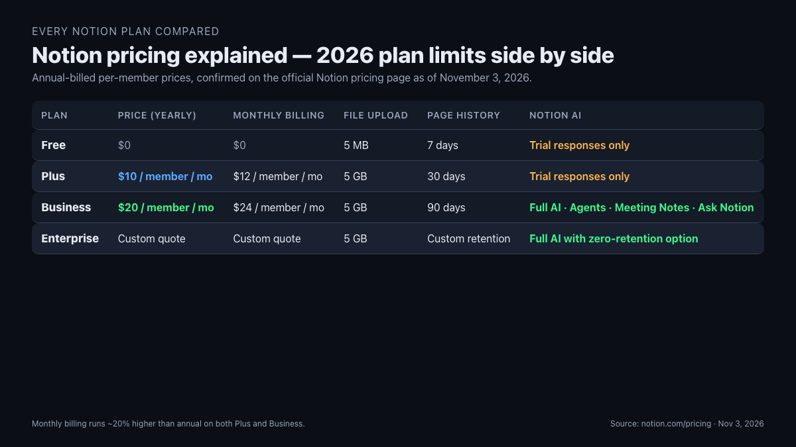
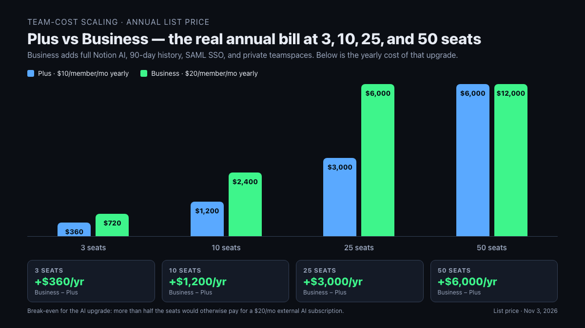

Notion pricing explained in one sentence — Free at $0, Plus at $10/member/month billed yearly, Business at $20/member/month billed yearly, Enterprise on quote. The "is it worth it" answer is also one sentence, up front: Free is enough for a solo note-taker, Plus is the honest minimum for any team of two or more, Business is only worth the jump when the team actually uses Notion AI every week, and Enterprise is a line-item for companies that need SAML and audit logs. The whole decision is a two-table exercise and the rest of this page is the tables, the math, and the one 2026 change that quietly doubled the cost of AI for most teams.

📌 Quick take
Worth it for solo use — Free covers unlimited pages, 10 guests, 5 MB uploads, 7-day history, and a limited Notion AI trial. Confirmed on the official Notion pricing page as of November 3, 2026.

Worth it for small teams — Plus at $10/member/month billed yearly ($12 monthly) removes the collaboration limits and extends history to 30 days. Notion AI is still trial-only on this tier.

Worth it for AI-first teams — Business at $20/member/month billed yearly ($24 monthly) is the only tier that includes full Notion AI (Agents, AI Meeting Notes, Enterprise Search), 90-day history, SAML SSO, and private teamspaces.

How this breakdown was built: on November 3, 2026 the live Notion pricing page plus ten top-ranking 2026 pricing explainers (plaky, eesel.ai, tinycommand, automationatlas, get-alfred, layer3labs, saascrmreview, usecarly, digijaws, nuclino) were opened by WebFetch and cross-checked on prices, plan limits, Notion AI gating, and the May 2025 AI add-on retirement. Dollar figures are current list prices before taxes and regional adjustments — reconfirm on the official page at checkout before committing a team.

## The one-paragraph verdict on Notion pricing

Notion is worth paying for when two things are true at the same time: more than one person needs to edit the same workspace, and you expect to still be using it a year from now. On the Free plan, a workspace with two or more members hits uncomfortable walls fast — the 5 MB file cap kills a single video embed, 7-day history disappears a page edited last week, and the Notion AI trial burns through its lifetime allowance in a weekend. Plus at $10/member/month annual lifts all three ceilings and, for most small teams, pays for itself in the first month by cutting the "where did that page go" tax to zero. The $10 is not generous, it is just the honest price of running a shared workspace that doesn't lose your work.

Business at $20/member/month annual doubles that cost and is only honest when the team actually uses Notion AI every week. On the official notion.com/pricing page as of November 3, 2026, full Notion AI — Notion Agent, AI Meeting Notes, Ask Notion, Enterprise Search — lives on Business and above; Free and Plus get a trial only. That is the one real "is it worth it" decision in Notion's 2026 pricing: pay $120/year extra per member for a bundled AI feature set, or stay on Plus and run a separate AI tool like [OpenAI ChatGPT pricing](https://openai.com/chatgpt/pricing/) that most of your team is probably already using.

Enterprise is only worth quoting when you need SAML SSO on every seat, SCIM provisioning, audit logs, zero-data-retention AI, or custom legal review. For every other team under about 200 seats, Business is the ceiling that actually makes sense.

## Every Notion plan in 2026 — price, limits, Notion AI

The four tiers, with annual-billing figures and the limits confirmed on notion.com/pricing on November 3, 2026, cross-referenced against the plaky, eesel, and layer3labs 2026 breakdowns:

| Plan | Price (annual) | Price (monthly) | File upload | Page history | Guests | Notion AI |
| --- | --- | --- | --- | --- | --- | --- |
| Free | $0 | $0 | 5 MB | 7 days | 10 | Trial responses only |
| Plus | $10/member/mo | $12/member/mo | 5 GB | 30 days | 10 (varies by source) | Trial responses only |
| Business | $20/member/mo | $24/member/mo | 5 GB | 90 days | Unlimited | Full AI incl. Agents, Meeting Notes, Ask Notion |
| Enterprise | Custom quote | Custom quote | 5 GB | Custom retention | Unlimited | Full AI with zero data retention option |

Two 2026 facts most comparison posts garble. First, the May 2025 restructure removed the standalone $8/member/month "Notion AI" add-on and folded full AI into Business — Plus users can no longer "just add AI" to a cheaper seat, confirmed on both the live Notion pricing page and the usecarly and saascrmreview 2026 breakdowns. Second, Custom Agents inside Business run on a separate credit meter at roughly $10 per 1,000 monthly Notion credits, pooled across the workspace, non-rolling, confirmed on the eesel.ai, saascrmreview, and usecarly pricing pages — standard AI writing and chat stay inside the seat price, but autonomous agents start burning credits once you wire them to run on a schedule.

The feature deltas that most roundups skip over: guest count on Plus varies between sources (notion.com shows a 10-guest cap on both Free and Plus, while several 2026 third-party summaries claim unlimited or 100 — treat the live Notion page as the authoritative number for your region). The 1,000-block ceiling that older comparison posts cite for free workspaces with two or more members no longer appears on the current pricing page as of November 3, 2026, so quoting it in 2026 is stale.

## The 2026 Notion AI change nobody frames clearly

The single most important thing to understand about Notion pricing in 2026 is a 2025 structural change the SERP still underplays. Before May 2025, Notion AI was an $8/member/month add-on you could bolt onto any paid plan — a Plus seat with AI cost $10 + $8 = $18/mo. In May 2025, Notion retired the standalone add-on and moved full Notion AI into the Business tier at $20/member/month, while Plus kept its $10 sticker but lost all but trial access to AI. That is a $2/member/month increase on the surface and effectively a doubled seat cost for any team that was previously running Plus + AI.

The gap bites hardest at AI-light teams. A five-person team on Plus with AI in 2024 paid 5 × $18 = $90/month. The same team on Business in 2026 pays 5 × $20 = $100/month — a $10/month bump that looks small until you add the Custom Agents credit meter on top. The ones hit worst are teams that only wanted AI writing or AI chat for one or two members: on the old add-on model, you could buy AI à la carte on exactly those seats. On the 2026 model, buying AI for one member means upgrading the whole workspace to Business or standing up a separate single-seat AI subscription outside Notion.

That is the moment the "is Notion AI worth it" question stops being about AI quality and starts being about plan math. If every member will use Notion AI weekly, Business at $20 is the single-vendor answer and the $10/member/month premium over Plus is cheaper than ten separate AI subscriptions. If only two members in a ten-person team actually use AI, the honest answer is Plus for all ten plus one shared external AI tool, because 10 × $20 = $200/month on Business compared to (10 × $10) + a shared ChatGPT Team seat = roughly $130/month on Plus.

💡 How to read "Notion AI is included" claims in 2026
Included on Business means standard AI writing, chat, Ask Notion, AI Meeting Notes, and Enterprise Search run inside the seat price with a monthly allowance tracked at the workspace level. Not included means Custom Agents — autonomous workflows that run on a schedule — bill separately at roughly $10 per 1,000 Notion credits, pooled across the workspace, no rollover.

## Plus vs Business — the real $10 upgrade decision

The hinge of Notion pricing in 2026 is not Free vs paid, it is Plus vs Business. Plus is $10/member/month annual. Business is $20/member/month annual. The $120/member/year gap buys three things: full Notion AI, 90-day page history (versus Plus's 30 days), and admin controls — SAML SSO, private teamspaces, audit logs, advanced permissions, and the "Ask Notion" workspace-wide search surface.

| What you unlock on Business over Plus | Why it matters |
| --- | --- |
| Full Notion AI (Agents, AI Meeting Notes, Ask Notion, Enterprise Search) | The only lane to native AI without a separate subscription |
| 90-day page history (vs 30 on Plus) | Covers the "I deleted that two months ago" case Plus misses |
| Private teamspaces | Legal, finance, HR get walled-off areas without leaving the workspace |
| SAML SSO + SCIM provisioning (SCIM on Enterprise, SAML on Business) | Compliance ask for most companies at or above 50 seats |
| Advanced permissions, audit logs | Required for client NDA work and SOC 2 defensibility |
| Advanced page analytics | Shows which pages your team actually reads |

The upgrade is honest when at least two of those rows apply this quarter. The upgrade is a tax when none of them apply this quarter. The number-one SERP mistake in 2026 comparison posts is treating the Plus-to-Business jump as a feature question when it is almost entirely an AI-usage question for teams under 50 seats.

## Hidden costs on top of the Notion sticker

The three dollar lines that do not show up on the headline pricing page but routinely show up on the invoice:

1. **Custom Agents credits.** Business includes standard Notion AI inside the seat price, but autonomous Custom Agents (the ones that run on a schedule or across your workspace unattended) draw from a workspace credit pool at roughly $10 per 1,000 monthly Notion credits, confirmed on the saascrmreview, usecarly, and eesel pricing breakdowns. A workspace running three medium-complexity agents daily can burn 2,000–5,000 credits a month = $20–$50/mo on top of seat fees. Not catastrophic — but it is a line item.
2. **Monthly billing premium.** Choosing month-to-month over annual billing costs about 20% more on every paid tier — Plus goes from $10 to $12, Business from $20 to $24. On a 10-person Business workspace, that is 10 × $4 × 12 = $480/year of pure optionality cost.
3. **Custom domain publishing.** If you publish Notion pages as a public site under your own domain, a published domain runs $8/month per domain on some invoice schedules — called out in the usecarly 2026 breakdown. Not every team hits it, but every team marketing a Notion-built page as a landing page does.

What is *not* a hidden cost that older posts still list: there is no per-page overage on Business, no per-member AI add-on in 2026 (it was retired), and the "1,000-block cap on free workspaces with 2+ members" that appears in older SEO-chasing explainers is not on the current Notion pricing page. Pricing moves on Notion more quietly than most SaaS platforms and old comparison posts rot fast.

## Real 2026 team-cost math — 3-seat, 10-seat, 25-seat annuals

The sticker price is noisy. The team annual is clean. Below are the real yearly totals at list price for the three team sizes that cover 80% of actual Notion buyers, each billed yearly on the two paid tiers worth considering:

| Team size | Plus annual | Business annual | Delta (Business − Plus) |
| --- | --- | --- | --- |
| 3 seats | $360 | $720 | +$360 |
| 10 seats | $1,200 | $2,400 | +$1,200 |
| 25 seats | $3,000 | $6,000 | +$3,000 |
| 50 seats | $6,000 | $12,000 | +$6,000 |

The delta column is the honest cost of "we want Notion AI for everyone." A 10-person team upgrading from Plus to Business pays $1,200/year extra per workspace to get full AI on every seat. That is cheaper than ten individual AI subscriptions (10 × $20/mo ChatGPT Plus = $2,400/yr) if every member uses AI, and more expensive than one or two shared external AI subscriptions if only a few members use it.

A quick break-even for the AI decision: on a 10-person team, the Business tier breaks even against Plus + external AI once six or more members would otherwise pay for a $20/mo external AI subscription. Below six, Plus plus a single ChatGPT Team or Claude Team seat shared across the team is cheaper on list price. Above six, Business is the honest answer. The eesel.ai 2026 analysis frames the same math at 50 users: Plus is $6,000/year, Business is $12,000/year, so a 50-seat upgrade is a $6,000/year decision that only pencils out if more than 25 of those seats would otherwise pay for AI separately.

## Who should actually pay for which Notion plan

Pick the first rule that matches your situation this quarter, not the one that matches an aspirational workspace plan a year out.

1. Solo user, personal notes, no collaboration? → **Free.** Unlimited pages and blocks, 5 MB upload cap, 7-day history. For a single-person second brain, this is enough.
2. Two to five people sharing a wiki or project tracker, no AI need yet? → **Plus at $10/member/month annual.** 30-day history and 5 GB uploads cover most non-video workflows. If you need the AI responses, upgrade later.
3. Team of any size where more than half the members will use Notion AI weekly? → **Business at $20/member/month annual.** Only tier with full AI, 90-day history, and private teamspaces.
4. Team needs SAML SSO, SCIM, audit logs, or zero-data-retention AI? → **Enterprise custom quote.** Business covers SAML; the rest triggers the Enterprise sales call.
5. Agency or consultancy with heavy client NDA work? → **Business minimum.** Private teamspaces and audit logs matter the moment one client sees another's page.
6. Prototyping a workspace before paying? → **Free for the first week, Plus from week two.** The free trial of AI runs out faster than the free trial of history does.
7. Already locked into Confluence, Slab, or Google Docs for wikis? → **Compare before you migrate.** Notion is worth the switch if the pain is "we need databases next to docs." If the pain is just "docs are messy," cheaper structural fixes exist.

Most small teams that follow the AI-use test above land on Plus for the first six months and move to Business only when they can name at least three AI workflows the team runs weekly. Teams that upgrade to Business "just in case AI gets good" usually pay the extra $120/member/year for six months before cancelling back to Plus.

## When Notion is not worth it — plan this out before paying

Three team shapes where Notion pricing stops making sense and a cheaper alternative beats the per-seat math:

**Pure note-taking for one person, with privacy as the headline requirement.** Notion is a cloud workspace by default; even the Free tier stores pages on Notion's servers. For a solo second brain that must stay offline or local, Obsidian is free, offline-first, and files stay on your device — the trade-off is live collaboration, which Obsidian does not have. The same reasoning sits inside the full [Notion vs Obsidian for note taking](/notion-vs-obsidian-note-taking/) breakdown, including the Obsidian Sync add-on pricing.

**Project tracking as the primary job.** Notion handles projects, but per-seat $10–$20 for a tool mostly used as a Kanban board is a tax when ClickUp, Linear, or Asana focus their entire product on projects. The best test: if your team opens Notion mostly to look at a tasks database, the money is in the wrong tool.

**Fifty or more members where only five use the AI.** Business at 50 seats is $12,000/year. If only five of those seats actually need Notion AI weekly, the delta between Plus-for-everyone + five external AI seats and Business-for-everyone is roughly $5,000/year in Plus's favor. A workspace this size should model the real AI usage before committing to Business across every seat.

⚠️ The pricing-page drift most 2026 posts miss
Multiple 2026 comparison blogs still quote the retired $8 Notion AI add-on, the pre-2025 Business price of $15/member/month, or a Plus plan with "100 guests" that does not match the live notion.com/pricing page. Always reconfirm on the official Notion pricing page at checkout for your region — localized pricing can diverge up to 10–15% from the US list rates above, and the AI gating changed as recently as the May 2025 restructure. Treat any 2024-dated SERP result as suspect by default.

## FAQ

**Q. Notion pricing explained — what are the plans and prices in 2026?**
A. Notion has four tiers on the official pricing page as of November 3, 2026: Free at $0, Plus at $10/member/month billed yearly ($12 monthly), Business at $20/member/month billed yearly ($24 monthly), and Enterprise on custom quote. Business is the only tier that includes full Notion AI; Free and Plus get a limited trial only.

**Q. Is the Notion Free plan actually enough for solo use?**
A. For most solo note-takers, yes. The 2026 Free plan covers unlimited pages and blocks, 10 guests, 5 MB file uploads, 7-day page history, and a limited Notion AI trial. The main shoe-pinch points are the 5 MB upload cap (which rules out most video embeds) and the 7-day history, which means an edit from two weeks ago is unrecoverable. Both are solved by Plus at $10/month annual.

**Q. Is Notion AI worth it in 2026?**
A. Only on Business, and only if every member will use it weekly. Full Notion AI moved into the Business tier at $20/member/month in the May 2025 restructure, retiring the old $8/member/month standalone add-on. For a team where fewer than half the seats would actually use AI, Plus at $10/month plus a single shared external AI subscription (ChatGPT Team, Claude Team) is cheaper on list price than upgrading everyone to Business.

**Q. What is the real difference between Plus and Business?**
A. The $10/month/member jump buys full Notion AI, 90-day page history (versus 30 on Plus), private teamspaces, SAML SSO, advanced permissions, and audit logs. Teams that need two or more of those rows this quarter are upgrading honestly. Teams that need none of them are paying a tax.

**Q. Does Notion have hidden costs beyond the sticker price?**
A. Three show up on real invoices: Custom Agents credits at roughly $10 per 1,000 Notion credits (metered, no rollover), a ~20% premium for monthly rather than annual billing, and about $8/month per published custom domain on some invoice schedules. None of them are catastrophic, but they are not on the headline pricing page.

**Q. How many members does it take for Notion to stop being worth it?**
A. The usual flip is 50+ seats where fewer than half the team actually uses Notion AI. At 50 seats, Business is $12,000/year versus Plus at $6,000/year — a $6,000/year delta that only pencils out when 25+ of those seats would otherwise pay for AI separately. Below that, Plus plus a shared external AI tool is cheaper on list price.

**Q. Is Enterprise worth asking about for a team under 100 seats?**
A. Rarely, unless there is a specific trigger — SCIM provisioning, zero-data-retention AI, custom legal review, SOC 2 defensibility. Business already covers SAML SSO and audit logs, which handle most under-100-seat compliance asks. Teams below 200 seats that call Enterprise sales usually end up on Business.

---

**Related keywords** — #notionpricing #notionpricingexplained #notionpricing2026 #isnotionworthit #notionplusvsbusiness #notionbusinessplan #notionaipricing #notionenterprise #notionfreeplanlimits #notionpricingguide #notionpercredit #notionagentpricing
