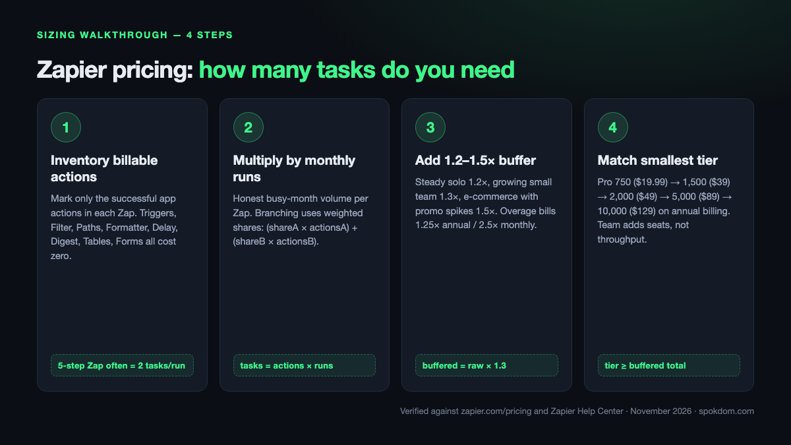
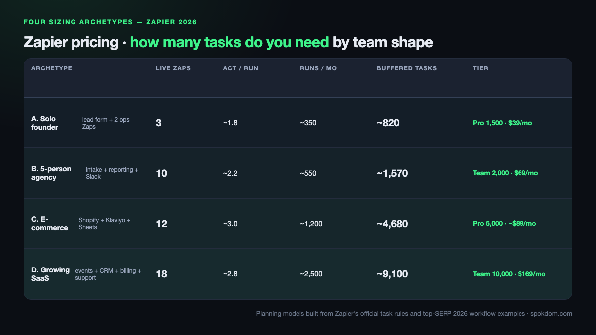
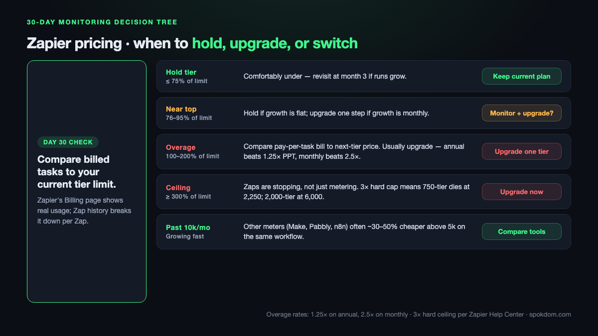

You don't pick a Zapier plan by name — you pick a monthly task budget, and the plan follows. As of November 5, 2026 the official Zapier pricing page sells Professional and Team by task tier, and the only question that actually matters is how many successful actions your Zaps will burn in a month. The short version, with the sizing math behind it worked out further down: a solo operator with three to five live Zaps usually lands between 500 and 850 billed tasks after Filters strip junk — the leanest setup fits 750 ($19.99/mo), most need the 1,500 tier ($39/mo) for buffer; a two-to-five-person team with ten to twenty Zaps usually lands between 1,500 and 2,000 tasks ($39–$49/mo on Professional, or $69/mo on Team for shared editing); and growing ops with branching workflows cross into 5,000–10,000 tasks territory where overage billing stops being a rounding error.

📌 Quick take
Zapier bills successful actions, not steps — polling, triggers, Filter, Paths, Formatter, Delay, and Digest all cost zero, so a five-step Zap frequently bills two tasks per run, not five.

Walk the four-step sizing path below (inventory → multiply → buffer → match) and you will almost always come in at half the "every-step × every-run" naive estimate — the gap between a $89 tier and a $39 tier.

All dollar figures below are US list prices verified on zapier.com/pricing on November 5, 2026. Local pricing and the 2.5× monthly / 1.25× annual overage multipliers can shift — reconfirm at checkout.

How this sizing guide was built: on November 5, 2026 the live Zapier pricing page, two Zapier Help Center articles (task usage, pay-per-task), and ten top-ranking 2026 pricing explainers (lindy, activepieces, nocode.mba, latenode, automationatlas, cratenorth, workflowpick, eesel, alltomate, neura) were opened by WebFetch and cross-checked for tier prices, task-counting rules, overage behavior, and sizing heuristics. No live Zapier workspace was metered for this piece — the archetypes below are planning models built from the official task rules and top-SERP workflow examples, not from a billed-out account.

## Step 1 — How many tasks do you need to count per Zap?

The single most common Zapier sizing mistake is counting every step in a Zap as a billable task. The Zapier Help Center article "[How is task usage measured in Zapier](https://help.zapier.com/hc/en-us/articles/8496196837261-How-is-task-usage-measured-in-Zapier)" is explicit: "A task is any successful action that runs in Zapier. Only successful actions count toward your task usage." Triggers, polling, and Zapier's built-in utility apps do not bill.

Walk through each live Zap and mark only the rows that bill. A five-step Zap with one trigger, one Filter, one Formatter, and two app actions bills two tasks per run — not five. A three-step Zap made of a trigger and two app actions also bills two tasks per run. The two look very different in the editor and cost exactly the same. On the free plan the counting trap is even worse: two-step Zaps allow no Filter in front of your action, so every trigger fire becomes a billed task with no way to drop junk early.

| Step type | Billable? | Notes verified on zapier.com/pricing + Help Center |
| --- | --- | --- |
| Trigger (including every poll) | No | Zapier never charges a task to check for new data |
| Successful app action | Yes, 1 | Gmail send, Slack post, Sheets row, CRM create |
| Filter by Zapier, Paths by Zapier | No | Free — put a Filter right after the trigger to drop junk |
| Formatter, Delay, Looping, Digest, Storage, Zapier Manager | No | Built-in utility steps never bill |
| Zapier Tables, Zapier Forms | No | Data-platform steps are free of task cost |
| Failed, halted, or skipped action | No | Only successes bill — a Zap that errors out is free |
| AI by Zapier, Code by Zapier | Yes, varies | Rate depends on model tier or extended runtime |
| Zapier MCP tool call | Yes, 2 | Fixed rate per successful MCP call |
| Zapier Lead Router | Yes, 5 | Charged per successful lead routed |
| Replayed successful step | Yes, 1 | Replays re-bill steps that had already succeeded |

Two 2026 facts most sizing posts underweight. First, "Next Gen Zaps" (starting December 1, 2026) still bill at least one task per successful run using the same rates as Classic Zaps, per the Help Center — the model is not changing, only the Zap engine. Second, AI by Zapier, Code by Zapier, Zapier MCP, and the Zapier SDK all draw from the same shared task pool, so a workflow that adds a single AI step on top of two app actions quietly climbs from two to three billed tasks per run.

## Step 2 — Multiply by expected monthly runs, not optimistic ones

With the billable action count locked, the second step is honest run-frequency math. For every Zap, estimate the trigger volume the Zap will actually see in a busy month — not an average month, and never the week-one number. The pricing multiplier is simple. Billable actions per run × monthly runs = tasks for that Zap. Sum across every live Zap and you have a raw monthly task estimate.

Two run-frequency traps show up on real invoices. Scheduled Zaps that fire on a fast cron (every 5 minutes = 8,640 runs/mo, every 15 minutes = 2,880 runs/mo) look harmless in the editor and can single-handedly exhaust a 750-task plan if even one action bills per run. And polling-triggered Zaps run their trigger constantly but only bill actions when new data appears — a new-row-in-Sheets Zap polls every 2 minutes on Professional and 1 minute on Team, but the action only fires when a row actually lands, so these are usually cheaper than they look.

The branching case is the one the top sizing posts handle worst. If a Filter stops 30% of runs before the first action, the task cost for those runs drops to zero — not to "most of the actions." If Paths splits a Zap into a two-action branch and a four-action branch, the weighted-average math is `(share_A × actions_A) + (share_B × actions_B)`. A 200-run Zap with a 60/40 Paths split that runs two actions on branch A and four on branch B bills `(200 × 0.6 × 2) + (200 × 0.4 × 4) = 240 + 320 = 560 tasks`, not 800.

## Step 3 — Add a 20–30% headroom buffer and plan for the spike week

Raw monthly estimates always miss something — launch spikes, ad campaigns, new integrations added mid-month, backfills triggered from CSV imports. The third sizing step is to multiply the raw estimate by a buffer multiplier that reflects how predictable your traffic is. For a steady solo operator with the same five Zaps every month, 1.2× is enough. For a growing team adding two or three new Zaps a month, 1.3×. For e-commerce with promotional spikes, 1.5× — the Black Friday weekend regularly bills a month's worth of orders in four days.

The buffer matters most near a tier boundary. If your raw estimate lands at 680 tasks and you buy the 750 Professional tier, a 10% busier month pushes you into overage territory, where the pay-per-task multipliers bite — 2.5× your base rate on monthly billing, 1.25× on annual billing, per the Zapier Help Center pay-per-task article. The 3× hard ceiling means Professional 750 silently stops at 2,250 completed tasks, even with pay-per-task enabled, and Team 2,000 stops at 6,000. Sizing to the next tier up for one busy quarter is almost always cheaper than ceiling-triggered downtime.

💡 Which buffer multiplier to use
Steady solo (three to five live Zaps, no promo cycle): 1.2×. Small team with monthly growth or active product launches: 1.3×. E-commerce or ad-driven ops with calendar spikes: 1.5×. A team that just migrated two or three workflows from a sister tool: 1.5× for the first quarter, then re-measure.

## Step 4 — Match the buffered total to the smallest Zapier tier that fits

Only after the first three steps does picking a plan name make sense. The 2026 task-tier ladder on zapier.com/pricing, with the US list prices confirmed on November 5, 2026 and cross-checked against the lindy and nocode.mba 2026 breakdowns:

| Tasks / month | Professional (annual) | Professional (monthly) | Team (annual) | Team (monthly) |
| --- | --- | --- | --- | --- |
| 100 | Free | Free | — | — |
| 750 | $19.99 | $29.99 | — | — |
| 1,500 | $39 | $58.50 | — | — |
| 2,000 | $49 | $73.50 | $69 | $103.50 |
| 5,000 | $89 (varies by source) | $133.50 | $119 | $179 |
| 10,000 | $129 | $193.50 | $169 | $253.50 |
| 100,000 | $489 | $733.50 | $599 | $898.50 |

*Monthly list prices beyond the $29.99 (750) and $103.50 (Team 2,000) tiers are approximations derived from the ~1.5× annual multiplier, not values re-confirmed per cell on zapier.com/pricing — reconfirm the exact monthly rate at checkout for your tier.*

Annual billing saves roughly 33% on every paid tier and lowers the pay-per-task overage rate from 2.5× to 1.25×. The Professional-to-Team jump buys collaboration (up to 25 users, shared Zaps, shared app connections, SAML SSO) and a 1-minute polling interval versus Professional's 2-minute polling — it is not a task-count upgrade on its own, since both plans scale to the same seven-figure tiers. Solo operators who buy Team "because it sounds more serious" pay for seats they never fill; teams of three or more who buy Professional pay the hidden tax of rebuilding Zaps when the one admin leaves.

One source-disagreement caveat: the 5,000-task Professional rate appears as $89/mo on some SERP breakdowns (consistent with the current pricing page tier ladder) and higher numbers on other 2026 comparison blogs — reconfirm the exact figure in your region before paying. The 750, 1,500, 2,000, 10,000, and 100,000 tiers above are consistent across the live pricing page and the two biggest 2026 breakdowns (lindy, nocode.mba) that were opened for this guide.

## Four sizing archetypes — how many tasks real teams actually need

Four shapes cover roughly 80% of Zapier accounts, with numbers assembled from the alltomate branching example, the lindy sizing guidance, and the official task-counting rules — not from a live metered account.

*All figures below are archetype estimates, not metered accounts — see the methodology note at the top of the post.*

| Archetype | Live Zaps | Billable actions per run (avg) | Monthly runs | Raw tasks | With 1.3× buffer | Recommended tier |
| --- | --- | --- | --- | --- | --- | --- |
| A. Solo founder — one lead form + two ops Zaps | 3 | ~1.8 | 350 | 630 | 820 | Professional 1,500 ($39/mo annual) |
| B. 5-person agency — client intake + reporting + Slack ops | 10 | ~2.2 | 550 | 1,210 | 1,570 | Professional 2,000 ($49/mo annual) or Team 2,000 ($69/mo) |
| C. E-commerce — Shopify orders + Klaviyo + Sheets + support | 12 | ~3.0 | 1,200 | 3,600 | 4,680 | Professional 5,000 (~$89 — reconfirm) |
| D. Growing SaaS — product events + CRM + billing + support | 18 | ~2.8 | 2,500 | 7,000 | 9,100 | Team 10,000 ($169/mo annual) |

Archetype A is the sizing lesson most sources miss. A solo founder's "lead form → Filter → Formatter → CRM contact → Slack alert" Zap looks like five tasks but bills two, because Filter and Formatter are free and the trigger is a trigger. 200 lead submissions a month at two billable actions each produces 400 tasks — well under the 750 tier. Add a weekly report Zap (two actions × 4 runs = 8 tasks) and a customer onboarding Zap (three actions × 50 runs = 150 tasks) and the raw total is 558 tasks, which 1.3× buffering lifts to about 725 — close enough to the 750 tier that a single 10% busier month will trigger overage. The 1,500 tier at $39/mo buys eight months of headroom for a $19/mo premium.

Archetype C is where the branching trap bites hardest. An e-commerce order handler with a Paths split (gift-card orders go through one two-action branch; physical-product orders through a four-action branch with inventory sync and label print) can easily land between 4,000 and 5,000 tasks a month on a mid-four-figure order count. The 5,000 Professional tier is the floor; teams that want multi-user editing move to Team 5,000 even though the task count is identical, because losing a Zap to an ex-contractor is a higher incident cost than the $30/mo tier delta. The 5,000 Professional list price itself carries a source-disagreement caveat flagged in the previous section — reconfirm the exact figure on the pricing page before paying.

## What happens when you go over — the pay-per-task decision

Overage is not optional on paid plans; it is a setting. Zapier's pay-per-task feature ships on by default on new paid accounts, and the Help Center article "How pay-per-task billing works in Zapier" confirms the behavior: when a monthly limit is exceeded, "Zap workflows stay on" by automatically billing extra tasks at a higher rate, up to a ceiling "set at 3 times your plan's task limit." Flip pay-per-task off and Zaps pause at the plan limit until the next billing cycle.

The overage multiplier difference between billing cycles is large. Zapier's own blog puts the overage rate at 1.25× the normal per-task cost on annual plans and 2.5× on monthly plans — the exact rate is printed on the Billing settings page, not the public pricing page. On a Professional 750 annual account (raw per-task cost roughly 2.7 cents), overage runs about 3.3 cents per extra task; on the monthly version of the same plan, the base per-task cost is roughly 4 cents, so overage runs about 10 cents per extra task. The honest decision rule: if your buffered estimate is within 15% of a tier boundary, buying the next tier up on annual billing is cheaper than running the current tier in near-constant overage.

⚠️ The 3× hard ceiling most pricing posts skip
Pay-per-task has a cap. Professional 750 stops at 2,250 completed tasks for the pay period even with overage enabled; Team 2,000 stops at 6,000. Past the ceiling, Zaps do not run — ad campaigns, order flows, and lead routing silently break. A surprise promo spike on Black Friday or a product launch is exactly the kind of event that trips this ceiling on an under-sized plan.

## The 30-day monitoring protocol — measure, don't guess

The four-step sizing path gets you a starting tier; the 30-day monitoring loop tells you if the guess held. Inside the Zapier app, the **Settings → Billing & usage** page reports monthly task consumption against the tier limit, and **My Apps → Zap history → Usage column** breaks that total down per run and per Zap — those two surfaces are the only metrics that actually matter for a resize decision.

Check at three waypoints in the first 30 days. At **day 7**, extrapolate the week's tasks to a full month (`week_tasks × 30/7`) and compare to your buffered estimate; a gap of more than 40% in either direction means the Zap-run frequency guess was wrong, not the counting rules. At **day 14**, look for the top three Zaps by task spend — one Zap typically burns 40–60% of all tasks on a real account, and that Zap is where filter-first optimization pays back most. At **day 30**, the full-month total decides the resize: inside the current tier with 15%+ margin, hold; within 10% of the ceiling, move up; over the ceiling with pay-per-task covering it, calculate whether the extra-task bill exceeds the next-tier price before upgrading.

| Day-30 result | Billed tasks vs tier | Action |
| --- | --- | --- |
| Comfortably under tier | ≤ 75% of tier limit | Hold the tier; revisit at month 3 if runs grow |
| Near the top | 76–95% of tier limit | Hold if growth is flat; upgrade one step if growth is monthly |
| Overage territory | 100–200% of tier limit | Compare pay-per-task bill to next-tier price; usually upgrade |
| At the 3× ceiling | ≥ 300% of tier limit | Upgrade immediately — Zaps are stopping, not just metering |
| Growing past 10,000/mo | n/a | Price-compare with meters that don't count triggers before renewing |

## How to shrink a Zapier bill without deleting Zaps

The cheapest task is the one that never fires. Three structural changes consistently cut task usage by 30–50% on busy accounts, drawn from the alltomate and workflowpick 2026 breakdowns plus the official Zapier Help Center rules.

First, put a **Filter by Zapier right after the trigger** so junk, spam, and duplicate triggers never reach a billed action. On a lead-form Zap that sees 30% test submissions, filtering at the top cuts the Zap's task count by nearly a third with no behavior change. Second, **batch notifications with Digest by Zapier** — Digest is free, so merging 20 Slack alerts a day into one daily summary turns 600 billed tasks a month into 30. Third, **do all string and date cleanup in Formatter**, which is free, rather than routing through a spreadsheet write and a lookup, which is two billed actions.

A few smaller moves add up: pick the cheapest AI by Zapier model tier that still works (model tiers vary in task cost), avoid full-run replays (they re-bill every previously-successful step), and use Paths instead of parallel Zaps for conditional logic, since a two-branch Paths Zap bills only the actions on the branch that actually runs. If the bill is still high after these fixes and you are comfortably past 10,000 tasks a month, the comparison to make is not Professional vs Team but Zapier vs a different billing meter. A deeper breakdown of the free-tier limits lives in the related [Zapier vs Make free plan](/zapier-vs-make-free-plan/) guide, including which meter is cheaper above 5,000 tasks.

## When Zapier pricing stops making sense — the honest ceiling

For most solo operators and small teams, Zapier is the right tool up to about 10,000 tasks a month. Beyond that, the pricing curve bends hard — 100,000 tasks lists at $489/mo on Professional annual, 300,000 at the next big tier jump, 1,000,000 well into four-figure monthly territory — and other automation meters price the same runs differently. Make.com's operation meter typically counts trigger-adjacent events as free operations, which commonly produces 30–50% lower consumption on the same workflow per the workflowpick 2026 calculator, so a Zapier 10,000-task bill around $129/mo often maps to a Make Core plan that runs cheaper for the same throughput.

The flip point also arrives early for AI-heavy and MCP-heavy workflows. One Zapier MCP tool call bills two tasks, and AI by Zapier steps vary by model tier — a Zap that calls an MCP tool and runs an AI by Zapier step on top of two normal actions can bill five tasks a run instead of two, so 1,000 monthly runs burn 5,000 tasks instead of 2,000. On a Professional 5,000 annual plan this is still manageable; at 3,000 monthly AI-heavy runs it becomes a conversation about whether a dedicated AI orchestrator is cheaper than paying for actions and AI steps in the same meter.

The ceiling above which Zapier stops being the obvious answer lands at 20,000 tasks a month on standard action workflows, or 5,000 tasks a month on AI-heavy or MCP-heavy workflows — cross-referenced across the eesel and workflowpick 2026 sizing analyses. Below those thresholds, Zapier's app library and reliability usually win on total cost of ownership even when per-task pricing looks steeper.

### Is the Zapier free plan's 100 tasks enough to test?

For validating a workflow idea, yes. 100 monthly tasks covers two or three light Zaps running under daily volume — a weekly digest, a once-a-day Slack ping, a low-frequency CRM sync. The harder free-plan limit is structural, not volumetric: two-step Zaps allow only one trigger and one action, so you cannot add a Filter in front of your billed action to drop junk early. Every trigger that fires becomes a billed task, which is why real production work almost always needs the 750-task Professional tier within the first month.

The 15-minute polling interval on free (versus 2-minute on Professional and 1-minute on Team) is also a real constraint for anything time-sensitive. A support ticket that pages the on-call engineer through a Zap is useful only when it fires within a minute or two — on the free plan it can take up to 15 minutes, which is often the difference between "automation" and "notification you missed." Upgrade to Professional 750 ($19.99/mo annual) the first week you need either a Filter, a multi-step Zap, or sub-15-minute latency, and keep the Zap history page open to watch real task usage for two weeks before moving tiers.

## FAQ

**Q. Zapier pricing — how many tasks do I need for a solo founder stack?**
A. Almost every solo founder with three to five live Zaps lands between 500 and 1,000 billable tasks a month after filters and free utility steps are removed from the count. The 1,500-task Professional tier at $39/mo annual gives a comfortable 1.3× buffer and saves the overage headache that 750 triggers around the 650-task mark.

**Q. Do Zapier triggers count toward my task limit?**
A. No. The Zapier Help Center is explicit that triggers, including polling, never use tasks. Only successful action steps bill, so a five-step Zap with a trigger, a Filter, a Formatter, and two app actions costs two tasks per run — not five.

**Q. What is the Zapier free plan good for in 2026?**
A. Validating a workflow for a week or two. The free plan allows two-step Zaps only (one trigger + one action), polls every 15 minutes, and caps at 100 tasks a month. It cannot run Filter-first Zaps because the Filter would be the second step, so every trigger becomes a billed task. Upgrade to Professional 750 the first week you need a multi-step Zap or sub-15-minute latency.

**Q. What happens if I go over my Zapier task limit mid-month?**
A. If pay-per-task is on (the default), Zaps stay on and extra tasks bill at a higher per-task rate — 1.25× on annual plans and 2.5× on monthly plans, per the Zapier Help Center, up to a hard ceiling of 3× your plan's task limit. If pay-per-task is off, Zaps pause until the next billing period. Professional 750 silently stops at 2,250 completed tasks even with overage on; Team 2,000 stops at 6,000.

**Q. Should a 5-person team buy Zapier Professional or Team?**
A. Team at $69/mo annual, in almost every case where more than one person edits Zaps. Professional is per-seat and does not share Zaps or app connections cleanly, so a Zap built on an ex-teammate's Gmail breaks when they leave. Team adds shared Zaps, shared app connections, SAML SSO, and 1-minute polling for a $20/mo premium over Professional 2,000.

**Q. How can I reduce my Zapier task usage without deleting Zaps?**
A. Three moves cut most bills by 30–50%: put a Filter by Zapier directly after the trigger to drop junk before any billed action, batch notifications with Digest by Zapier (free) instead of posting every event, and do all string and date cleanup in Formatter (free) instead of routing through spreadsheet writes and lookups. Avoid full-run replays and prefer Paths over parallel Zaps for conditional logic.

**Q. When is Zapier pricing no longer worth it?**
A. Roughly past 20,000 tasks a month on standard workflows, or 5,000 tasks a month on AI-heavy or MCP-heavy workflows. At those volumes, meters that do not count trigger-adjacent events (Make, Pabbly, self-hosted n8n) often price the same throughput 30–50% cheaper per the workflowpick 2026 calculator. Below those thresholds, Zapier's app library and reliability usually keep the total cost of ownership favorable.

For current numbers and regional pricing, always check the official [Zapier pricing page](https://zapier.com/pricing) before you pay — tier ladders, overage rates, and AI by Zapier model tiers all moved in 2026 and will move again.

---

**Related keywords** — #zapierpricing #zapiertasks #zapierpricing2026 #howmanytasksdoineed #zapierplancalculator #zapierprofessional #zapierteamplan #zapierfreeplan #paypertask #zapierformatter #zapierdigest #zaptasksizing
