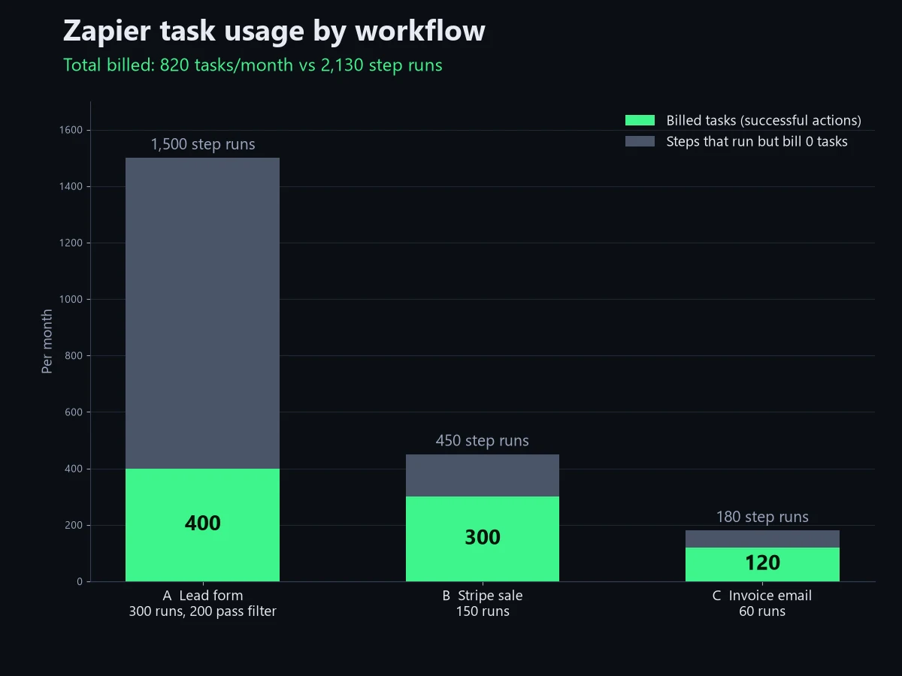
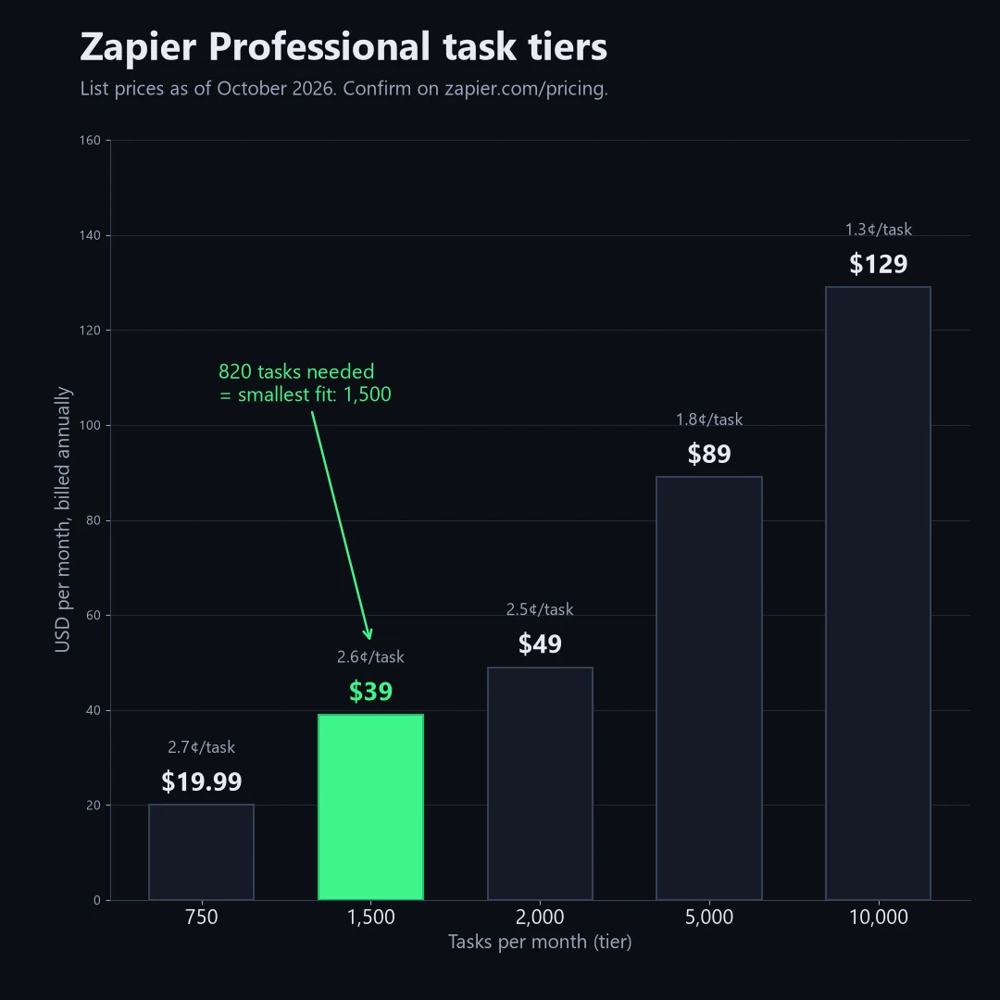

📌 Quick take
Zapier bills successful actions, not steps. Triggers, Filter, Formatter, Paths and Delay steps use zero tasks.

In my worked example, three typical solo-founder Zaps run 2,130 steps a month but bill only 820 tasks — the gap between a $89 tier and a $39 tier.

Count actions × runs, add 20% headroom, and pick the smallest tier that fits. Prices below are list prices as of October 2026.

Zapier pricing tasks are easy to overestimate, and that mistake is what pushes most solo founders onto a bigger plan than they need. As of October 2026, Zapier sells its paid plans by monthly task volume, so your real question is not "which plan" but "how many tasks will my Zaps actually burn."

Here's the short version: count only the action steps that succeed, multiply by how often each Zap runs, and ignore the rest. This guide is built from Zapier's own pricing page and Help Center as of October 2026, not from a year of monitoring a live account, plus a small three-Zap example you can redo with your own numbers. In that example, the naive count came out 2.6 times too high.

## The surprising part: your step count is not your task count

A Zap with five steps does not cost five tasks per run. Zapier's pricing FAQ is explicit: "Each successful action in a Zap counts as a separate task." Triggers are not actions, and most of Zapier's built-in helper steps are not billed either.

That means two Zaps that look equally busy in the editor can cost very different amounts. A five-step Zap made of a trigger, a Filter, a Formatter step and two app actions bills two tasks per run. A three-step Zap with a trigger and two app actions also bills two tasks per run. The extra steps are free.

The common counting error is multiplying total steps by runs. A 5-step Zap that runs 150 times looks like 750 tasks that way, but if the first step is the trigger and the other four are app actions, Zapier's rules put it at 600.

## What counts as a task in Zapier?

A task is one successful action. The Zapier Help Center article "[How is task usage measured in Zapier?](https://help.zapier.com/hc/en-us/articles/8496196837261-How-is-task-usage-measured-in-Zapier)" defines it as "any successful action that runs in Zapier," and the pricing FAQ gives a plain example: if your Zap creates new Google Contacts, each contact created uses one task.

Three details matter for your estimate:

- **Failed actions are free.** If an action errors or halts, it does not count against your limit.
- **Some actions cost more than one task.** Zapier says some apps or actions can use more than one task. AI by Zapier steps vary by model tier, Code by Zapier can use extra tasks if you extend runtime, and one Zapier MCP tool call uses two tasks.
- **Replays count again.** Replaying a whole Zap run re-bills the steps that had already succeeded.

Polling is also free. Zapier's FAQ says it "never charges you a task to check for new data," so a trigger that checks Dropbox every few minutes and finds nothing costs you nothing.

## Which Zapier steps are free?

Triggers and Zapier's built-in data tools are free. According to the pricing page FAQ, the following steps do not count as a task: Zapier Tables, Zapier Forms, Filter by Zapier, Formatter by Zapier, Path by Zapier, and Delay, Looping, Sub-Zap, Digest, Zapier Manager and Storage.

| Step type | Uses tasks? | Note |
| --- | --- | --- |
| Trigger (including polling) | No | Checking for new data is free |
| Successful app action (Gmail, Slack, Sheets, CRM) | Yes, usually 1 | Some apps use more |
| Filter, Paths, Formatter | No | Built-in data tools |
| Delay, Looping, Digest, Storage | No | Built-in utilities |
| Failed or halted action | No | Only successes are billed |
| AI by Zapier, Code by Zapier | Yes, varies | Depends on model tier or runtime |
| Zapier MCP tool call | Yes, 2 | Fixed rate per successful call |

💡 Tip
Steps that never run because a Filter stopped the Zap also cost nothing. A Filter placed right after the trigger is the cheapest way to keep junk runs from reaching your paid actions.

## How many tasks do I need? A worked example for three solo workflows

Most solo founders land between 500 and 1,500 tasks a month with a handful of Zaps. To show the math, I modeled three common workflows and counted them two ways: every step, and billed actions only.

| Workflow | Steps in the Zap | Runs / month | Every step counted | Billed tasks |
| --- | --- | --- | --- | --- |
| A. Lead form → Filter → Formatter → CRM contact → Slack alert | 5 | 300 (200 pass the Filter) | 1,500 | 400 |
| B. New Stripe payment → Google Sheets row → Gmail thank-you | 3 | 150 | 450 | 300 |
| C. Invoice email in Gmail → save attachment to Drive → Slack note | 3 | 60 | 180 | 120 |
| **Total** | | | **2,130** | **820** |

Workflow A is where the gap opens. The trigger and Filter run on all 300 submissions, and Formatter runs only on the 200 that pass the Filter; none of those three steps bill. The 100 spam or test entries the Filter drops never reach the CRM or Slack. So 300 runs produce only 200 × 2 = 400 tasks.

Counted naively, 2,130 tasks would push you past the 2,000 tier to the 5,000 tier, which lists at $89 a month billed annually. The real figure, 820, fits the 1,500 tier at $39 a month. That's a $50 monthly difference from a counting mistake alone.

To run this on your own account, list each Zap, count its successful app actions, multiply by expected monthly runs, and add about 20% headroom for busy months. Zapier's Zap history shows task usage per run, which is the fastest way to check your guess after a week.

| Zap | Successful app actions per run | Runs per month | Subtotal | ×1.2 buffer |
| --- | --- | --- | --- | --- |
| Example: Stripe payment → Sheets → Gmail | 2 | 150 | 300 | 360 |
|  |  |  |  |  |
|  |  |  |  |  |
|  |  |  |  |  |

## Which Zapier plan fits your task count?

The plan comes second; the task tier does the real work. As of October 2026, Zapier's pricing page lists Free at 100 tasks a month, Professional starting at $19.99 a month billed annually ($29.99 monthly) for 750 tasks, and Team starting at $69 a month billed annually ($103.50 monthly) for 2,000 tasks. Enterprise is quoted by sales.

| Tasks / month | Professional (annual) | Professional (monthly) | Team (annual) |
| --- | --- | --- | --- |
| 750 | $19.99 | $29.99 | — |
| 1,500 | $39 | $58.50 | — |
| 2,000 | $49 | $73.50 | $69 |
| 5,000 | $89 | $133.50 | $119 |
| 10,000 | $129 | $193.50 | $169 |

List prices in USD as of October 2026, from zapier.com/pricing. Confirm on the official page before you pay.

Per task, the price falls as you climb: roughly 2.7 cents at 750 tasks, 2.5 cents at 2,000 and 1.3 cents at 10,000 on annual Professional billing. Team mainly adds collaboration (25 users, shared Zaps and shared app connections) and a 1-minute polling time versus 2 minutes on Professional. If you work alone, I'd skip Team until someone else needs to edit your Zaps.

## What happens when you go over your Zapier task limit?

It depends on your pay-per-task setting. With pay-per-task turned on, Zapier keeps your Zaps running after you hit your tier and bills the extra tasks "at a higher per-task rate than your base subscription tasks," according to the pricing FAQ. With it turned off, your Zaps pause until the next usage period.

There is a ceiling either way. Zapier's Help Center article "[How pay-per-task billing works in Zapier](https://help.zapier.com/hc/en-us/articles/15279018245901)" says the maximum "is set at 3 times your plan's task limit." On Professional 750, that means 750 plan tasks plus up to 1,500 pay-per-task tasks, for 2,250 in total, before Zaps stop.

⚠️ Watch out
Zapier does not print the exact overage rate on its public pricing page. <a href="https://zapier.com/blog/what-is-a-task-in-zapier/">Zapier's own blog</a> puts the overage at 1.25x your normal per-task cost on annual plans and 2.5x on monthly plans; your Billing settings show the exact rate.

The free plan has no pay-per-task option, so free Zaps simply stop at 100 tasks. On self-serve plans the task limit is monthly (tasks are listed "per month" even on annual billing), while Enterprise uses an annual task limit.

## How to cut your Zapier task usage without deleting Zaps

The cheapest task is the one that never fires. Because Filter and Paths steps are free, putting a Filter directly after the trigger stops spam, test entries and irrelevant records before they reach a billed action.

A few other changes add up:

- **Merge notifications.** Digest by Zapier is free, so batching ten Slack alerts into one daily message turns ten tasks into one.
- **Do formatting in Formatter, not in an app step.** Cleaning a name or date in Formatter costs nothing; routing it through a spreadsheet write and lookup can cost two.
- **Pick the cheapest AI tier that works.** AI by Zapier task usage depends on the model tier you select, so test the standard tier before defaulting to a premium one.
- **Avoid full replays.** Replaying a whole run re-bills steps that already succeeded.

If your numbers still sit well above 2,000 tasks for simple flows, it may be worth comparing tools that meter differently. I laid out the options, including self-hosted ones with no task meter at all, in my guide to [free Zapier alternatives for automation](/free-zapier-alternatives-for-automation/).

## Is the Zapier free plan's 100 tasks per month enough?

For one or two light Zaps, yes. 100 tasks covers a Zap that fires three times a day with a single action, or a weekly report with a handful of actions.

The bigger limit is structure, not volume. The free plan allows two-step Zaps only, meaning one trigger and one action, and polls every 15 minutes. That rules out the free-step trick above: you can't add a Filter in front of your action on a two-step Zap, so every trigger that fires becomes a billed task.

If you need a Filter, a second action, or webhooks, you need Professional. In that case, start at the 750 tier, watch your usage for a month, and move up only when Zap history shows you need it. Upgrades take effect right away and are prorated, per Zapier's FAQ.

## Frequently asked questions

**Q. How many tasks does a multi-step Zap use?**
A. One task per successful app action per run. Triggers and built-in tools such as Filter, Formatter, Paths and Delay are not billed, so a five-step Zap with two app actions uses two tasks each time it runs.

**Q. Do Zapier triggers count as tasks?**
A. No. Zapier says triggers and polling for new data do not count toward your task limit. You only pay when an action completes successfully.

**Q. Does Formatter by Zapier use tasks?**
A. No. Formatter is listed on Zapier's pricing page among the built-in tools that do not count as a task, along with Filter, Paths, Tables and Forms.

**Q. What happens if I run out of Zapier tasks mid-month?**
A. With pay-per-task on, Zaps keep running and extra tasks are billed at a higher rate, up to 3 times your plan's task limit. Zapier's blog puts that rate at 1.25x your normal per-task cost on annual plans and 2.5x on monthly plans. With it off, Zaps pause until your next usage period.

**Q. How do I check my Zapier task usage?**
A. Zapier's Billing and usage page shows your total for the period, and Zap history breaks task usage down by individual run. Check it a week after launching a new Zap to confirm your estimate.

**Q. Is Zapier Professional or Team better for a solo founder?**
A. Professional, in most cases. Team starts at 2,000 tasks and adds shared workspaces and connections for up to 25 users, which a single operator rarely needs.

If I had to pick one rule to remember about Zapier pricing tasks, it's this: count successful actions, never steps. For current numbers, go straight to the official [Zapier pricing page](https://zapier.com/pricing) before you pay.

---

**Related keywords** — #zapierpricing #zapiertasks #zapierpricingtasks #zapiertaskusage #zapiertasklimits #zapierfreeplan #zapierprofessional #zapierteamplan #paypertask #zapierformatter #multistepzap #zapieralternatives
