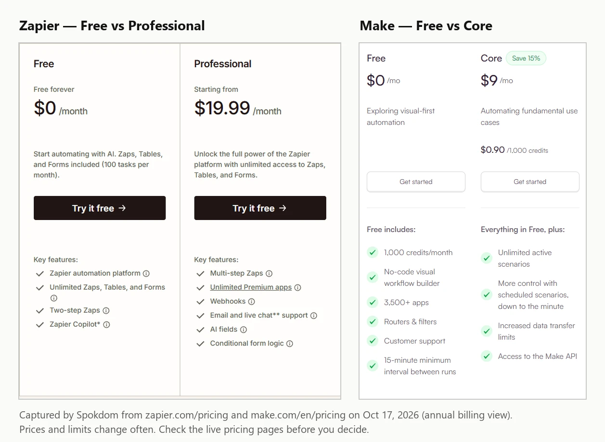
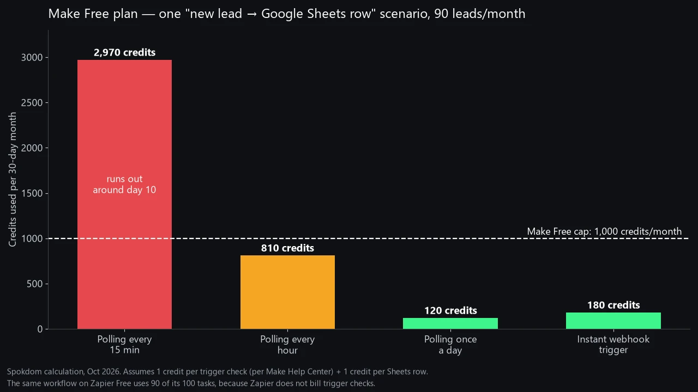

The Zapier vs Make free plan question has a short answer that most comparisons get backwards: Make's 1,000 credits are not "ten times more" than Zapier's 100 tasks, because Make bills every time a scheduled trigger checks for new data and Zapier does not. Pick Make Free if your workflow has three or more steps and you can use an instant trigger or an hourly schedule. Pick Zapier Free if you need one simple trigger-and-action Zap that polls all month without you thinking about it.

📌 Quick take
Zapier Free = 100 tasks a month, two-step Zaps only, no Filter or Formatter, but trigger checks cost nothing.

Make Free = 1,000 credits a month, multi-step scenarios with routers and filters, 2 active scenarios, and every trigger check costs 1 credit.

In my worked example, one Make scenario polling every 15 minutes burns 2,970 credits a month and stops around day 10. The same job on Zapier Free uses 90 of 100 tasks.

How I checked this: on October 17, 2026 I captured both official pricing pages, read Make's Help Center pages on credits and scheduling, and priced three common workflows on both free plans with the published counting rules. I did not run a month-long live test on either account, so treat the numbers as a planning model and confirm limits on the live pages before you build.

## Zapier vs Make free plan: what each one includes in October 2026

Zapier Free gives you 100 tasks a month, while Make Free gives you 1,000 credits a month. That's where the similarity ends, because the two meters count different things and the plans lock different features.

The screenshot above is what each pricing page showed on the day I checked. On [Zapier's pricing page](https://zapier.com/pricing), the Free card lists "Two-step Zaps" and "Unlimited Zaps, Tables, and Forms," with multi-step Zaps, premium apps and webhooks starting on Professional. Make's Free card lists 1,000 credits a month, routers and filters, and a 15-minute minimum interval between runs, while "Unlimited active scenarios" only appears on Core.

| As of Oct 17, 2026 | Zapier Free | Make Free |
| --- | --- | --- |
| Monthly allowance | 100 tasks | 1,000 credits |
| What is billed | Each successful action | Each module run, including trigger checks |
| Workflow length | Two steps (1 trigger + 1 action) | Multi-step, with routers and filters |
| How many can run | Unlimited Zaps (inside 100 tasks) | 2 active scenarios (per most plan guides) |
| Fastest schedule | Polls every 15 minutes | 15-minute minimum interval |
| Logic and data tools | No Filter, Formatter or Paths | Routers and filters included |
| Webhooks / premium apps | Not on Free | Webhook triggers available |
| First paid tier | Professional, from $19.99/mo billed yearly (750 tasks) | Core, about $9–$12/mo billed yearly (10,000 credits), varies by source |

One honest caveat on the table: I couldn't find the two-scenario number in the pricing page text I captured, only that Core adds "Unlimited active scenarios." The figure of 2 comes from several independent plan guides that agree with each other, so confirm it inside your Make account before you plan around a third scenario.

## Myth 1: Is Make's free plan really 10x bigger than Zapier's?

Make's 1,000 credits are not ten times Zapier's 100 tasks, because a credit and a task measure different events. Zapier's pricing page says each successful action in a Zap counts as one task, and the trigger is not an action. Make's pricing FAQ says that "every time a module in a scenario performs an action, it consumes credits," and reading data from an app or webhook counts as a module action.

So for the simplest possible automation, a new form entry that becomes a Google Sheets row, Zapier charges 1 task per entry and Make charges at least 2 credits per entry: 1 for the trigger module that reads the entry and 1 for the Sheets module that writes it. Before polling enters the picture, Make's advantage is already closer to 5x than 10x for two-step jobs.

Where Make does pull far ahead is long workflows. A five-module scenario that runs 100 times costs about 500 credits on Make Free. On Zapier Free you cannot build it at all, because Free stops at one trigger and one action.

## Myth 2: Do Make trigger checks cost credits even when nothing happens?

On Make Free, a scheduled scenario spends a credit every time it checks for new data, even when it finds nothing. Make's [Help Center scheduling guide](https://help.make.com/step-10-schedule-your-scenario) spells out the cost of a busy schedule: "Running every 5 minutes = 288 credits per day," and it notes those numbers cover the trigger module only. Free users can't go below 15 minutes, which still means 96 checks a day.

I ran the numbers for one scenario that turns new leads into Google Sheets rows, at 90 leads a month:

- **Polling every 15 minutes:** 96 checks × 30 days = 2,880 credits, plus 90 Sheets rows = 2,970 credits. That's nearly three times the free allowance, and at about 99 credits a day it hits the 1,000 cap around day 10.
- **Polling every hour:** 24 × 30 = 720 checks, plus 90 rows = 810 credits. That fits, with 190 credits of headroom.
- **Polling once a day:** 30 checks plus 90 rows = 120 credits.
- **Instant webhook trigger:** no idle checks, so roughly 90 trigger reads plus 90 rows = 180 credits.

This is where most roundups get it wrong. At least one comparison page says Make doesn't charge for empty polling runs, but Make's own scheduling guide and community answers say each check costs a credit whether new data arrives or not. On Zapier, the same lead workflow costs 90 tasks out of 100, because Zapier states that triggers and polling don't count toward your task limit.

## Myth 3: "Unlimited Zaps means you can build anything on Zapier Free"

Zapier Free lets you create as many Zaps as your 100 tasks allow, but every one of them is capped at two steps. One trigger, one action, and that's the whole Zap. Multi-step Zaps start on Professional.

The less obvious limit is the toolbox. Filters and Paths are paid-only, so "only send it to Slack if the deal is over $500" can't live in a free Zap. Formatter is off the table too: both the pricing table and Zapier's "Get started with Formatter" Help Center article mark it as unavailable on Free, so "clean up the phone number first" needs a paid plan. Webhooks and premium apps such as Salesforce are paid-only.

The usual workaround is to split a three-step job into two separate Zaps that share the same trigger. It works, and it costs the same 2 tasks per lead that a three-step Zap would on Professional, so 90 leads a month need 180 tasks and you run out around day 17. The real cost is the 100-task cap, plus setting up and maintaining the same trigger twice.

## Myth 4: How many scenarios can Make Free actually run?

Make Free allows 2 active scenarios at a time according to most plan guides, and the pricing page backs this indirectly by listing "Unlimited active scenarios" as a Core feature. You can build more and keep them switched off, but only two can run on a schedule or listen for webhooks.

The second limit is speed. Make Free has a 15-minute minimum interval between scheduled runs, which matches Zapier Free's 15-minute polling. Neither free tier is right for anything that needs a reply within a minute, unless you use Make's instant webhook triggers, which fire when data arrives instead of on a clock.

Make's paid pricing also shows why the free tier is designed as a trial: Core runs about $9 to $12 a month billed yearly for 10,000 credits. The page I captured on October 17 showed $9, while Zapier's own guide to Make pricing lists $12, so the price you see may depend on when and where you load the page. Once you have more than two live workflows, Core is usually the cheapest jump in this whole comparison.

## Three real workflows priced on both free plans

The free plan that "wins" depends on the shape of your workflow, so here is the same counting applied to three jobs a solo founder commonly automates. All figures are per 30-day month, as of October 2026.

| Workflow (per month) | Zapier Free (100 tasks) | Make Free (1,000 credits) |
| --- | --- | --- |
| A. 90 form leads → Google Sheets row | 90 tasks — fits | 180 (webhook) / 810 (hourly) / 2,970 (15-min) |
| B. 90 leads → Sheets row + Slack message | 180 tasks across 2 Zaps — runs out ~day 17 | 270 (webhook) / 900 (hourly) — fits |
| C. Daily check of an RSS feed, ~5 new posts/day → Slack | 150 tasks — runs out ~day 20 | 30 checks + 150 posts = 180 — fits |

Workflow A is Zapier's home turf: two steps, steady volume, and free polling. Workflows B and C flip the result, because once you need a second action or more than about three actions a day, 100 tasks is simply too small. Make handles both comfortably, as long as you avoid 15-minute polling.

💡 Quick rule
Count actions per month. Under 100 and two steps only → Zapier Free. Anything with three or more steps, or over 100 actions → Make Free, with a webhook or hourly trigger.

## How to make either free plan last the whole month

Both free plans stretch further if you design around their meters instead of fighting them. The fixes are different for each platform.

On Make Free, the biggest lever is the trigger. Use an instant or webhook trigger whenever the app offers one, because it fires only when data arrives. If you have to poll, schedule hourly, or restrict the schedule to working hours, a scheduling option Make's own training uses as an example. The Router module itself uses no credits, but each module on each branch still does, so branch only where the logic needs it.

On Zapier Free, the lever is task count. Keep one action per Zap, avoid duplicating the same trigger across several Zaps, and send low-value events to a digest rather than one message per event once you upgrade. If you're close to 100 tasks, this guide to [how many Zapier tasks you actually need](/zapier-pricing-how-many-tasks/) walks through counting tasks before you pick a paid tier.

⚠️ What happens when you run out
On Make, scenarios stop until credits are added. Incoming webhooks queue up to your webhook storage limit and run once credits return. On Zapier Free, new runs are held (or the Zap pauses) until your tasks reset or you upgrade, since pay-per-task overage is not available on Free. Check Zap History for held runs you can replay later.

## When to upgrade, and what the first paid tier costs

Upgrade when the free meter, not the feature list, becomes your bottleneck. For Make that usually means a third live workflow or a need for schedules faster than 15 minutes. For Zapier it usually means your first three-step Zap or your first Filter step.

The first paid tiers, as listed on October 17, 2026:

- **Make Core:** about $9 to $12 a month billed yearly for 10,000 credits, with unlimited active scenarios and schedules down to one minute. My October 17 captures of the pricing page showed $9 on the annual toggle and $10.59 on the monthly toggle, but other sources report $12, and Make has changed these prices before, so confirm the exact number on [Make's pricing page](https://www.make.com/en/pricing).
- **Zapier Professional:** from $19.99 a month billed yearly, or $29.99 billed monthly, for 750 tasks, multi-step Zaps, premium apps and webhooks.

Here's what I'd skip: paying for Zapier Professional just to get a Filter step on one Zap. If that's the only blocker, move that one workflow to Make Free, or to one of the [free Zapier alternatives](/free-zapier-alternatives-for-automation/) such as self-hosted n8n, and keep Zapier Free for the simple jobs.

## Which free plan fits you?

If I had to pick one for most solo founders, it's Make Free, with one condition: never leave a scenario polling every 15 minutes. With instant or hourly triggers, 1,000 credits cover two real multi-step workflows. Zapier Free makes more sense for a single two-step Zap that you want to set and forget, especially with an app Make doesn't support.

- **Choose Zapier Free if:** you have one or two simple Zaps, under 100 actions a month, and you value Zapier's larger app catalog more than logic tools.
- **Choose Make Free if:** you need three or more steps, filters or routers, or more than 100 actions a month, and you can work within 2 active scenarios.
- **Use both if:** your simple notification Zaps live on Zapier Free and your multi-step jobs live on Make Free. Nothing stops you from running the two side by side.

## FAQ

**Q. Is Make's free plan better than Zapier's free plan?**
A. For multi-step workflows, yes. Make Free allows multi-step scenarios with routers and filters and gives 1,000 credits a month, while Zapier Free is limited to two-step Zaps and 100 tasks. For a single two-step Zap that polls all month, Zapier Free can last longer, because its trigger checks are free.

**Q. Do Make trigger checks use credits even when there is no new data?**
A. Yes, for scheduled polling triggers. Each scheduled run of the trigger module costs a credit, so a scenario checking every 15 minutes uses about 2,880 credits a month before doing any work. Instant webhook triggers avoid those idle checks.

**Q. How many steps can a Zap have on Zapier's free plan?**
A. Two. Zapier Free supports two-step Zaps, one trigger and one action. Multi-step Zaps, Filters, Paths, Formatter, webhooks and premium apps start on the Professional plan.

**Q. How many scenarios can I run on Make's free plan?**
A. Two active scenarios, according to most plan guides, with a 15-minute minimum interval between scheduled runs. Make lists unlimited active scenarios as a Core feature, so check your account if you need a third.

**Q. Should I switch from Zapier to Make to save money?**
A. Only if your workflows are multi-step or high-volume. Make Core, at roughly $9 to $12 a month billed yearly, includes 10,000 credits, far more than Zapier Professional's 750 tasks for $19.99 a month billed yearly, but rebuilding Zaps takes time, and some niche apps exist only on Zapier.

If you remember one thing from this Zapier vs Make free plan comparison, make it this: Zapier counts finished actions, Make counts every module run including idle checks. Choose the meter that matches your workflow, and the free plan will last the month.

---

**Related keywords** — #zapiervsmake #makevszapier #zapierfreeplan #makefreeplan #makecredits #zapiertasks #zapiervsmakepricing #nocodeautomation #workflowautomation #zapieralternatives #makecore
