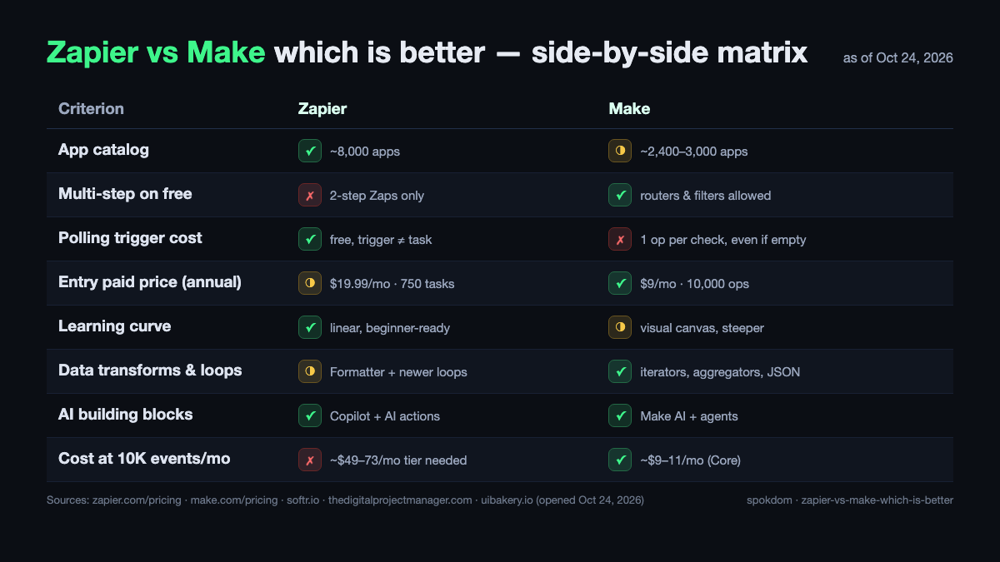
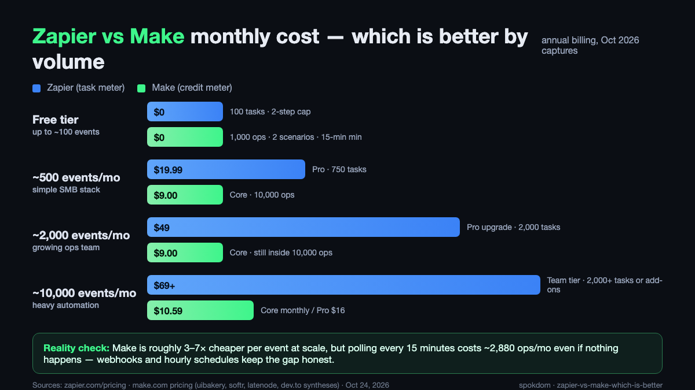
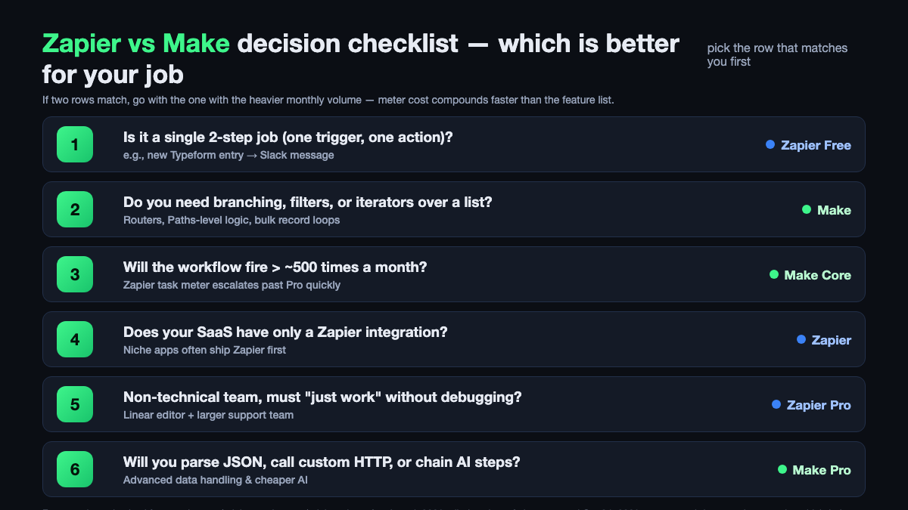

📌 Quick take
Zapier vs Make which is better has no single winner — it depends on workflow shape. Zapier wins linear 2-step jobs and the broadest app catalog; Make wins multi-step logic, bulk data, and ~3–7× lower cost at scale.

Zapier Free bills successful actions only; Make Free bills every scheduled polling check, so a 15-minute poll burns 2,880 operations a month before any real work.

Default pick for ops teams: Make Core at $9/mo for 10,000 ops. Default for solo founders with one niche app: Zapier.

Zapier vs Make which is better is the wrong question until you decide what the workflow has to do. As of October 24, 2026, Zapier charges per successful action and Make charges per module execution — including scheduled trigger checks that find nothing — and those two meters flip the "cheaper" winner based on volume and whether the trigger is a webhook or a poll. Pick by meter + workflow shape, not by brand.

How this comparison was built: on October 24, 2026 I opened both official pricing pages, nine of the top ten search results, and the Make Community thread on polling triggers, then priced three common workflow volumes against the published counting rules. No month-long production account on either side, so treat the numbers as a planning model and reconfirm them on the live pricing pages before you commit a card.

## Zapier vs Make: which is better in one paragraph

For a single automation that fires on a webhook with one action, Zapier is better. For a workflow with routers, filters, iterators, or more than ~500 events a month, Make is better. For a niche SaaS that only ships a Zapier integration, Zapier is the only answer; for anything that parses JSON, loops a list, or chains three AI steps, Make is the cleaner tool and the cheaper meter at scale.

Where it gets interesting is the middle: a two-step Zap that polls every 15 minutes stays free on Zapier because trigger checks cost zero tasks, but on Make the same shape burns 2,880 ops a month before doing a single real action. That one rule flips many "Make is always cheaper" claims upside down for low-volume polling.

The honest short answer: Zapier for linear and niche; Make for logic and volume; both free tiers if your real stack has one of each. Nothing in Zapier's or Make's terms stops you from running both side by side on the same email address.

## How Zapier and Make actually differ in 2026

Zapier is a form-style builder: one trigger, a list of actions underneath, and Formatter/Filter steps in between. The runtime fires on the trigger, walks the steps, and bills one task per successful action. Trigger checks are free. Filter and Paths steps that skip the rest of the Zap are free. Any step that errors or halts is free. That makes task counting predictable: steps that *finish* cost money, steps that *decide not to* do not.

Make is a canvas builder: modules are nodes, lines are the data flow, and routers can split the scenario into parallel branches that each loop with iterators. Every module execution counts as one operation, including the trigger module when it checks for data. Polling triggers charge even when nothing changed. Webhooks fire only when data arrives, so they avoid idle polling cost entirely. Iterators multiply operations by list length, which is the right trade when you want to process every row, and the wrong one when you only wanted to react to the first new row.

The one difference that drives price is this: Zapier never bills for the "did anything happen" question; Make always does, on polling triggers. If your trigger is a webhook or an "instant" integration on either side, the meters are roughly similar. If your trigger is a cron-style poll, Make's meter sprints ahead whether or not any work was done. The uibakery and Latenode 2026 breakdowns both call this out; the Make Community thread confirms it directly.

## Zapier vs Make pricing in October 2026

Here are the current list prices as published on the two official pricing pages on October 24, 2026, cross-checked against three top comparison posts. Prices change — reconfirm on the live pages before paying.

| Tier | Zapier (annual) | Make (annual) |
| --- | --- | --- |
| Free | $0 · 100 tasks · 2-step Zaps · 5 Zaps | $0 · 1,000 ops · 2 scenarios · 15-min minimum |
| Entry paid | Professional $19.99/mo · 750 tasks · multi-step | Core $9/mo · 10,000 ops · 1-min minimum |
| Mid | Professional $49/mo · 2,000 tasks | Pro ~$16/mo · 10,000 ops + priority |
| Team | Team $69/mo · 25 seats · 2,000+ tasks | Teams ~$29/mo · multi-user ops |
| Enterprise | Custom · SSO · unlimited seats | Custom · SSO · dedicated support |

Billed monthly, Zapier Professional starts at $29.99/mo and Make Core is around $10.59/mo. Zapier Help Center defines a task as a successful action step; Make Help Center defines an operation as one module execution and specifically includes polling trigger checks. For a longer breakdown of what counts as a Zapier task, see our [Zapier pricing tasks guide](/zapier-pricing-how-many-tasks/).

💡 How to read "tasks" and "ops" without getting fooled
Zapier's "task" is one <b>successful action</b>. A three-step Zap that runs 500 times a month bills 1,000 tasks (not 1,500) because the trigger is free. A Zap that filters out 400 of those 500 runs bills roughly 200 tasks (filtered Zaps stop, Zapier does not charge for the skipped actions).

Make's "operation" is one <b>module execution</b>. A three-module scenario on a 15-minute poll that finds data once a day bills ~2,880 trigger ops + ~60 action ops = ~2,940 ops/month. The idle polling, not the real work, is the headline number.

## Feature matrix: who wins each criterion

Treat the matrix as a tie-breaker, not a scoreboard. Most teams only care about the three rows that match their workflow.

| Criterion | Zapier | Make | Why |
| --- | --- | --- | --- |
| App catalog breadth | ✓ | ◑ | Zapier lists ~8,000 apps; Make ~2,400–3,000. Niche SaaS often ships Zapier first. |
| Multi-step on free | ✗ | ✓ | Zapier Free is 2-step only; Make Free allows routers and filters inside 1,000 ops. |
| Polling trigger cost | ✓ | ✗ | Zapier trigger checks are free; Make bills 1 op per scheduled check. |
| Entry paid price | ◑ | ✓ | Make Core $9/mo for 10,000 ops; Zapier Professional $19.99/mo for 750 tasks. |
| Learning curve | ✓ | ◑ | Zapier's linear editor onboards faster; Make's canvas rewards patience. |
| Data transforms and loops | ◑ | ✓ | Formatter + newer looping on Zapier; iterators, aggregators and JSON parsing on Make. |
| AI building blocks | ✓ | ✓ | Zapier Copilot + agents vs. Make AI + agents. Both strong, both billed separately. |
| Cost at 10,000 events/mo | ✗ | ✓ | Zapier Team ~$69/mo+ vs. Make Core ~$9–11/mo. |

Zapier wins four, Make wins four, and that's exactly the point: whichever side matches your top-two criteria is the one you buy. If "polling cost" and "entry price" matter most, Make wins; if "catalog breadth" and "learning curve" matter most, Zapier wins.

## Three real workflows: who wins by job

The best way to settle Zapier vs Make which is better is to run your actual job through both meters, on paper, before you buy. Here are three common solo and small-team shapes.

**Workflow A — Typeform entry to Slack notice.** One trigger, one action, instant-trigger support. On Zapier Free this is a two-step Zap, 1 task per submission; 100 submissions a month fits inside Free. On Make Free this is a one-op scenario with the Typeform webhook, so 100 submissions bill ~100 ops. Both free; Zapier is simpler to set up. **Winner: Zapier.**

**Workflow B — Shopify order → Google Sheet row + Slack notice + conditional email.** Three real actions, with the email only firing when the order total is over $200. On Zapier Professional that's 3 actions per order (minus skipped action when the Filter blocks the email), ~2.3 tasks/order on average. 500 orders a month = ~1,150 tasks, so Professional 2,000 at $49/mo. On Make Core: 4 modules per run × 500 runs = 2,000 ops, well inside Core's 10,000 at $9/mo. **Winner: Make.**

**Workflow C — Webhook from a webhook-free CRM, polled every 15 minutes.** No instant integration available, so the trigger has to poll. On Zapier the trigger is free; a two-step Zap that fires on roughly 20 real events a month bills ~20 tasks, inside Free. On Make the same poll runs 4 times/hour × 24 × 30 = 2,880 trigger checks a month, so Free's 1,000 ops is burnt in roughly 10 days. **Winner: Zapier Free.**

The pattern across all three: if your trigger is instant and your scenario is multi-step, Make wins; if your trigger is a cron-style poll and your scenario is small, Zapier wins; if your SaaS exposes a webhook, both are fine and the pricing gap narrows.

## Cost at scale: when the task meter breaks

For teams past the free tier, the Zapier vs Make price gap stops being theoretical. Here is the same workflow priced at four monthly volumes, assuming an instant-trigger multi-step scenario so Make's polling trap does not apply.

At 500 events/mo with 2 actions each, Zapier bills 1,000 tasks (Professional 2,000 at ~$49/mo) and Make bills 1,500 ops (Core at $9/mo). At 2,000 events/mo with 2 actions each, Zapier is still Professional 2,000 tasks maxed out, nudging into the $69 Team territory; Make Core absorbs the 4,000 ops without upgrading. At 10,000 events/mo, Zapier's Team tier at $69/mo covers 2,000 tasks and overage climbs quickly, while Make Core still accommodates 10,000 ops before pushing to Pro.

Make Pro at ~$16/mo adds priority execution, faster schedules below one minute, and the same 10,000-op baseline. The gap at 10,000 events a month is roughly 4–7× in Make's favor on paper, and the published numbers from the UI Bakery and dev.to 2026 breakdowns agree with that spread. The caveat is that if Make's AI modules or large iterators dominate your scenario, the op burn climbs fast and Zapier's add-on billing for Agents and Chatbots can look saner.

## The polling trigger trap only Make has

Make's docs and community confirm the same rule: a scheduled polling trigger charges 1 operation per check, even when nothing changed. A scenario on a 15-minute interval runs 4 times per hour × 24 hours × 30 days = 2,880 trigger ops per month before processing a single update. That's three-quarters of a Core plan burnt on empty checks.

The fix is simple when the integration supports it. Prefer webhook triggers wherever the app offers one; Make's "instant" trigger label on an integration means the vendor fires a webhook, not a poll. For apps that only expose a scheduled trigger, slow the interval down — hourly schedules cut the trigger burn by 4×, and working-hours-only schedules cut it by another 3× — or batch-fetch with a filter so each run processes multiple records per op.

Zapier does not have this trap because its polling triggers are free. The flip side is that Zapier's billable tasks start the moment any action succeeds, so a one-trigger-three-action Zap that fires often will outrun Make's op meter in the opposite direction. The decision is less "which is cheaper" and more "where does your workflow sit on the polling-vs-webhook axis."

⚠️ The one line of fine print both tools share
Each platform has changed pricing in 2026. Zapier reorganized its Professional and Team tiers; Make tweaked Core and Pro operation limits. Always confirm the current numbers on <a href="https://zapier.com/pricing">Zapier's pricing page</a> and Make's pricing page before you build a cost model, and screenshot the version you're buying so you can prove what you agreed to if it moves.

## Decision checklist: which is better for your job

Pick the first row that matches your workflow. If two match, go with the row that reflects the heavier monthly volume — meter cost compounds faster than any feature-list difference.

1. Is it a single 2-step job (one trigger, one action)? → **Zapier Free.**
2. Do you need branching, filters, or iterators over a list? → **Make.**
3. Will the workflow fire more than ~500 times a month? → **Make Core.**
4. Does your SaaS have only a Zapier integration? → **Zapier.**
5. Non-technical team that must "just work" without debugging? → **Zapier Professional.**
6. Will you parse JSON, call custom HTTP, or chain AI steps? → **Make Pro.**

Most ops teams end up on Make for the heavy lifters and Zapier Free for a handful of lightweight notice Zaps. Most solo founders end up on Zapier Professional because the catalog has their niche SaaS, with Make Free sitting next to it for anything that needs logic.

## Using both together, and when to migrate

Zapier and Make can run on the same workflows side by side; many teams do, especially during a migration. There is no one-click importer, so moving a workflow means rebuilding it, but you can leave the live Zap running while the new Make scenario is validated and only cut over when the output matches for a week.

If you are starting fresh and your top job is multi-step and will exceed ~500 events a month, start on Make. If you are starting fresh and your top job is one niche-app webhook into one place, start on Zapier Free. If your automation stack is already on Zapier and you only have one logic-heavy scenario burning tasks, port that one scenario to Make Core and keep the rest. If you want a free self-hosted option in the mix, our guide to [free Zapier alternatives for automation](/free-zapier-alternatives-for-automation/) covers n8n and the trade-offs of running it yourself.

The one thing not to do is migrate on principle. Zapier counts actions, Make counts module runs, and either meter can win depending on the workflow. The verdict is always "which meter is cheaper for the specific shape I'm about to build," answered with a worked example, not a vibes-based ranking.

## FAQ

**Q. Zapier vs Make which is better for beginners?**
A. Zapier. The linear step-by-step editor is faster to learn than Make's visual canvas, and Zapier's larger app catalog means a beginner is less likely to hit "no integration available." Make is better once you need routers, filters or iterators, but that usually comes a few workflows in.

**Q. Which is cheaper at 10,000 events a month, Zapier or Make?**
A. Make, by a wide margin. Make Core is around $9–11/mo for 10,000 operations; the equivalent Zapier plan for 10,000 action-steps lands in the $69/mo Team tier or higher. The gap narrows if your Make scenario relies on polling triggers or paid AI modules, which can both inflate op counts.

**Q. Do Make polling triggers really use operations even when there is no new data?**
A. Yes, confirmed in Make's own community and docs. Every scheduled trigger check is one operation. A 15-minute poll runs 2,880 times a month on average, so your op budget is partially spent before any real work happens. Webhook triggers avoid this entirely.

**Q. Can I run Zapier and Make at the same time on the same account email?**
A. Yes. Neither platform forbids it, and both free tiers remain available in parallel. Many solo teams end up with Zapier Free for notice Zaps and Make Free for logic-heavy scenarios, moving to paid tiers only on whichever side first outgrows its meter.

**Q. Is Zapier's app catalog actually bigger than Make's in 2026?**
A. Yes. Zapier publishes about 8,000 integrations and Make around 2,400–3,000 depending on the source. Where Make catches up is depth per app — some integrations expose dozens more actions on Make, which matters for workflows that need obscure actions on a popular SaaS like Xero or Google Sheets.

**Q. Should I switch from Zapier to Make to save money?**
A. Only if your top workflows are multi-step on instant triggers and total more than ~500–1,000 events a month. Below that, Zapier Free or Professional is often cheaper and quicker to set up. The honest answer to Zapier vs Make which is better in 2026 is "whichever meter is cheaper for the specific job in front of you" — and that only becomes clear after you price your real workflow against both counting rules.

---

**Related keywords** — #zapiervsmake #makevszapier #zapiervsmakewhichisbetter #zapierpricing2026 #makepricing2026 #makecredits #zapiertasks #zapiervsmakecost #nocodeautomation #workflowautomation #automationtools #zapieralternatives
